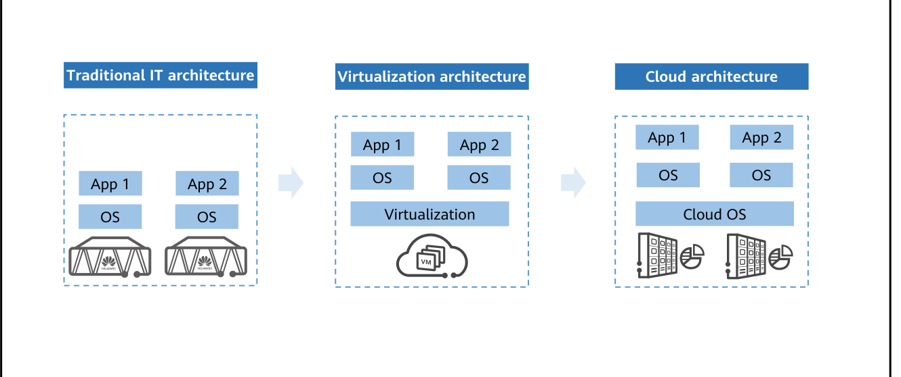
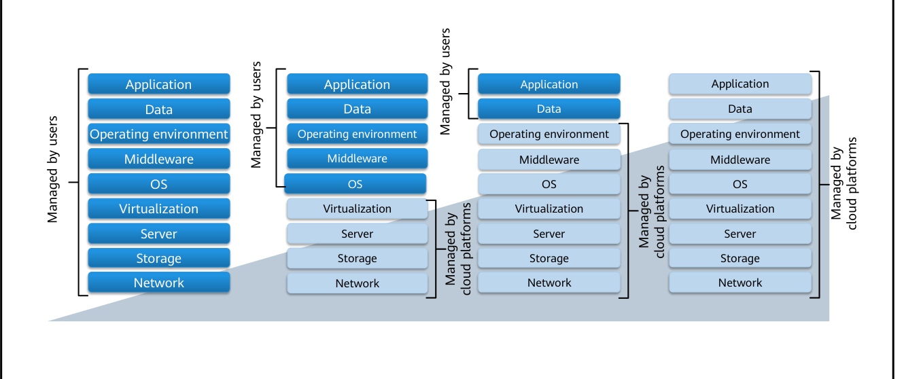
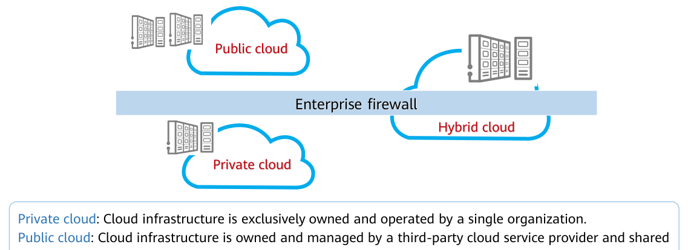

# Cloud Computing Architecture, Evolution & Service Models

**Pillar:** HCIA-Computing V3.0 (Kunpeng & Server Ecosystem)  
**Schedule Block:** Hour 01 — History of Computing & Industry Trends (Sprint 2 of 4)  
**Format:** Bite-Sized Lecture (7 mins) - Followed immediately by `04-Exercise-Cloud-Service-and-Deployment-Classification` (8 mins)  
**Official Material Reference:** `HCIA-Computing V3.0 Training Material.pdf` — Ch.01, pp. 29–37

---

## Learning Objectives
- Master the NIST definition of cloud computing and its 5 core benefits
- Compare the First, Second, and Third IT Platforms and Cloud 1.0, 2.0, and 3.0 phases
- Distinguish IaaS, PaaS, and SaaS responsibility boundaries and Private, Public, and Hybrid cloud deployment models

---

### 1. NIST Definition & The Three IT Platforms (pp. 31–33)
According to the **National Institute of Standards and Technology (NIST)**, cloud computing is a model for enabling ubiquitous, convenient, on-demand network access to a shared pool of configurable computing resources (networks, servers, storage, applications, and services) that can be rapidly provisioned and released with minimal management effort or service provider interaction.

#### Evolution of the Three IT Platforms (IDC):
1. **First Platform (From 1964)**: **Mainframe** era — millions of users, thousands of applications.
2. **Second Platform (From 1981)**: **LAN, Internet, and client/server** era — hundreds of millions of users, tens of thousands of applications.
3. **Third Platform (From 2012, mainstream since 2015)**: **Cloud computing, Big Data, Mobile Internet, and IoT** — billions of users, millions of apps; accounts for 1/3 of global IT spending and 100% of IT spending growth.

#### Five Core Benefits of Cloud Computing (p. 33):
- **On-demand self-service**: Deploy server time and storage without human interaction with the provider.
- **Widespread network access**: Access via mobile phones, laptops, and tablets over the Internet.
- **Resource pooling**: Multi-tenant dynamic allocation of physical/virtual resources; users do not need to know exact physical locations.
- **Quick deployment and auto scaling**: Rapid, elastic provisioning and release of resources.
- **Metered services**: Pay-per-use (hourly, monthly, or yearly) for CPU, memory, storage, and bandwidth.

---

### 2. Cloud 1.0 vs. Cloud 2.0 vs. Cloud 3.0 (pp. 34–35)
Enterprise data centers are transforming in 5 ways: from **resource silos to resource pooling**, **centralized to distributed architecture**, **dedicated hardware to software-defined storage (SDS)**, **manual handling to self-service/automation**, and **distributed statistics to unified metering**.

| Phase | Focus & Core Concept | Representative Technologies |
| :--- | :--- | :--- |
| **Cloud 1.0 (Efficiency)** | **Virtualization-centric** — abstracts hardware into VMs for higher resource utilization | VMware ESXi, KVM, Xen, Microsoft Hyper-V |
| **Cloud 2.0 (Cloud Pilot)** | **Resource-centric (Software Defined / Cloud Resource)** — infrastructure migration to cloud, standardized & automated resource services | OpenStack, VMware |
| **Cloud 3.0 (Cloud Native)** | **Application-centric (Container / Cloud Native)** — agile application development, microservices, and lifecycle management | Docker, Cloud Foundry, Kubernetes |
<!-- PDF_FIGS_START -->

*Figure: Enterprise Migration from Traditional IT to Cloud Architecture (Official Reference: p. 35)*
<!-- PDF_FIGS_END -->

---

### 3. Cloud Service Models (IaaS, PaaS, SaaS) & Deployment Models (pp. 36–37)

| Layer (Top to Bottom) | Traditional IT | IaaS | PaaS | SaaS |
| :--- | :---: | :---: | :---: | :---: |
| **Application & Data** | User | **User** | **User** | Cloud Platform |
| **Operating Environment, Middleware, OS** | User | **User** | Cloud Platform | Cloud Platform |
| **Virtualization, Server, Storage, Network** | User | Cloud Platform | Cloud Platform | Cloud Platform |

- **Private Cloud**: Exclusively owned and operated by a single organization behind the enterprise ingress firewall for maximum data protection.
- **Public Cloud**: Owned and operated by a third-party cloud service provider and shared across organizations over the Internet (like water/electricity utilities).
- **Hybrid Cloud**: Combines public and private clouds (or on-premises resources) as distinct entities bound together, viewed externally as a single cloud with workload portability.
<!-- PDF_FIGS_START -->

*Figure: Cloud Service Models Responsibility Boundaries (IaaS, PaaS, SaaS) (Official Reference: p. 36)*

*Figure: Cloud Deployment Models (Public, Private, Hybrid Cloud) (Official Reference: p. 37)*
<!-- PDF_FIGS_END -->

---

## Key Takeaways
- **The Third Platform (from 2012: Cloud, Big Data, Mobile Internet, IoT) overtook the Second Platform in 2015.**
- **Cloud 1.0 is virtualization-centric (ESXi, KVM, Xen, Hyper-V); Cloud 2.0 is resource-centric (OpenStack); Cloud 3.0 is application-centric (Docker, Cloud Foundry, Cloud Native).**
- **In IaaS, users manage OS, Middleware, Runtime, Data, and Applications; in PaaS, users only manage Applications and Data; in SaaS, the cloud platform manages all layers.**

## Huawei ICT Competition National Stage Exam Traps
> [!WARNING]
> EXAM TRAP: In IaaS, the Operating System (OS) is managed by the USER, whereas Virtualization is managed by the Cloud Platform. In PaaS, the OS and Middleware are managed by the Cloud Platform.

> [!WARNING]
> EXAM TRAP: Do not confuse Cloud 2.0 (Resource-centric / OpenStack) with Cloud 3.0 (Application-centric / Containers & Cloud Native).

---

### Next Step: Immediate Hands-On Exercise
Proceed immediately to **[`04-Exercise-Cloud-Service-and-Deployment-Classification.html`](./04-Exercise-Cloud-Service-and-Deployment-Classification.html)** (or [`04-Exercise-Cloud-Service-and-Deployment-Classification.md`](./04-Exercise-Cloud-Service-and-Deployment-Classification.md)) to apply this concept in an interactive lab workbench!
