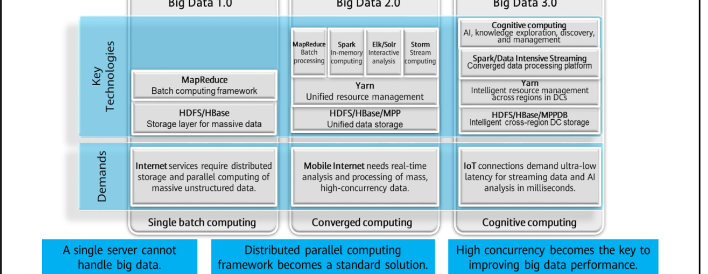
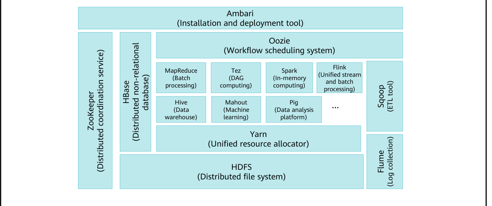

# Big Data Ecosystem, Data Types & Computing Modes

**Pillar:** HCIA-Computing V3.0 (Kunpeng & Server Ecosystem)  
**Schedule Block:** Hour 01 — History of Computing & Industry Trends (Sprint 3 of 4)  
**Format:** Bite-Sized Lecture (8 mins) - Followed immediately by `06-Exercise-Hadoop-Ecosystem-Component-Mapping` (8 mins)  
**Official Material Reference:** `HCIA-Computing V3.0 Training Material.pdf` — Ch.01, pp. 38–45, 55

---

## Learning Objectives
- Distinguish structured, semi-structured, and unstructured data and contrast traditional vs. big data processing ('Fishing in the pond' vs. 'Fishing in the ocean')
- Trace Big Data Architecture 1.0, 2.0, and 3.0 and target personas (programmer, analyst, engineer)
- Map every component of the Hadoop Big Data Ecosystem and the 4 main big data computing modes

---

### 1. Structured, Semi-Structured, and Unstructured Data (pp. 39–42)
Big data is a combination of structured, semi-structured, and unstructured data collected, analyzed, and mined to obtain insights:
- **Structured data**: Stored in relational databases as two-dimensional tables (rows = entities with identical attributes).
- **Semi-structured data**: Does not comply with relational table schemas but contains semantic labels/tags to separate elements and layer records/fields (e.g., **XML** and **JSON** files).
- **Unstructured data**: Data without a fixed structure (documents, images, videos, audio), generally stored in binary format.

#### Traditional Data Processing vs. Big Data Processing (p. 42):
| Dimension | Traditional Data Processing ("Fishing in the pond") | Big Data Processing ("Fishing in the ocean") |
| :--- | :--- | :--- |
| **Data Scale** | Small (in **MB**) | Large (in **GB, TB, or PB**) |
| **Data Type** | Single data type (mostly structured) | Diverse (structured, semi-structured, unstructured) |
| **Mode vs. Data Relationship** | **Modes are set before data is generated** (the pond exists before fish come) | **Modes are set after data is generated**; modes evolve as data grows |
| **Processing Tool** | **One size fits all** | **No size fits all** |

---

### 2. Big Data Evolution: 1.0, 2.0, and 3.0 (pp. 40, 43, 55)
- **Timeline**: Hadoop created in **2005**; first Big Data white paper by CCC in **2008**; US `Data.gov` in **2009**; IBM Watson won *Jeopardy!* in **Feb 2011**; **Splunk** listed on NASDAQ in **April 2012** (first listed big data company).
- **Big Data 1.0 (2003, Web app era — Programmer-oriented)**: Distributed storage + query + batch processing (Google GFS, MapReduce, Bigtable).
- **Big Data 2.0 (2010, Mobile Internet era — Analyst-oriented)**: Interactive analysis + incremental refreshing + graph computing (Spark, Storm, Solr, YARN).
- **Big Data 3.0 (Intelligent brain / IoT & AI era — Engineer-oriented)**: Intelligent analysis + cloud service (Google Brain, Cloud DataFlow, Spanner).
<!-- PDF_FIGS_START -->

*Figure: Big Data 1.0 to 3.0 Computing Demands and Key Technologies (Official Reference: p. 55)*
<!-- PDF_FIGS_END -->

---

### 3. Hadoop Ecosystem & Four Computing Modes (pp. 44–45)

| Component | Exact Official Role in Hadoop Ecosystem (p. 44) |
| :--- | :--- |
| **HDFS** | Distributed file system |
| **YARN** | Unified resource allocator |
| **MapReduce** | Batch processing |
| **Spark** | In-memory computing (also used in batch & stream computing) |
| **Flink** | Unified stream and batch processing |
| **Tez** | DAG computing |
| **Hive / Pig** | Data warehouse (`Hive`) / Data analysis platform (`Pig`) |
| **HBase** | Distributed non-relational database |
| **ZooKeeper** | Distributed coordination service |
| **Ambari / Oozie** | Installation and deployment tool (`Ambari`) / Workflow scheduling system (`Oozie`) |
| **Flume / Sqoop / Mahout** | Log collection (`Flume`) / ETL tool (`Sqoop`) / Machine learning (`Mahout`) |

#### Four Main Computing Modes of Big Data Applications (p. 45):
1. **Batch computing**: Massive batch data — **MapReduce, Spark**.
2. **Stream computing**: Real-time stream data — **Spark, Storm, Flink, Flume, DStream**.
3. **Graph computing**: Massive graph data — **GraphX** (built-in Spark library), **Gelly** (built-in Flink library), **Giraph** (open-source counterpart to Google Pregel), **PowerGraph** (vertex-cuts for power-law natural graphs).
4. **Query analytics and computing**: Massive storage & SQL query analytics — **Hive, Impala** (Cloudera, faster than Hive), **Dremel** (Google interactive analysis, referenced by Impala), **Cassandra** (Facebook open-source NoSQL combining Amazon Dynamo + Google Bigtable).
<!-- PDF_FIGS_START -->

*Figure: Hadoop Big Data Ecosystem Component Stack (Official Reference: p. 44)*
<!-- PDF_FIGS_END -->

---

## Key Takeaways
- **Traditional data processing sets the schema/mode BEFORE data is generated ('fishing in the pond', One size fits all); Big Data sets the mode AFTER data is generated ('fishing in the ocean', No size fits all).**
- **Big Data 1.0 is programmer-oriented, Big Data 2.0 is analyst-oriented, and Big Data 3.0 is engineer-oriented.**
- **Know the exact Hadoop component roles: Ambari (installation/deployment), Oozie (workflow scheduling), ZooKeeper (distributed coordination), Sqoop (ETL), Flume (log collection), GraphX (Spark graph library), Gelly (Flink graph library).**

## Huawei ICT Competition National Stage Exam Traps
> [!WARNING]
> EXAM TRAP: Do not confuse GraphX (built-in graph library of Spark) with Gelly (built-in graph library of Flink) or Giraph (open-source counterpart to Google's Pregel).

> [!WARNING]
> EXAM TRAP: XML and JSON are semi-structured data (not unstructured data); documents, images, audio, and video are unstructured data.

---

### Next Step: Immediate Hands-On Exercise
Proceed immediately to **[`06-Exercise-Hadoop-Ecosystem-Component-Mapping.html`](./06-Exercise-Hadoop-Ecosystem-Component-Mapping.html)** (or [`06-Exercise-Hadoop-Ecosystem-Component-Mapping.md`](./06-Exercise-Hadoop-Ecosystem-Component-Mapping.md)) to apply this concept in an interactive lab workbench!
