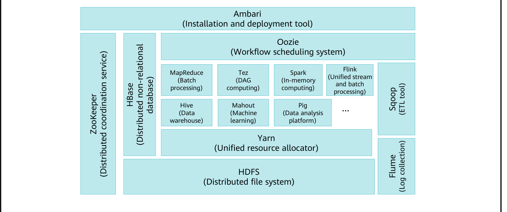

# Hands-On Lab: Hadoop Big Data Ecosystem & Computing Modes Mapping

**Pillar:** HCIA-Computing V3.0 (Kunpeng & Server Ecosystem)  
**Schedule Block:** Hour 01 — History of Computing & Industry Trends (Sprint 3 of 4)  
**Format:** Immediate Hands-On Exercise (8 mins) — Paired with `05-Lecture-Big-Data-Ecosystem-and-Evolution`  
**Interactive Workbench:** Open **[`06-Exercise-Hadoop-Ecosystem-Component-Mapping.html`](./06-Exercise-Hadoop-Ecosystem-Component-Mapping.html)** or **[`../index.html`](../index.html)** for live execution & auto-grading!

---

## Part A: Practical Lab Scenario
You are designing a Huawei Cloud MRS big data architecture blueprint. Map the official Hadoop components to their exact roles and assign the graph/query frameworks.

<!-- PDF_FIGS_START -->
#### Reference Diagrams


*Figure: Hadoop Big Data Ecosystem Component Stack (Official Reference: p. 44)*
<!-- PDF_FIGS_END -->

### Step-by-Step Instructions
1. Set `deployment_tool` to `'Ambari'`, `workflow_scheduler` to `'Oozie'`, `coordination_service` to `'ZooKeeper'`, and `etl_tool` to `'Sqoop'`.
2. Set `spark_graph_library` to `'GraphX'` and `flink_graph_library` to `'Gelly'`.
3. Set `big_data_mode_relation` to `'after'` (modes are set after data is generated).

### Starter Workspace (`bigdata@mrs-cluster:~#`)
```bash
# Hadoop & Big Data Architecture Mapping
hadoop_ecosystem:
  deployment_tool: "___"
  workflow_scheduler: "___"
  coordination_service: "___"
  etl_tool: "___"
  log_collection: "Flume"
  unified_resource_allocator: "YARN"

graph_and_schema:
  spark_graph_library: "___"
  flink_graph_library: "___"
  big_data_mode_relation: "___"
```

<details>
<summary><strong>Click to View Hints</strong></summary>

- Ambari handles installation and deployment; Oozie handles workflow scheduling; ZooKeeper provides distributed coordination; Sqoop is the ETL tool.
- GraphX is built into Spark; Gelly is built into Flink.

</details>

<details>
<summary><strong>Click to Reveal Full Working Solution & Expected Output</strong></summary>

#### Solution Code / Commands:
```bash
# Hadoop & Big Data Architecture Mapping
hadoop_ecosystem:
  deployment_tool: "Ambari"
  workflow_scheduler: "Oozie"
  coordination_service: "ZooKeeper"
  etl_tool: "Sqoop"
  log_collection: "Flume"
  unified_resource_allocator: "YARN"

graph_and_schema:
  spark_graph_library: "GraphX"
  flink_graph_library: "Gelly"
  big_data_mode_relation: "after"
```

#### Expected Console / Query Output:
```text
[OK] Hadoop Ecosystem Blueprint Validated:
- Installation & Deployment: Ambari | Workflow Scheduling: Oozie | Coordination: ZooKeeper
- ETL: Sqoop | Log Collection: Flume | Resource Allocator: YARN
- Graph Libraries: Spark -> GraphX, Flink -> Gelly
- Big Data Schema Rule: Modes are set AFTER data is generated ("Fishing in the ocean").
```
</details>

---

## Part B: National Stage Exam Verification Drill

### Question 1 [Single-Choice]
**In the Hadoop big data ecosystem, which component serves as the workflow scheduling system, and which serves as the installation and deployment tool?**

- A. ZooKeeper (workflow scheduling) and Sqoop (installation/deployment)
- B. Oozie (workflow scheduling) and Ambari (installation/deployment)
- C. Tez (workflow scheduling) and Flume (installation/deployment)
- D. Pig (workflow scheduling) and YARN (installation/deployment)

<details>
<summary>[PASS] <strong>Check Answer & Explanation (Question 1)</strong></summary>

- **Correct Answer:** `B`
- **Explanation:** According to Ch.01 p.44, Oozie is the workflow scheduling system, Ambari is the installation and deployment tool, ZooKeeper is the distributed coordination service, and Sqoop is the ETL tool.
</details>

### Question 2 [Multiple-Choice (Select ALL)]
**Which of the following statements accurately contrast Big Data processing with Traditional Data processing?**

- A. In traditional data processing, modes (schemas) are set before data is generated ('fishing in the pond').
- B. In big data processing, modes are set after data is generated and evolve as data increases ('fishing in the ocean').
- C. XML and JSON files are typical examples of semi-structured data.
- D. Big data 1.0 is analyst-oriented, whereas Big data 2.0 is programmer-oriented.

<details>
<summary>[PASS] <strong>Check Answer & Explanation (Question 2)</strong></summary>

- **Correct Answer:** `ABC`
- **Explanation:** A, B, and C are true (Ch.01, pp. 39, 42). D is false because Big Data 1.0 is programmer-oriented, Big Data 2.0 is analyst-oriented, and Big Data 3.0 is engineer-oriented (Ch.01, p.55).
</details>

### Question 3 [Single-Choice]
**Which of the following is the built-in graph computing algorithm library of Apache Flink?**

- A. GraphX
- B. Gelly
- C. Impala
- D. Dremel

<details>
<summary>[PASS] <strong>Check Answer & Explanation (Question 3)</strong></summary>

- **Correct Answer:** `B`
- **Explanation:** GraphX is the built-in graph computing library of Spark, while Gelly is the built-in graph computing algorithm library of Flink (Ch.01, p.45).
</details>
