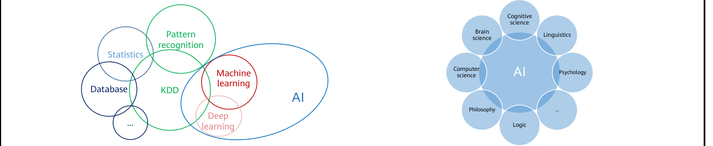
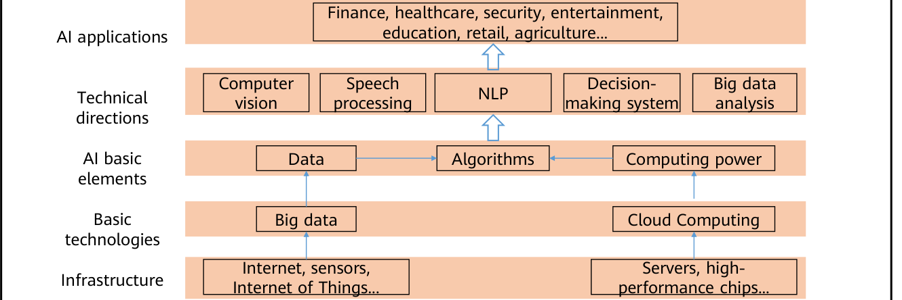

# Artificial Intelligence History, Basic Elements & Industry Trends

**Pillar:** HCIA-Computing V3.0 (Kunpeng & Server Ecosystem)  
**Schedule Block:** Hour 01 — History of Computing & Industry Trends (Sprint 4 of 4)  
**Format:** Bite-Sized Lecture (8 mins) - Followed immediately by `08-Exercise-AI-Elements-and-Heterogeneous-Trends-Lab` (7 mins)  
**Official Material Reference:** `HCIA-Computing V3.0 Training Material.pdf` — Ch.01, pp. 46–66

---

## Learning Objectives
- Master the relationship between AI, Machine Learning, and Deep Learning and the 4 basic elements of AI applications
- Trace the peaks, troughs, recovery, and booming phases of AI development from 1956 to present
- Analyze AI computing power challenges, integer vs. floating-point workloads, x86-to-Arm transition, and cloud-edge collaboration

---

### 1. AI, Machine Learning, Deep Learning & Basic Elements (pp. 47–51)
- **Artificial Intelligence (AI)**: Coined by **John McCarthy in 1956** at the **Dartmouth Conference** as the *"science and engineering of making intelligent machines, especially intelligent computer programs."*
- **Machine Learning (ML, 1980s)**: Proposed by **Arthur Samuel in 1959**; **Tom Mitchell** defined it via experience E, task class T, and performance measure P. Builds models from sample/training data without explicit rules.
- **Deep Learning (DL, 2010s)**: Subfield of ML originating from artificial neural networks (such as Multilayer Perceptron, **MLP**); **Geoffrey Hinton** spearheaded deep learning with backpropagation in **2006**.
- **Four Basic Elements of AI Applications (pp. 48, 51, 61 Quiz Q1)**:
  1. **Data**
  2. **Algorithms**
  3. **Computing power**
  4. **Scenarios**
  *(Note: On p. 56, the three conditions for explosive AI growth are **algorithm, computing power, and data**. **Talent** is NOT a basic element of AI applications!)*
<!-- PDF_FIGS_START -->

*Figure: Relationship Between AI, Machine Learning, KDD, and Deep Learning (Official Reference: p. 47)*

*Figure: AI Industry Ecosystem Stack (Official Reference: p. 51)*
<!-- PDF_FIGS_END -->

---

### 2. AI Development History: Peaks & Troughs (pp. 49–50)
| Period | Phase | Key Milestones & Causes |
| :--- | :--- | :--- |
| **1956–1976** | **First Peak** | **1956 Dartmouth Conference** coined AI; **1959 Arthur Samuel** proposed ML. |
| **1976–1982** | **First Trough** | Failure of machine translation, negative academic reports, low hardware computing power, high algorithm complexity. |
| **1982–1987** | **Second Peak** | Decision tree models, multi-layer neural networks, **Expert systems** (logical rule inference), and fifth-generation computer projects. |
| **1987–1997** | **Second Trough** | **1987 Lisp machine market collapsed**; abstract reasoning hit bottlenecks and symbolic AI models faced opposition. |
| **1997–2010** | **Recovery** | **1997 IBM Deep Blue** beat chess champion Garry Kasparov; **2006 Geoffrey Hinton** proposed Deep Learning; **2010** advent of Big Data era. |
| **2010–Present** | **Booming** | **2014** Microsoft Cortana; **2017** DeepMind **AlphaGo Zero**; **2018** Transformer-based **BERT**; **2020** OpenAI **GPT-3**; **2022** Google **Imagen & DreamBooth** diffusion models. |

---

### 3. Computing Challenges & Emerging Trends (pp. 53–66)
- **Top AI Application Fields in China (p. 53)**: Computer vision (**34%**), Data mining (**18%**), Machine learning (**17%**), Intelligent voice (**8%**), NLP (**7%**). The two primary general AI directions are **Computer Vision** and **NLP**.
- **Challenges of AI Computing Power (p. 56)**: Explosive data growth, rising enterprise hardware investment/cost, **Moore's Law coming to an end** (Intel stopped its 2-year **"Tick-Tock"** CPU R&D cycle, extending it to 3 years), and single-CPU performance bottlenecks.
- **Integer vs. Floating-Point Computing (p. 57)**:
  - **Integer computations**: Outstanding in **text processing, storage, and big data analysis**.
  - **Floating-point computations**: Excellent in **scientific computing and video processing**.
- **Two Major Computing Industry Trends (p. 58)**:
  1. **PCs \rightarrow Intelligent Mobile Terminals**: In 2023, 1.17 billion mobile terminals vs. 240 million PCs shipped. Processor shift from **x86 to Arm**, requiring **homogeneous computing power** across cloud data centers (DCs) and mobile devices.
  2. **All Things Connected (IoT & Cloud-Edge Collaboration)**: **AI computing power accounts for 80%** of computing power consumed in DCs. **Cloud-edge collaboration** uses **central training (Cloud DC) + edge inference (Edge)**.
- **Key Chapter 01 Acronyms (pp. 64–65)**: **CANN** (*Compute Architecture for Neural Networks*, Ascend heterogeneous compute architecture for AI), **BMS** (*Bare Metal Server*), **NFV** (*Network Functions Virtualization*), **CRM** (*Computing Resource Manager*).

---

## Key Takeaways
- **The 4 basic elements of AI applications are Data, Algorithms, Computing power, and Scenarios — Talent is NOT one of them (Ch.01 Quiz Q1)!**
- **AI History phases: 1st Peak (1956–1976), 1st Trough (1976–1982), 2nd Peak (1982–1987, Expert Systems), 2nd Trough (1987–1997, Lisp machine collapse), Recovery (1997–2010, Deep Blue & Hinton DL), Booming (2010–present).**
- **Integer computing excels at text processing, storage, and big data analysis; floating-point computing excels at scientific computing and video processing.**
- **AI computing power accounts for 80% of DC computing power, and Cloud-Edge collaboration combines Central Training + Edge Inference.**

## Huawei ICT Competition National Stage Exam Traps
> [!WARNING]
> EXAM TRAP (Ch.01 Quiz Q1): 'Which of the following is NOT a basic element of AI applications?' -> D. Talent! (Data, Algorithms, Computing power, and Scenario ARE the four basic elements).

> [!WARNING]
> EXAM TRAP: Do not reverse Integer vs. Floating-point scenarios — Integer is for text processing, storage, and big data; Floating-point is for scientific computing and video processing.

---

### Next Step: Immediate Hands-On Exercise
Proceed immediately to **[`08-Exercise-AI-Elements-and-Heterogeneous-Trends-Lab.html`](./08-Exercise-AI-Elements-and-Heterogeneous-Trends-Lab.html)** (or [`08-Exercise-AI-Elements-and-Heterogeneous-Trends-Lab.md`](./08-Exercise-AI-Elements-and-Heterogeneous-Trends-Lab.md)) to apply this concept in an interactive lab workbench!
