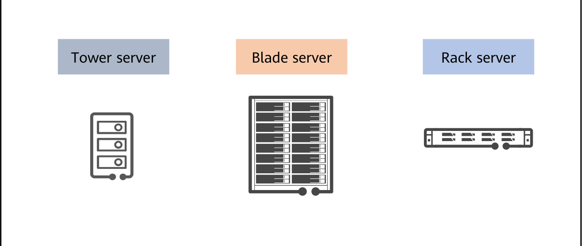
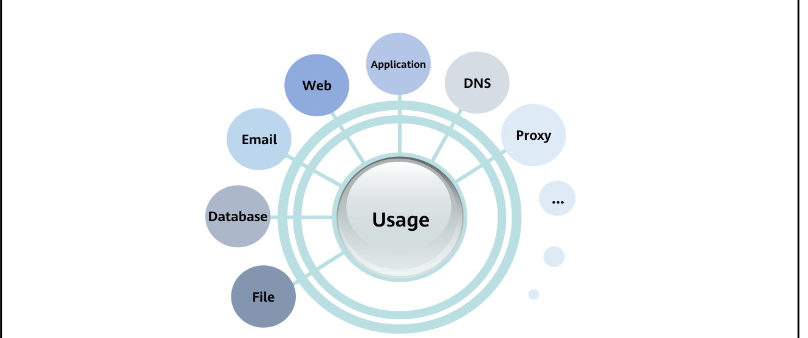

# Computing System Architecture & Server Classification

**Pillar:** HCIA-Computing V3.0 (Kunpeng & Server Ecosystem)  
**Schedule Block:** Hour 02 — Computing System Overview, System Software & Virtualization (Sprint 1 of 4)  
**Format:** Bite-Sized Lecture (7 mins) - Followed immediately by `02-Exercise-Server-Classification-and-Instruction-Set-Lab` (7 mins)  
**Official Material Reference:** `HCIA-Computing V3.0 Training Material.pdf` — Ch.02, pp. 72–83

---

## Learning Objectives
- Understand the Computing System formula (Computing System = Computer + Data) and its 3 layers (Hardware, Software, Solutions)
- Master the 5 RASUM server features and the chronological evolution of servers
- Compare Tower, Blade, and Rack servers, C/S vs. B/S deployment architectures, and CISC vs. RISC instruction sets

---

### 1. Computing System Architecture & RASUM Features (pp. 72–75)
- **Definition**: Computing System = Computer + Data. In a narrow sense, it consists of a **hardware system** (hosts + peripherals) and a **software system** (system software + application software). Broadly, it is divided into three layers: **Hardware**, **Software**, and **Solutions**.
- **Five Server Features (RASUM, p. 75)**:
  - **R — Reliability**: Duration that the server operates consecutively without failure.
  - **A — Availability**: Percentage of normal system uptime and service time.
  - **S — Scalability**: Hardware expansion and OS support capabilities.
  - **U — Usability**: Ease of maintaining and restoring server hardware and software.
  - **M — Manageability**: Monitoring, alarm reporting of running status, and intelligent fault processing.

---

### 2. Server Development Timeline (p. 76 — Official Quiz Q1 Trap!)
Servers evolved strictly in the following chronological sequence:
1. **Mainframes (1940s–1950s)**: Birth of ENIAC ushered in the mainframe era (modern mainframes are ~2 m high × 1–3 m long × 1 m wide).
2. **Midrange Computers (1960s–1970s)**: Mainframes scaled down for SMEs and institutions at an affordable cost (cabinet-sized).
3. **Microcomputers (1970s–1980s)**: Second scale-down; Apple Inc. founded in 1976, Apple II (1977), IBM-PC (1981).
4. **General-Purpose Servers (1980s–1990s)**: Intel launched the first x86 processor in **1978**; **Compaq launched SystemPro** in the 1980s (world's first standard x86 server); Intel launched **Pentium (1993)** and **Pentium Pro (1995, x86 server CPU)**.

---

### 3. Server Classification by Form Factor, Usage & Processor (pp. 77–83)
| Form Factor | Characteristics | Advantages | Disadvantages |
| :--- | :--- | :--- | :--- |
| **Tower Server** | Vertically placed like a PC; reserved motherboard slots | **Easy maintenance & upgrade**, **Low cost** (ideal for SMEs) | **Large space occupation**, **High power consumption** (independent cooling/PSU) |
| **Blade Server** | Chassis housing multiple swappable thin server blades | **Small footprint**, **Easy expansion** (hot-swappable blades, unified management) | **High heat dissipation requirements**, **High cost** & complex maintenance |
| **Rack Server** | Standardized width (**19-inch / 48.26 cm** cabinet); heights in **1U (4.45 cm), 2U (8.9 cm), 4U (17.8 cm)** | **Space saving**, **Low power consumption** (shared cabinet cooling) | **Limited scalability** vs. tower, **High initial cost** (cabinets, power, cooling) |

- **Deployment Architectures (p. 81)**:
  - **C/S (Client/Server)**: Dedicated client GUI software (e.g., **FileZilla** or **WinSCP**) connects to backend server daemon (e.g., **vsftpd**). Fast communication.
  - **B/S (Browser/Server)**: Users only need a web browser; application logic is centralized on the server and middleware.
- **Processor Instruction Sets (pp. 82–83)**:
  - **CISC (Complex Instruction Set Computing)**: **x86** (Intel Core, AMD Ryzen). Uses microprograms in ROM; variable instruction length; complex hardware structure, **beneficial for compiler development**.
  - **RISC (Reduced Instruction Set Computing)**: Proposed by **Prof. David Patterson (1979)** after observing **80% of computing uses only 20% of instructions**. Includes **Arm** (Huawei Kunpeng, Apple A-series), **RISC-V** (Qualcomm Snapdragon Wear), and **MIPS** (Loongson 2). Fixed instruction length, register-based operations, simpler CPU hardware, **higher requirements on compiler design**. Software compiled for CISC cannot run directly on RISC without recompilation or binary translation.
<!-- PDF_FIGS_START -->

*Figure: Server Classification by Appearance (Tower, Blade, Rack) (Official Reference: p. 77)*

*Figure: Server Classification by Usage Scenarios (Official Reference: p. 81)*
<!-- PDF_FIGS_END -->

---

## Key Takeaways
- **Server evolution order: Mainframes (1940s–50s) -> Midrange computers (1960s–70s) -> Microcomputers (1970s–80s) -> General-purpose servers (1980s–90s, Compaq SystemPro & Intel Pentium Pro).**
- **1U equals 4.45 cm (1.75 inches), and standard rack cabinets are 19 inches (48.26 cm) wide.**
- **CISC (x86) has complex CPU hardware but simplifies compiler design; RISC (Arm, RISC-V, MIPS) simplifies CPU hardware with fixed-length instructions but places higher requirements on compiler design.**

## Huawei ICT Competition National Stage Exam Traps
> [!WARNING]
> EXAM TRAP (Ch.02 Quiz Q1): 'Servers are developed from midrange computers to general-purpose servers and then to mainframe servers.' -> FALSE! Mainframes came FIRST (1940s–50s), then Midrange (1960s–70s), Microcomputers (1970s–80s), and General-purpose servers (1980s–90s).

> [!WARNING]
> EXAM TRAP: Loongson 2 uses MIPS (RISC), Qualcomm Snapdragon Wear uses RISC-V, and Huawei Kunpeng uses Arm (RISC).

---

### Next Step: Immediate Hands-On Exercise
Proceed immediately to **[`02-Exercise-Server-Classification-and-Instruction-Set-Lab.html`](./02-Exercise-Server-Classification-and-Instruction-Set-Lab.html)** (or [`02-Exercise-Server-Classification-and-Instruction-Set-Lab.md`](./02-Exercise-Server-Classification-and-Instruction-Set-Lab.md)) to apply this concept in an interactive lab workbench!
