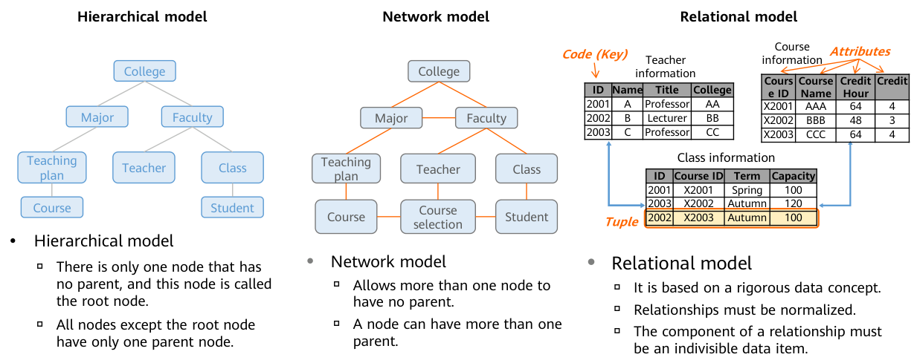

# Hands-On Lab: Database Server Sizing & Middleware Selection

**Pillar:** HCIA-Computing V3.0 (Kunpeng & Server Ecosystem)  
**Schedule Block:** Hour 02 — Computing System Overview, System Software & Virtualization (Sprint 2 of 4)  
**Format:** Immediate Hands-On Exercise (7 mins) — Paired with `03-Lecture-System-Software-OS-Middleware-and-Databases`  
**Interactive Workbench:** Open **[`04-Exercise-Database-Models-OLTP-OLAP-and-Sizing-Lab.html`](./04-Exercise-Database-Models-OLTP-OLAP-and-Sizing-Lab.html)** or **[`../index.html`](../index.html)** for live execution & auto-grading!

---

## Part A: Practical Lab Scenario
Configure the hardware and software specification sheet for deploying openGauss 5.0.0 on a 4-socket Kunpeng server and validate middleware/OS rules.

<!-- PDF_FIGS_START -->
#### Reference Diagrams


*Figure: Database Models: Hierarchical (Tree), Network (Graph), Relational (Official Reference: p. 98)*
<!-- PDF_FIGS_END -->

### Step-by-Step Instructions
1. Set `server_model` to `'TaiShan 200 2480'`, `max_cpu_peak_load_percent` to `85`, and `nic_chip` to `'Hi1822'`.
2. Set `open_source_ejb_middleware` to `'JBoss'` and `lightweight_no_ejb_middleware` to `'Tomcat'`.
3. Set `win2022_standard_max_vms` to `2`.

### Starter Workspace (`dba@opengauss-2480:~#`)
```bash
# Database Server & Middleware Specification
opengauss_4p_spec:
  server_model: "___"
  cpu_sockets_x_cores: "4 x 64"
  memory_capacity: "1 TB"
  max_cpu_peak_load_percent: ___
  nic_chip: "___"
  nvme_v5_seq_write_mbps: 2600

software_stack:
  open_source_ejb_middleware: "___"
  lightweight_no_ejb_middleware: "___"
  win2022_standard_max_vms: ___
```

<details>
<summary><strong>Click to View Hints</strong></summary>

- TaiShan 200 (model 2480) is the 2U 4-socket Kunpeng server; database CPU peak load should not exceed 85%.
- JBoss supports EJB under LGPL, while Tomcat only supports Servlet/JSP. Windows Server 2022 Standard allows 2 VMs.

</details>

<details>
<summary><strong>Click to Reveal Full Working Solution & Expected Output</strong></summary>

#### Solution Code / Commands:
```bash
# Database Server & Middleware Specification
opengauss_4p_spec:
  server_model: "TaiShan 200 2480"
  cpu_sockets_x_cores: "4 x 64"
  memory_capacity: "1 TB"
  max_cpu_peak_load_percent: 85
  nic_chip: "Hi1822"
  nvme_v5_seq_write_mbps: 2600

software_stack:
  open_source_ejb_middleware: "JBoss"
  lightweight_no_ejb_middleware: "Tomcat"
  win2022_standard_max_vms: 2
```

#### Expected Console / Query Output:
```text
[OK] openGauss 4-Socket Hardware & System Software Spec Verified:
- Server: TaiShan 200 (2480) | 4 x 64-core Kunpeng 920 | 1 TB RAM | Peak CPU <= 85%
- Network: Hi1822 (4 x 25GE, latency < 0.1 ms) | Storage: 4 x NVMe (>= 2600 MB/s write)
- Middleware: JBoss (LGPL, supports EJB) vs. Tomcat (Servlet/JSP only).
```
</details>

---

## Part B: National Stage Exam Verification Drill

### Question 1 [Single-Choice]
**According to the database model definitions in Chapter 02 (p. 98), which database model allows more than one node to have no parent and allows a node to have more than one parent?**

- A. Hierarchical model
- B. Network model
- C. Relational model
- D. Transaction model

<details>
<summary>[PASS] <strong>Check Answer & Explanation (Question 1)</strong></summary>

- **Correct Answer:** `B`
- **Explanation:** On Ch.02 p.98, the Network model is explicitly defined as: 'Allows more than one node to have no parent. A node can have more than one parent.' (Note: p.124 slide notes have a known typo 'C', whereas p.98 defines Network model).
</details>

### Question 2 [Single-Choice]
**Which of the following middleware products is open-source, complies with the LGPL license, and supports Enterprise JavaBeans (EJB) 1.1, 2.0, and 3?**

- A. Tomcat
- B. JBoss
- C. WebLogic
- D. WebSphere

<details>
<summary>[PASS] <strong>Check Answer & Explanation (Question 2)</strong></summary>

- **Correct Answer:** `B`
- **Explanation:** JBoss is open-source under LGPL and supports JEE and EJB 1.1, 2.0, and 3. Tomcat is open-source but only supports Servlet/JSP (not EJB). WebLogic and WebSphere are closed-source commercial software (Ch.02, p.91).
</details>

### Question 3 [Multiple-Choice (Select ALL)]
**Which of the following statements accurately compare OLTP and OLAP systems?**

- A. OLTP focuses on short, simple online transactions (read and write) and emphasizes memory efficiency and transaction throughput.
- B. OLAP focuses on complex analytical queries (mostly read) over historical data and emphasizes drive I/O bandwidth and query response time.
- C. Typical OLTP database scale is 100 MB to GB accessing dozens of records, whereas OLAP scale is 100 GB to TB accessing millions of records.
- D. When selecting a database server CPU, the peak CPU load should be allowed to reach 99% continuously.

<details>
<summary>[PASS] <strong>Check Answer & Explanation (Question 3)</strong></summary>

- **Correct Answer:** `ABC`
- **Explanation:** A, B, and C are accurate comparisons from Ch.02 pp. 99–100. D is false because p. 101 states that peak CPU load must not exceed 85% so that the database can respond quickly.
</details>
