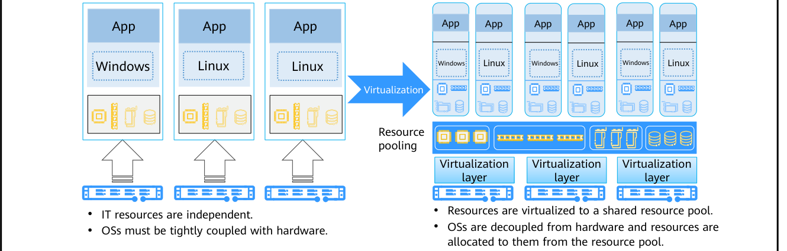
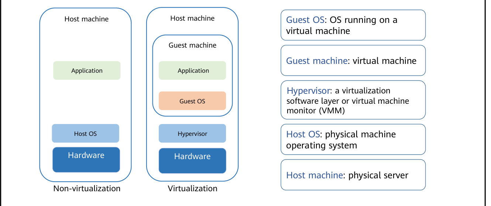
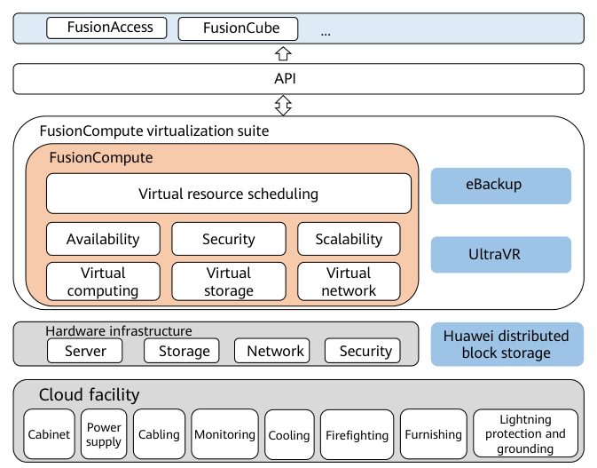
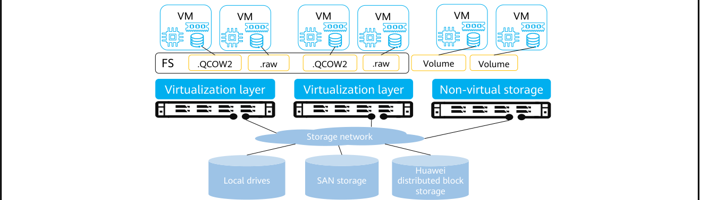
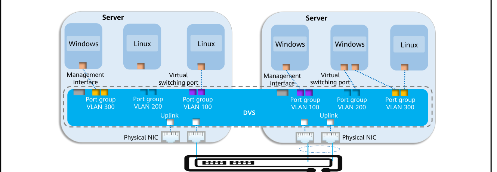
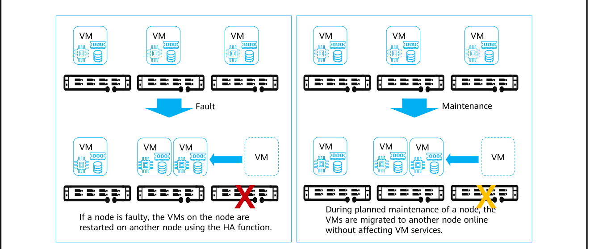

# Cloud OS & Huawei FusionCompute Virtualization Suite

**Pillar:** HCIA-Computing V3.0 (Kunpeng & Server Ecosystem)  
**Schedule Block:** Hour 02 — Computing System Overview, System Software & Virtualization (Sprint 3 of 4)  
**Format:** Bite-Sized Lecture (7 mins) - Followed immediately by `06-Exercise-FusionCompute-Cluster-Hardware-Planning-Lab` (8 mins)  
**Official Material Reference:** `HCIA-Computing V3.0 Training Material.pdf` — Ch.02, pp. 102–116

---

## Learning Objectives
- Master virtualization terminology: Host Machine, Host OS, Hypervisor (VMM), Guest Machine (VM), and Guest OS
- Understand the FusionCompute virtualization suite (FusionCompute, FusionStorage Block, eBackup, UltraVR)
- Know the exact hardware requirements for deploying FusionCompute VRM and CNA compute nodes

---

### 1. Virtualization Concepts & FusionCompute Suite (pp. 104–108)
Virtualization creates an abstraction layer over physical hardware to decouple OSs from tight hardware binding, pooling resources via space or time division.
- **Key Virtualization Terms (p. 105)**:
  - **Host Machine**: The physical server providing underlying hardware resources.
  - **Host OS**: The operating system running on the physical machine.
  - **Hypervisor (Virtual Machine Monitor / VMM)**: The virtualization software layer that abstracts and schedules hardware.
  - **Guest Machine**: The Virtual Machine (VM).
  - **Guest OS**: The operating system running inside a VM.

#### Huawei FusionCompute Virtualization Suite (pp. 107–108):
- **FusionCompute**: Cloud OS software that virtualizes compute, storage, and network resources and centrally manages virtual, service, and user resources.
- **FusionStorage Block**: Scale-out distributed block storage software deployed on general-purpose servers to consolidate local drives into a virtual storage pool.
- **eBackup**: Virtualization backup software that works with **FusionCompute snapshots** and **Changed Block Tracking (CBT)** to back up VM data.
- **UltraVR**: Disaster Recovery (DR) management software providing VM data protection via **asynchronous remote replication** of underlying SAN storage.
<!-- PDF_FIGS_START -->

*Figure: Before Virtualization vs After Virtualization Architecture (Official Reference: p. 104)*

*Figure: Hypervisor (VMM), Host OS, and Guest OS Stack (Official Reference: p. 105)*

*Figure: Position of FusionCompute in Huawei Virtualization Suite (Official Reference: p. 107)*
<!-- PDF_FIGS_END -->

---

### 2. Virtual Computing, Storage, Network & Benefits (pp. 109–114)
- **Virtual Storage (pp. 110–111)**: Aggregates SAN storage, Huawei distributed block storage, and local drives into **Data Stores**, allocating **Virtual Volumes** (`.raw` or `.QCOW2` files) to VMs. Supports features physical drives lack: **snapshots, online resizing, thin provisioning, QoS, and storage migration**.
- **Virtual Network (p. 112)**: Uses a **Distributed Virtual Switch (DVS)** across multiple hosts. VMs connect to **Virtual Switching Ports** organized into **Port Groups** (isolated by **VLANs**, e.g., VLAN 100/200/300), while physical NICs connect to the DVS as **Uplinks**, ensuring network consistency during cross-host live migration.
- **FusionCompute Benefits (pp. 113–114)**:
  - **Resource & Time-based Sharing**: Increases physical server utilization from **5%–10% (before virtualization)** to **60%+ (after virtualization)** with a **1:5 to 1:10 consolidation ratio** (e.g., balancing daytime MMS server peaks `08:00–20:00` with nighttime WAP gateway peaks `22:00–04:00`).
  - **High Availability (HA) vs. Live Migration**: If a node **fails**, **HA** detects the fault and **restarts** VMs on another healthy host. During **planned maintenance**, VMs are **migrated online (live migration)** without interrupting services.
<!-- PDF_FIGS_START -->

*Figure: FusionCompute Virtual Computing Resource Pooling (Official Reference: p. 109)*

*Figure: FusionCompute Virtual Storage Architecture (Official Reference: p. 110)*

*Figure: FusionCompute Virtual Network (DVS and VLAN Port Groups) (Official Reference: p. 112)*

*Figure: FusionCompute Fault Recovery (HA) and Live Migration (Official Reference: p. 114)*
<!-- PDF_FIGS_END -->

---

### 3. Hardware Requirements for Deploying FusionCompute (pp. 115–116)
| Resource | Official FusionCompute Requirement (pp. 115–116) |
| :--- | :--- |
| **CPU** | CPUs in the same cluster **must be of the same model** and support hardware virtualization (e.g., **Intel VT-x** enabled in BIOS; x86 Intel/Hygon or Arm **Kunpeng 920**/Phytium). |
| **Memory** | At least **8 GB** (**48 GB or more** is recommended). Host memory ≥ Management VM memory + Host management domain memory. |
| **System Drive** | **VRM (Virtual Resource Manager) node**: ≥ 270 GB; **Compute node (CNA)**: ≥ 150 GB. Recommended: **two SAS drives in RAID 1** for system drives (and RAID 1 for local VM storage). |
| **Network Port** | ≥ 1 NIC interface; recommended **6 NICs** at **1000 Mbit/s (1 GE) or higher**. Network load should be ≤ 60% of bandwidth. |

---

## Key Takeaways
- **eBackup uses snapshots + Changed Block Tracking (CBT) for backup; UltraVR uses SAN asynchronous remote replication for Disaster Recovery (DR).**
- **Before virtualization, server utilization is 5%–10%; after virtualization with FusionCompute, integration ratio is 1:5 to 1:10 and server utilization reaches 60%+.**
- **FusionCompute hardware requirements: VRM system drive >= 270 GB, Compute node system drive >= 150 GB, RAM >= 8 GB (>= 48 GB recommended), >= 1 NIC (6 GE+ NICs recommended), network load <= 60%.**

## Huawei ICT Competition National Stage Exam Traps
> [!WARNING]
> EXAM TRAP: Do not swap the system drive capacities for FusionCompute: VRM node requires >= 270 GB, while Compute node requires >= 150 GB!

> [!WARNING]
> EXAM TRAP: HA restarts VMs on another host after an unexpected node fault, whereas Live Migration moves running VMs online without service interruption during planned maintenance.

---

### Next Step: Immediate Hands-On Exercise
Proceed immediately to **[`06-Exercise-FusionCompute-Cluster-Hardware-Planning-Lab.html`](./06-Exercise-FusionCompute-Cluster-Hardware-Planning-Lab.html)** (or [`06-Exercise-FusionCompute-Cluster-Hardware-Planning-Lab.md`](./06-Exercise-FusionCompute-Cluster-Hardware-Planning-Lab.md)) to apply this concept in an interactive lab workbench!
