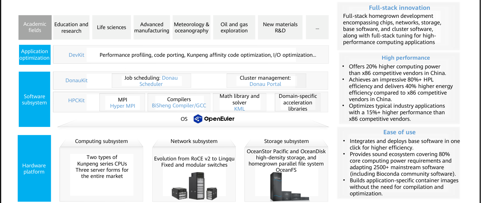

# Hands-On Lab: Kunpeng HPC Stack & Cloud Solution Verification

**Pillar:** HCIA-Computing V3.0 (Kunpeng & Server Ecosystem)  
**Schedule Block:** Hour 02 — Computing System Overview, System Software & Virtualization (Sprint 4 of 4)  
**Format:** Immediate Hands-On Exercise (8 mins) — Paired with `07-Lecture-Computing-Solutions-Kunpeng-HPC-MRS-and-ModelArts`  
**Interactive Workbench:** Open **[`08-Exercise-Kunpeng-HPC-and-Cloud-BigData-Solution-Lab.html`](./08-Exercise-Kunpeng-HPC-and-Cloud-BigData-Solution-Lab.html)** or **[`../index.html`](../index.html)** for live execution & auto-grading!

---

## Part A: Practical Lab Scenario
Configure the Kunpeng HPC solution stack manifest and verify the industry software ecosystem characteristics for the Huawei ICT Competition.

<!-- PDF_FIGS_START -->
#### Reference Diagrams


*Figure: Kunpeng High-Performance Computing (HPC) Full Stack (Official Reference: p. 118)*
<!-- PDF_FIGS_END -->

### Step-by-Step Instructions
1. Set `hpc_storage_product` to `'OceanStor Pacific'` and `parallel_filesystem` to `'OceanFS'`.
2. Set `cluster_scheduler_suite` to `'DonauKit'` and `compiler_mpi_math_suite` to `'HPCKit'`.
3. Set `education_research_software_type` to `'open-source'` and `manufacturing_cae_software_type` to `'commercial'`.

### Starter Workspace (`hpc-admin@donau-portal:~#`)
```bash
# Kunpeng HPC & Cloud Solution Blueprint
kunpeng_hpc_stack:
  hpc_storage_product: "___"
  parallel_filesystem: "___"
  cluster_scheduler_suite: "___"
  compiler_mpi_math_suite: "___"

ecosystem_characteristics:
  education_research_software_type: "___"
  meteorology_software_type: "open-source"
  manufacturing_cae_software_type: "___"

huawei_cloud_services:
  big_data_platform: "MRS"
  ai_one_stop_platform: "ModelArts"
```

<details>
<summary><strong>Click to View Hints</strong></summary>

- The HPC storage subsystem uses OceanStor Pacific and OceanFS; DonauKit handles cluster management/scheduling; HPCKit includes Hyper MPI, KML, and BiSheng Compiler.
- Education/research and meteorology are mainly open-source, while manufacturing simulation is mainly commercial.

</details>

<details>
<summary><strong>Click to Reveal Full Working Solution & Expected Output</strong></summary>

#### Solution Code / Commands:
```bash
# Kunpeng HPC & Cloud Solution Blueprint
kunpeng_hpc_stack:
  hpc_storage_product: "OceanStor Pacific"
  parallel_filesystem: "OceanFS"
  cluster_scheduler_suite: "DonauKit"
  compiler_mpi_math_suite: "HPCKit"

ecosystem_characteristics:
  education_research_software_type: "open-source"
  meteorology_software_type: "open-source"
  manufacturing_cae_software_type: "commercial"

huawei_cloud_services:
  big_data_platform: "MRS"
  ai_one_stop_platform: "ModelArts"
```

#### Expected Console / Query Output:
```text
[OK] Kunpeng HPC & Huawei Cloud Solution Blueprint Validated:
- Storage: OceanStor Pacific + OceanFS | Network: RoCE v2 -> Lingqu
- Software: DonauKit (Donau Portal + Scheduler) + HPCKit (Hyper MPI + KML + BiSheng Compiler) + DevKit
- Ecosystem: Education/Research & Meteorology (>80% Open-Source) vs. Manufacturing (Commercial).
```
</details>

---

## Part B: National Stage Exam Verification Drill

### Question 1 [Multiple-Choice (Select ALL)]
**(Official Ch.02 Quiz Q3) Which of the following statements are true about computing system solutions?**

- A. The storage subsystem of the HPC solution hardware platform can be built using OceanStor Pacific products.
- B. Most applications in the education and scientific research fields are closed-source. The Kunpeng HPC ecosystem is accelerating the adaptation of these software.
- C. Users can use the MapReduce service (MRS) to run big data components such as HBase and Kafka.
- D. ModelArts is a one-stop AI development platform for developers to quickly create and deploy models.

<details>
<summary>[PASS] <strong>Check Answer & Explanation (Question 1)</strong></summary>

- **Correct Answer:** `ACD`
- **Explanation:** A, C, and D are true (Ch.02, p.125 Quiz Q3). B is false because more than 80% of applications in the education and scientific research fields (as well as meteorology and life sciences) are open-source; closed-source commercial software is mainly used in manufacturing, EDA, and oil & gas (Ch.02, pp. 119, 122).
</details>

### Question 2 [Single-Choice]
**In Huawei's Kunpeng HPC software subsystem, which suite includes the Hyper MPI communication library, Kunpeng Math Library (KML), and BiSheng Compiler?**

- A. DonauKit
- B. HPCKit
- C. DevKit
- D. FusionCompute

<details>
<summary>[PASS] <strong>Check Answer & Explanation (Question 2)</strong></summary>

- **Correct Answer:** `B`
- **Explanation:** HPCKit integrates Hyper MPI, Kunpeng Math Library (KML), and BiSheng Compiler/GCC. DonauKit provides cluster management (Donau Portal) and job scheduling (Donau Scheduler), while DevKit provides code porting and performance profiling (Ch.02, p.118).
</details>

### Question 3 [Single-Choice]
**Which meteorological numerical analysis application is the most commonly used open-source weather forecast model on Kunpeng HPC, characterized by single-precision (fp32) computing and memory-intensive bandwidth?**

- A. WRF
- B. Abaqus
- C. GATK
- D. LS-DYNA

<details>
<summary>[PASS] <strong>Check Answer & Explanation (Question 3)</strong></summary>

- **Correct Answer:** `A`
- **Explanation:** WRF (Weather Research and Forecasting) is the most commonly used meteorological application, mainly using single-precision fp32 computing (180 GFlops) and high memory bandwidth (180 GB/s) (Ch.02, p.121).
</details>
