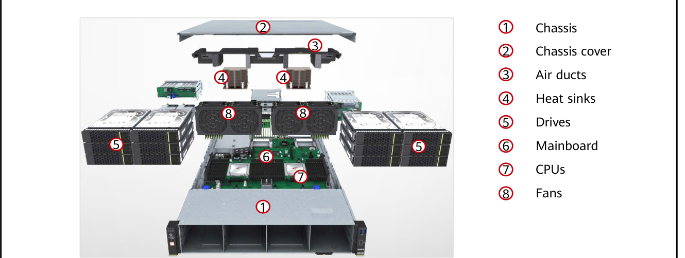
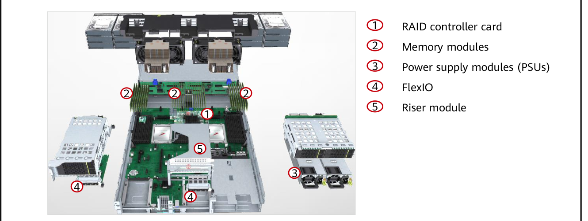
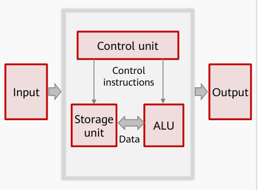
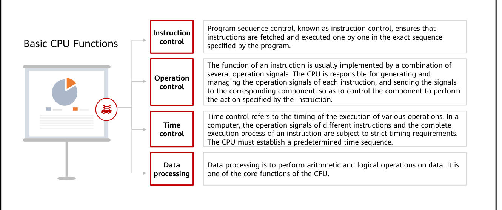

# CPU Architecture, Parameters & Multi-Socket Topologies

**Pillar:** HCIA-Computing V3.0 (Kunpeng & Server Ecosystem)  
**Schedule Block:** Hour 03 — Server Hardware Architecture: CPU, Memory, Mainboard & Storage Drives (Sprint 1 of 4)  
**Format:** Bite-Sized Lecture (7 mins) - Followed immediately by `02-Exercise-CPU-Instruction-Cycle-and-Kunpeng-920-SKU-Lab` (7 mins)  
**Official Material Reference:** `HCIA-Computing V3.0 Training Material.pdf` — Ch.03, pp. 134–141, 223–224

---

## Learning Objectives
- Identify front/rear exploded hardware components of a TaiShan 200 (model 2280) server
- Master CPU internal components (Control Unit [PC, IR, ID, OC], ALU, Storage Unit [Registers + Cache]) and the 4 basic CPU functions
- Understand key CPU parameters (dominant frequency, cache L1/L2/L3, cores/threads) and TaiShan 200 (2280) Kunpeng 920 processor models

---

### 1. TaiShan 200 (2280) Exploded View & CPU Internal Structure (pp. 134–138)
- **Front Exploded Components (p. 134)**: Chassis, Chassis cover, Air ducts, Heat sinks, Drives, Mainboard, CPUs, Fans.
- **Rear Exploded Components (p. 135)**: RAID controller card, Memory modules, Power supply modules (PSUs), FlexIO cards, Riser module.
- **Three Core Units of a CPU (pp. 136, 138, 224)**:
  1. **Control Unit (Command & Control Center)**: Composed of:
     - **Program Counter (PC)**: Register storing the memory address of the **next instruction** to be executed.
     - **Instruction Register (IR)**: Register storing the instruction **currently being executed**.
     - **Instruction Decoder (ID)**: Decodes an instruction into its **operation code** (action to take) and **address code** (location of operand).
     - **Operation Controller (OC)**: Generates micro-operation control signals according to strict timing pulses.
  2. **Arithmetic Logic Unit (ALU)**: Execution core performing arithmetic (`+`, `-`, `*`, `/`), logical (`AND`, `OR`, `NOT`, `XOR`), shift, comparison, and transfer operations upon receiving commands from the control unit.
  3. **Storage Unit**: Includes **on-chip cache (L1/L2/L3)** and the **register group**, which temporarily hold data/results to reduce slow main memory accesses.
<!-- PDF_FIGS_START -->

*Figure: TaiShan 200 (Model 2280) Front Exploded View (Components 1-8) (Official Reference: p. 134)*

*Figure: TaiShan 200 (Model 2280) Rear Exploded View (Components 1-5) (Official Reference: p. 135)*

*Figure: CPU Architecture: Control Unit, ALU, and Storage Unit Data/Control Flow (Official Reference: p. 138)*
<!-- PDF_FIGS_END -->

---

### 2. Basic CPU Functions & Key Parameters (pp. 139–140)
- **Four Basic CPU Functions (p. 139)**:
  1. **Instruction control** (program sequence control — fetching/executing instructions in exact order)
  2. **Operation control** (generating and sending operation signals for each instruction)
  3. **Time control** (strict timing sequences for signals and instruction execution)
  4. **Data processing** (arithmetic and logical operations on data)
- **Three Key CPU Parameters (p. 140)**:
  - **Dominant frequency (Clock frequency)**: E.g., at 100 MHz, 1 clock cycle = 10 ns, which is twice as fast as 50 MHz (20 ns).
  - **Cache (L1/L2/L3)**: Bridges the speed gap between fast CPU cores and slower main memory; operates near processor frequency.
  - **Number of cores & threads**: Normally a **1:1** correspondence (16 cores = 16 threads); with hyper-threading (SMT), it becomes **1:2** (16 cores = 32 threads).
- **Arm RISC Characteristics (p. 137)**: Small size, low power, supports **Thumb (16-bit) / Arm (32-bit)** dual instruction sets (plus 64-bit AArch64), uses a large number of registers, performs most data operations in registers, and uses **fixed instruction length**.
<!-- PDF_FIGS_START -->

*Figure: Four Basic CPU Functions Flow (Official Reference: p. 139)*
<!-- PDF_FIGS_END -->

---

### 3. Multi-Socket CPUs & TaiShan 200 (2280) Kunpeng 920 Models (p. 141)
"Socket" refers to the number of physical CPUs (CPU slots) on the server mainboard (1P, 2P, 4P, multi-socket).

| Processor Model | Supported Sockets | Processor Specifications (p. 141) |
| :--- | :---: | :--- |
| **Kunpeng 920 7260** | 2-socket (2P) | **64-core @ 2.6 GHz** |
| **Kunpeng 920 5250** | 2-socket (2P) | **48-core @ 2.6 GHz** |
| **Kunpeng 920 5220** | 2-socket (2P) | **32-core @ 2.6 GHz** |
| **Kunpeng 920 3210** | 2-socket (2P) | **24-core @ 2.6 GHz** |

---

## Key Takeaways
- **The Control Unit consists of the Program Counter (PC, next instruction address), Instruction Register (IR, current instruction), Instruction Decoder (ID, opcode + address code), and Operation Controller (OC).**
- **The 4 basic CPU functions are Instruction control, Operation control, Time control, and Data processing.**
- **TaiShan 200 (2280) supports 2-socket Kunpeng 920 models at 2.6 GHz: 7260 (64-core), 5250 (48-core), 5220 (32-core), and 3210 (24-core).**

## Huawei ICT Competition National Stage Exam Traps
> [!WARNING]
> EXAM TRAP: Do not confuse the Program Counter (PC — stores the memory address of the NEXT instruction) with the Instruction Register (IR — stores the instruction CURRENTLY being executed)!

> [!WARNING]
> EXAM TRAP: Kunpeng 920 model numbers encode core counts and frequency: 7260 = 64 cores @ 2.6 GHz, 5250 = 48 cores @ 2.6 GHz, 5220 = 32 cores @ 2.6 GHz, 3210 = 24 cores @ 2.6 GHz.

---

### Next Step: Immediate Hands-On Exercise
Proceed immediately to **[`02-Exercise-CPU-Instruction-Cycle-and-Kunpeng-920-SKU-Lab.html`](./02-Exercise-CPU-Instruction-Cycle-and-Kunpeng-920-SKU-Lab.html)** (or [`02-Exercise-CPU-Instruction-Cycle-and-Kunpeng-920-SKU-Lab.md`](./02-Exercise-CPU-Instruction-Cycle-and-Kunpeng-920-SKU-Lab.md)) to apply this concept in an interactive lab workbench!
