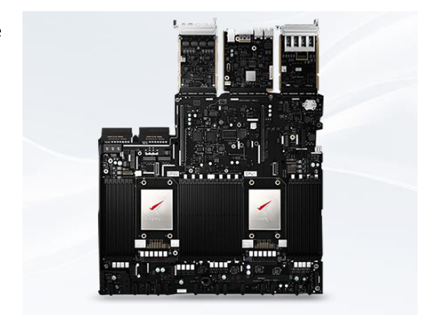
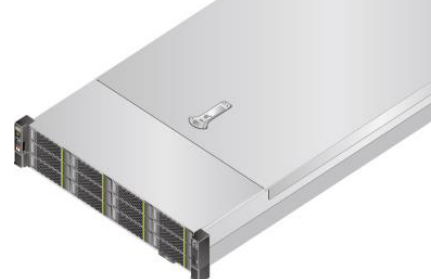
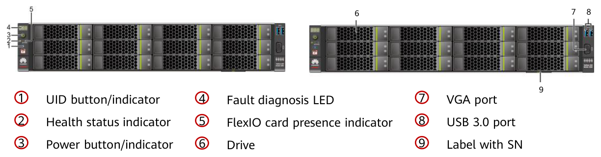
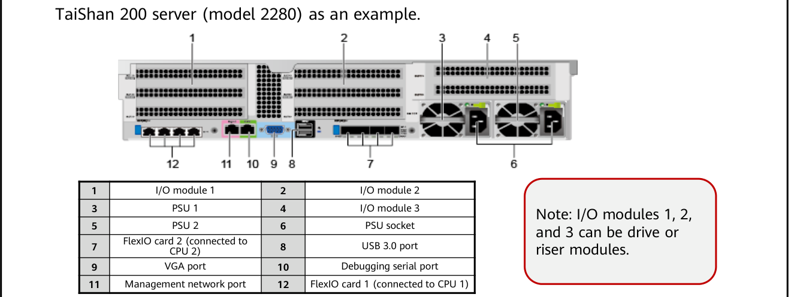

# Mainboard S920X00, Front/Rear Panels & Drive Classifications

**Pillar:** HCIA-Computing V3.0 (Kunpeng & Server Ecosystem)  
**Schedule Block:** Hour 03 — Server Hardware Architecture: CPU, Memory, Mainboard & Storage Drives (Sprint 3 of 4)  
**Format:** Bite-Sized Lecture (7 mins) - Followed immediately by `06-Exercise-Mainboard-S920X00-and-Drive-MTBF-DWPD-Lab` (8 mins)  
**Official Material Reference:** `HCIA-Computing V3.0 Training Material.pdf` — Ch.03, pp. 149–154

---

## Learning Objectives
- Master the specifications of the Kunpeng server mainboard S920X00
- Identify every port, button, indicator, and I/O module on the TaiShan 200 (2280) front and rear panels
- Compare SATA, SAS, NL-SAS, and SSD drives by rotational speed, MTBF, annual failure rate, and SSD DWPD classes

---

### 1. Kunpeng Server Mainboard (S920X00) & Chassis Sizes (pp. 149–150)
- **Mainboard Role**: Provides the connection platform integrating CPUs, memory, storage, PCIe expansion cards, and external ports. The **chipset** is the most important component on the mainboard, managing inter-device communication and built-in functions (such as an integrated GPU).
- **Kunpeng Server Mainboard Model `S920X00` (p. 149)**:
  - **CPUs**: **2 × Kunpeng 920 processors**
  - **Management Chip**: **Hi1710** intelligent management chip
  - **Memory**: Up to **32 DDR4-2933** memory slots
  - **PCIe Expansion**: **8 × PCIe 4.0** slots
  - **Chassis Compatibility**: Compatible with **2U or 4U rack servers** (e.g., TaiShan 2280 2U and TaiShan 5280 4U share this motherboard!).
- **Rack Heights (p. 150)**: **1U = 1.75 in (4.45 cm)**, **2U = 3.5 in (8.9 cm)**, **4U = 7 in (17.8 cm)**.
<!-- PDF_FIGS_START -->

*Figure: Server Mainboard Physical Hardware Layout (Official Reference: p. 149)*

*Figure: Server Rack Unit (U) Chassis Dimensions (Official Reference: p. 150)*
<!-- PDF_FIGS_END -->

---

### 2. TaiShan 200 (2280) Front and Rear Panels (pp. 151–152)
- **Supported Front Drive Configurations (p. 151)**: `12 × 3.5-inch`, `25 × 2.5-inch`, `8 × 2.5" SAS/SATA + 12 × 2.5" NVMe`, `24 × 2.5" SAS/SATA`, or `8 × 2.5-inch` drives.
- **Front Panel Components (p. 151)**: (1) UID button/indicator, (2) Health status indicator, (3) Power button/indicator, (4) Fault diagnosis LED, (5) **FlexIO card presence indicator**, (6) Drives, (7) **VGA port**, (8) **USB 3.0 port**, (9) Label with SN.
- **Rear Panel Components (p. 152)**:
  - **I/O module 1, I/O module 2, I/O module 3** (can be drive modules or PCIe riser modules)
  - **PSU 1 & PSU 2** (with PSU sockets)
  - **FlexIO card 1 (connected to CPU 1)** and **FlexIO card 2 (connected to CPU 2)**
  - **USB 3.0 port**, **VGA port**, **Debugging serial port**, and **Management network port (iBMC)**.
<!-- PDF_FIGS_START -->

*Figure: TaiShan 200 (2280) Front Panel Components and Indicators (1-9) (Official Reference: p. 151)*

*Figure: TaiShan 200 (2280) Rear Panel Ports and I/O Modules (1-12) (Official Reference: p. 152)*
<!-- PDF_FIGS_END -->

---

### 3. Drive Overview (SATA, SAS, NL-SAS, SSD) & Service Categories (pp. 153–154)

| Parameter | SATA HDD | SAS HDD | NL-SAS HDD | SSD |
| :--- | :--- | :--- | :--- | :--- |
| **Rotational Speed (RPM)** | **7,200** | **15,000 / 10,000** | **7,200** | **N/A** (Flash/DRAM) |
| **Serial / Parallel** | Serial | Serial | Serial | Serial |
| **Typical Capacity** | 1 T / 2 T / 3 T | 0.6 T / 0.9 T / 1.8 T / 2.4 T | 2 T / 3 T / 4 T / 8 T / 10 T | 480 G / 960 G / 1.92 T / 3.84 T |
| **MTBF (Hours)** | **1,200,000** | **1,600,000** | **1,200,000** | **2,000,000** |
| **Annual Failure Rate (AFR)** | **~2%** | **< 2%** | **~2%** | Lowest |
| **Key Features** | SATA 3.0 max **600 MB/s** | Compatible with SATA; **3.0 / 6.0 / 12.0 Gbit/s** | **Enterprise SATA drive with SAS interface** (ideal for storage tiering) | Control unit + storage unit (Flash or DRAM chip); highest price |

- **HDD Service Categories (p. 154)**: Enterprise-class performance, Enterprise-class capacity (SATA/SAS), Enterprise-class cloud drive (24/7 low power), Desktop drive (**5 day / 8 hour** household/PC use).
- **SSD Service Categories by DWPD (*Drive Writes Per Day*, p. 154)**:
  - **Read-intensive SSD**: DWPD < 3 (frequent reads)
  - **Mixed read/write SSD**: 3 ≤ DWPD ≤ 10 (balanced reads/writes)
  - **Write-intensive SSD**: DWPD > 10 (frequent writes)

---

## Key Takeaways
- **Kunpeng S920X00 mainboard features 2 × Kunpeng 920 CPUs, Hi1710 management chip, 32 DDR4-2933 slots, and 8 PCIe 4.0 slots for 2U/4U rack servers.**
- **NL-SAS drives are 7,200 RPM enterprise SATA platters equipped with a SAS interface (MTBF 1,200,000 h, AFR ~2%).**
- **MTBF rankings: SATA/NL-SAS = 1,200,000 h; SAS = 1,600,000 h (<2% AFR); SSD = 2,000,000 h.**
- **SSD DWPD categories: Read-intensive (< 3), Mixed read/write (3 to 10), Write-intensive (> 10).**

## Huawei ICT Competition National Stage Exam Traps
> [!WARNING]
> EXAM TRAP: On the TaiShan 200 (2280) rear panel, FlexIO card 1 is connected to CPU 1, and FlexIO card 2 is connected to CPU 2!

> [!WARNING]
> EXAM TRAP: Memorize the DWPD thresholds: Read-intensive (< 3), Mixed read/write (3 to 10), Write-intensive (> 10).

---

### Next Step: Immediate Hands-On Exercise
Proceed immediately to **[`06-Exercise-Mainboard-S920X00-and-Drive-MTBF-DWPD-Lab.html`](./06-Exercise-Mainboard-S920X00-and-Drive-MTBF-DWPD-Lab.html)** (or [`06-Exercise-Mainboard-S920X00-and-Drive-MTBF-DWPD-Lab.md`](./06-Exercise-Mainboard-S920X00-and-Drive-MTBF-DWPD-Lab.md)) to apply this concept in an interactive lab workbench!
