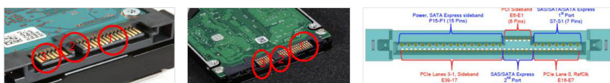

# Hands-On Lab: Storage Interface Rate & IOPS Performance Analyzer

**Pillar:** HCIA-Computing V3.0 (Kunpeng & Server Ecosystem)  
**Schedule Block:** Hour 03 — Server Hardware Architecture: CPU, Memory, Mainboard & Storage Drives (Sprint 4 of 4)  
**Format:** Immediate Hands-On Exercise (8 mins) — Paired with `07-Lecture-Drive-Interfaces-Form-Factors-and-NVMe-Architecture`  
**Interactive Workbench:** Open **[`08-Exercise-Drive-Interface-Rates-and-IOPS-Benchmark-Lab.html`](./08-Exercise-Drive-Interface-Rates-and-IOPS-Benchmark-Lab.html)** or **[`../index.html`](../index.html)** for live execution & auto-grading!

---

## Part A: Practical Lab Scenario
Complete the storage benchmark script comparing SATA 3.0, SAS 3.0, and NVMe SSD interface rates, form factors, and 4 KB random write IOPS.

<!-- PDF_FIGS_START -->
#### Reference Diagrams


*Figure: Physical Drive Interfaces: SATA (Notched Gap) vs SAS vs PCIe (Official Reference: p. 155)*
<!-- PDF_FIGS_END -->

### Step-by-Step Instructions
1. Set `sata_3_rate_gbps` to `6` and `sas_3_rate_gbps` to `12`.
2. Set `lff_inches` to `3.5` and `sff_inches` to `2.5`.
3. Set `nvme_4k_write_iops` to `'300K'` and `nvme_seq_read_mbps` to `3500`.

### Starter Workspace (`python3@taishan-storage:~$`)
```bash
# Drive Interface & Benchmark Verification
interface_rates = {
    "sata_3_rate_gbps": ___,
    "sas_3_rate_gbps": ___,
    "nvme_external_bus": "PCIe"
}
form_factors = {
    "lff_inches": ___,
    "sff_inches": ___,
    "max_sff_ssd_depth_mm": 15
}
nvme_4k_write_iops = "___"
nvme_seq_read_mbps = ___
print(interface_rates, form_factors, nvme_4k_write_iops, nvme_seq_read_mbps)
```

<details>
<summary><strong>Click to View Hints</strong></summary>

- SATA 3.0 is 6 Gbit/s; SAS 3.0 is 12 Gbit/s.
- LFF is 3.5-inch, SFF is 2.5-inch; NVMe SSD reaches 300K 4KB random write IOPS and 3500 MB/s 128KB sequential read bandwidth.

</details>

<details>
<summary><strong>Click to Reveal Full Working Solution & Expected Output</strong></summary>

#### Solution Code / Commands:
```bash
# Drive Interface & Benchmark Verification
interface_rates = {
    "sata_3_rate_gbps": 6,
    "sas_3_rate_gbps": 12,
    "nvme_external_bus": "PCIe"
}
form_factors = {
    "lff_inches": 3.5,
    "sff_inches": 2.5,
    "max_sff_ssd_depth_mm": 15
}
nvme_4k_write_iops = "300K"
nvme_seq_read_mbps = 3500
print(interface_rates, form_factors, nvme_4k_write_iops, nvme_seq_read_mbps)
```

#### Expected Console / Query Output:
```text
{'sata_3_rate_gbps': 6, 'sas_3_rate_gbps': 12, 'nvme_external_bus': 'PCIe'} {'lff_inches': 3.5, 'sff_inches': 2.5, 'max_sff_ssd_depth_mm': 15} 300K 3500
[OK] SATA/SAS/NVMe interfaces, LFF/SFF dimensions, and IOPS benchmarks verified.
```
</details>

---

## Part B: National Stage Exam Verification Drill

### Question 1 [Single-Choice]
**What are the maximum transmission rates of SAS 3.0 and SATA 3.0 interfaces, respectively?**

- A. SAS 3.0 = 6 Gbit/s; SATA 3.0 = 3 Gbit/s
- B. SAS 3.0 = 12 Gbit/s; SATA 3.0 = 6 Gbit/s
- C. SAS 3.0 = 16 Gbit/s; SATA 3.0 = 12 Gbit/s
- D. SAS 3.0 = 6 Gbit/s; SATA 3.0 = 6 Gbit/s

<details>
<summary>[PASS] <strong>Check Answer & Explanation (Question 1)</strong></summary>

- **Correct Answer:** `B`
- **Explanation:** According to Ch.03 p.155, SAS 1.0/2.0/3.0 rates are 3 / 6 / 12 Gbit/s, while SATA 1.0/2.0/3.0 rates are 1.5 / 3 / 6 Gbit/s.
</details>

### Question 2 [Single-Choice]
**How can you physically distinguish a SATA drive interface from a SAS drive interface?**

- A. A SATA interface has a gap between the connectors, whereas a SAS interface has no gap and has an edge connector on the back.
- B. A SAS interface has a gap between the connectors, whereas a SATA interface has no gap.
- C. A SATA interface uses an 89 mm PCIe x16 edge connector.
- D. There is no physical difference between SATA and SAS drive connectors.

<details>
<summary>[PASS] <strong>Check Answer & Explanation (Question 2)</strong></summary>

- **Correct Answer:** `A`
- **Explanation:** According to Ch.03 p.155, a SATA interface has a physical gap between its two connector segments, while a SAS interface does not have a gap and features an edge connector on its back.
</details>

### Question 3 [Multiple-Choice (Select ALL)]
**Which of the following statements about NVMe SSDs and drive form factors are true?**

- A. NVMe connects directly to CPUs through the PCIe interface, providing high IOPS, high bandwidth, and low latency.
- B. A 3.5-inch HDD is referred to as Large Form Factor (LFF), and a 2.5-inch HDD/SSD is referred to as Small Form Factor (SFF).
- C. The depth of a 2.5-inch SFF SSD can be 7 mm, 9.5 mm, or 15 mm, and does not exceed 15 mm.
- D. Rotational speed (RPM) is a key performance indicator for both HDDs and NVMe SSDs.

<details>
<summary>[PASS] <strong>Check Answer & Explanation (Question 3)</strong></summary>

- **Correct Answer:** `ABC`
- **Explanation:** A, B, and C are true (Ch.03, pp. 156–157). D is false because SSDs have no platters, so rotational speed applies to HDDs only (Ch.03, p.158).
</details>
