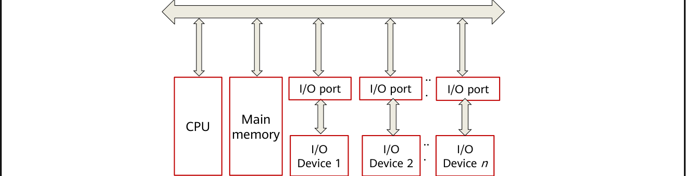
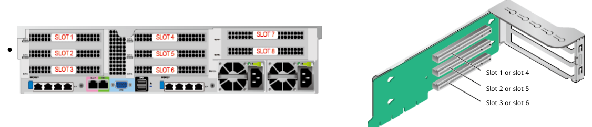
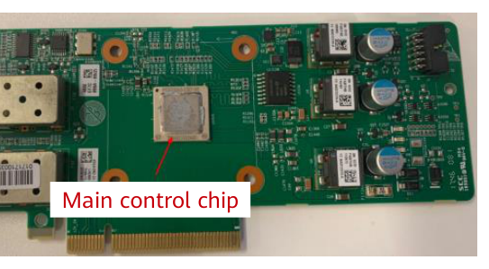
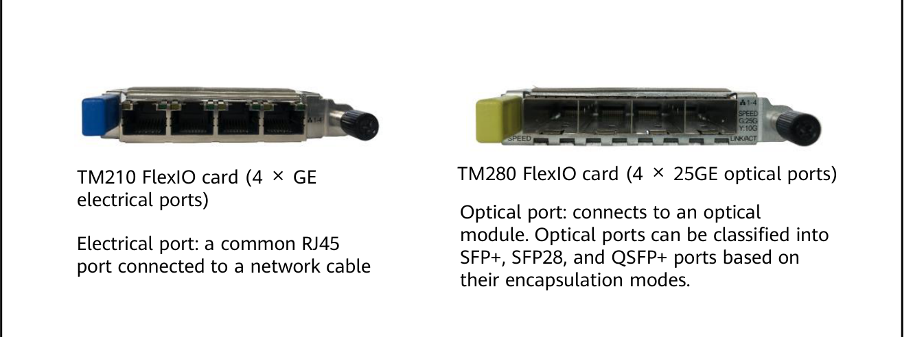
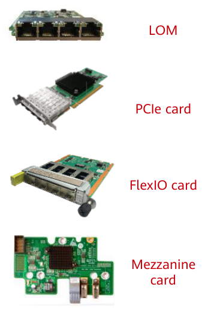
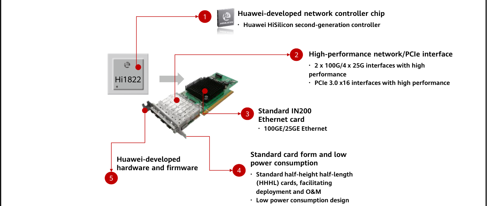
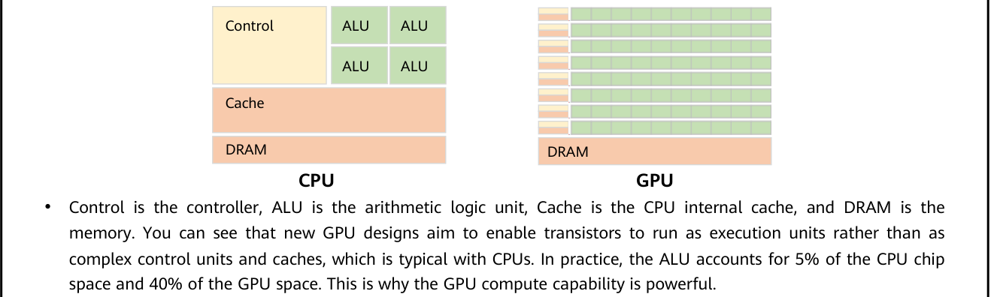
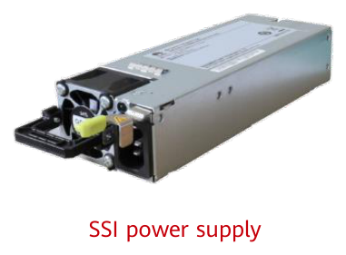

# PCIe 1.0–5.0, Riser Cards, Huawei NICs/iNICs, GPU/NPU & Power/Cooling

**Pillar:** HCIA-Computing V3.0 (Kunpeng & Server Ecosystem)  
**Schedule Block:** Hour 04 — RAID Arrays, PCIe Bus, NICs/iNICs, GPU/NPU, Power/Cooling & Server Software (Sprint 2 of 4)  
**Format:** Bite-Sized Lecture (8 mins) - Followed immediately by `04-Exercise-PCIe-Bandwidth-Huawei-NIC-Types-and-PSU-Lab` (8 mins)  
**Official Material Reference:** `HCIA-Computing V3.0 Training Material.pdf` — Ch.03, pp. 170–189, 220

---

## Learning Objectives
- Master bus evolution (PC/XT, ISA, EISA, PCI, AGP, PCIe), Riser slot mappings on TaiShan 200, and PCIe 1.0–5.0 transfer rates and bandwidths
- Distinguish Huawei server NIC types (LOM, PCIe card, FlexIO card, Mezzanine card — Ch.03 Quiz Q1!) and Hi1822 iNIC features
- Compare CPU vs. GPU vs. NPU architectures, FLOPS vs. TOPS, Air vs. Liquid Cooling (Cold-plate, Spray, Immersion), and ATX vs. SSI/CRPS PSUs

---

### 1. Bus Evolution, Riser Cards & PCIe 1.0–5.0 Specifications (pp. 170–173)
- **Bus History (p. 171)**:
  - **1st-Gen Buses**: **PC/XT (1981**, 8-bit 8088), **ISA (1984**, 16-bit 80286, max **8 MB/s**), **EISA (1988**, 32-bit @ 8 MHz, **32 MB/s**), VESA, Micro Channel.
  - **2nd-Gen Buses**: **PCI (1992)**, **AGP (1996)**, **PCI-X**, and **PCIe (2004)**.
- **TaiShan 200 Riser Cards & PCIe Slots (p. 172)**: Rear **I/O module 1** provides **slots 1–3** (when riser installed: **slot 2 & slot 3**); **I/O module 2** provides **slots 4–6** (when riser installed: **slot 5 & slot 6**); **I/O module 3** provides **slots 7–8**.
- **PCIe 1.0 to 5.0 Transmission Rates & Bandwidths (p. 173)**:

| PCIe Version | Launch Year | Transfer Rate | × 1 Bandwidth | × 4 Bandwidth | × 8 Bandwidth | × 16 Bandwidth |
| :---: | :---: | :---: | :---: | :---: | :---: | :---: |
| **PCIe 1.0** | 2003 | **2.5 GT/s** | 250 MB/s | 1.0 GB/s | 2.0 GB/s | **4.0 GB/s** |
| **PCIe 2.0** | 2007 | **5.0 GT/s** | 500 MB/s | 2.0 GB/s | 4.0 GB/s | **8.0 GB/s** |
| **PCIe 3.0** | 2010 | **8.0 GT/s** | 984.6 MB/s | 3.94 GB/s | 7.88 GB/s | **15.8 GB/s** |
| **PCIe 4.0** | 2017 | **16.0 GT/s** | 1969 MB/s | 7.88 GB/s | 15.75 GB/s | **31.5 GB/s** |
| **PCIe 5.0** | 2019 | **32.0 GT/s** | 3938 MB/s | 15.75 GB/s | 31.51 GB/s | **63.0 GB/s** |

*(Pin counts & lengths: × 1 = 36 pins / 25 mm; × 4 = 64 pins / 39 mm; × 8 = 98 pins / 56 mm; × 16 = 164 pins / 89 mm.)*
<!-- PDF_FIGS_START -->

*Figure: Single Bus System Interconnection Diagram (Official Reference: p. 170)*

*Figure: TaiShan 200 Riser Cards and PCIe I/O Module Slot Mapping (Official Reference: p. 172)*
<!-- PDF_FIGS_END -->

---

### 2. Huawei Server NICs & Hi1822 iNIC (pp. 174–180 — Official Quiz Q1!)
- **Ports**: **Electrical port (RJ45)** for twisted-pair cables (e.g., **TM210** FlexIO 4 × GE); **Optical port** (optical cage for **SFP+, SFP28, QSFP+** modules, e.g., **TM280** FlexIO 4 × 25GE).
- **Four Huawei Server NIC Structural Types (p. 177 — Ch.03 Quiz Q1!)**:
  1. **LOM (LAN on Motherboard)**: **Integrated directly in the PCH chip of the server mainboard and CANNOT be replaced**. Provides 2 × GE electrical + 2 × 10GE optical/electrical ports; **does NOT occupy PCIe slots**.
  2. **PCIe Standard Card**: Self-developed or purchased; installed in **standard PCIe slots**.
  3. **FlexIO Card**: Non-standard Huawei-developed PCIe card mounted at the **rear panel**, used **ONLY on Huawei rack servers**.
  4. **Mezzanine Card**: Used **ONLY on compute nodes of Huawei E9000 blade servers** (no external physical ports; signals route via blade backplane; not interchangeable across vendors).
- **Huawei Intelligent Converged Network Chips & IN200 iNIC (pp. 179–180)**:
  - Evolution: **FE308 (2004, 1st-gen)** > **Hi1821 (2014, 2nd-gen)** > **Hi1822 (2018, 3rd-gen)**.
  - **Hi1822 / IN200 iNIC**: Converged Ethernet (25GE–100GE) & FC (16G–32G), **48 built-in programmable data forwarding cores**, OVS (15 Mpps) & **RoCE v1/v2** offloading, SR-IOV, PCIe 3.0 x16 HHHL card.
<!-- PDF_FIGS_START -->

*Figure: Server NIC Physical Board and Main Control Chip (Official Reference: p. 174)*

*Figure: Electrical (TM210 4xGE) vs Optical (TM280 4x25GE) FlexIO Ports (Official Reference: p. 175)*

*Figure: Huawei Server NIC Types: LOM, PCIe, FlexIO and Mezzanine Cards (Official Reference: p. 177)*

*Figure: Huawei IN Series Intelligent NIC (Hi1822) Hardware Callouts (Official Reference: p. 180)*
<!-- PDF_FIGS_END -->

---

### 3. GPU vs. NPU, FLOPS vs. TOPS, Liquid Cooling & PSUs (pp. 181–189)
- **CPU vs. GPU vs. NPU (pp. 181–183)**:
  - **ALU Chip Area**: ALU accounts for **5% of CPU chip space** vs. **40% of GPU chip space**. Discrete GPUs (PCIe, e.g., NVIDIA Tesla/GeForce, AMD Radeon/FireStream) have independent video memory; Integrated GPUs (in CPU) occupy system memory.
  - **NPU**: Simulates biological neurons and synapses at the circuit layer; **intermediate neuron layer results do NOT need to be output to main memory** but pass directly to the next layer, Processing a group of neurons in 1 or a few instructions. Both GPUs and NPUs require **CPU cooperation**.
- **Computing Power Metrics (pp. 184–185)**:
  - **FLOPS** (Floating-Point Operations/s): **MFLOPS (10^6)**, **GFLOPS (10^9)**, **TFLOPS (10^{12})**, **PFLOPS (10^{15})**, **EFLOPS (10^{18})**.
  - **TOPS** (10^{12} Ops/s): Focuses on **integer computing power**.
- **Server Cooling (pp. 186–187)**:
  - **Indirect Liquid Cooling**: **Cold plate** (uses safe, non-toxic deionized water + glycol in closed loop over main heat components; other components cooled by air/liquid doors).
  - **Direct Liquid Cooling (100% liquid)**: **Spray** (selective coolant spray) and **Immersion** (single-phase or two-phase low-boiling-point refrigerant).
- **Server Power Supplies (pp. 188–189)**:
  - **ATX** (125–350 W, 20-pin, ATX12V added 4-pin 12V for Pentium 4) vs. **SSI** (Server System Infrastructure, supplies UPS/HVDC).
  - **Width standards**: **73.5 mm** (CRPS 800W/1300W) and **68.0 mm** (Kunpeng 900W/2000W used in **TaiShan 200 2280** and **2288X V5**; AC input `90V–264V AC`, DC input `180V–300V/320V DC`, output `12V DC`).
<!-- PDF_FIGS_START -->

*Figure: CPU vs GPU Die Resource Allocation (Control/Cache vs ALU) (Official Reference: p. 181)*

*Figure: Indirect Liquid Cooling Cold-Plate Heat Exchange Schematic (Official Reference: p. 187)*

*Figure: SSI Server Power Supply Module Photo (Official Reference: p. 188)*
<!-- PDF_FIGS_END -->

---

## Key Takeaways
- **PCIe transfer rates double each generation from Gen 1 to Gen 5: 2.5 -> 5.0 -> 8.0 -> 16.0 -> 32.0 GT/s (x16 bandwidth: 4 -> 8 -> 15.8 -> 31.5 -> 63.0 GB/s).**
- **Huawei NIC types (Ch.03 Quiz Q1): LOM is integrated in the mainboard PCH chip and cannot be replaced; PCIe cards fit standard PCIe slots; FlexIO cards are rear-panel cards for Huawei rack servers; Mezzanine cards are ONLY for E9000 blade servers.**
- **ALU accounts for 5% of CPU die area vs. 40% of GPU die area; NPUs pass neuron outputs directly between layers without writing back to main memory.**
- **Cold-plate is indirect liquid cooling, while Immersion and Spray are direct (100%) liquid cooling. TaiShan 200 (2280) uses 68.0 mm Kunpeng PSUs (900W / 2000W).**

## Huawei ICT Competition National Stage Exam Traps
> [!WARNING]
> EXAM TRAP (Ch.03 Quiz Q1): Mezzanine cards can ONLY be used on Huawei E9000 blade servers (NOT rack servers!), and FlexIO cards are installed in rear-panel FlexIO slots of rack servers (NOT integrated on the front panel for front-end service connection!). Only A and B are true in Ch.03 Quiz Q1.

> [!WARNING]
> EXAM TRAP: Cold-plate liquid cooling is INDIRECT cooling (coolant does not touch electronics directly), whereas Spray and Immersion are DIRECT cooling.

---

### Next Step: Immediate Hands-On Exercise
Proceed immediately to **[`04-Exercise-PCIe-Bandwidth-Huawei-NIC-Types-and-PSU-Lab.html`](./04-Exercise-PCIe-Bandwidth-Huawei-NIC-Types-and-PSU-Lab.html)** (or [`04-Exercise-PCIe-Bandwidth-Huawei-NIC-Types-and-PSU-Lab.md`](./04-Exercise-PCIe-Bandwidth-Huawei-NIC-Types-and-PSU-Lab.md)) to apply this concept in an interactive lab workbench!
