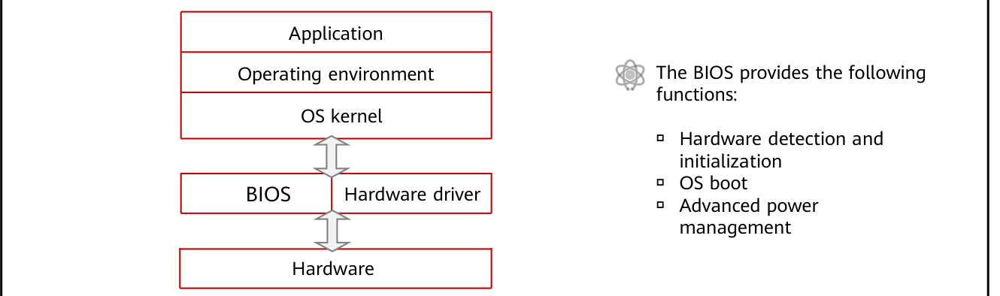
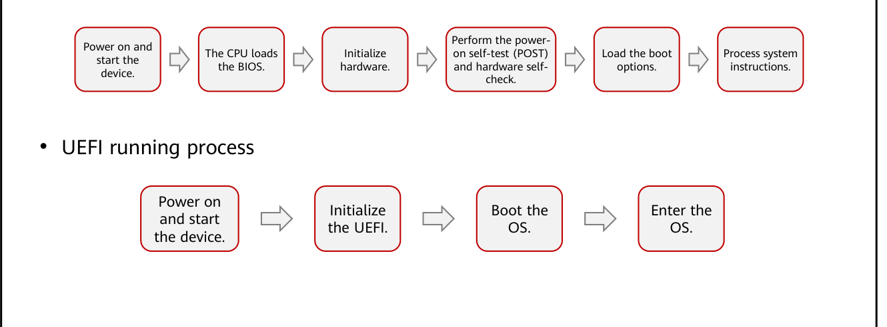
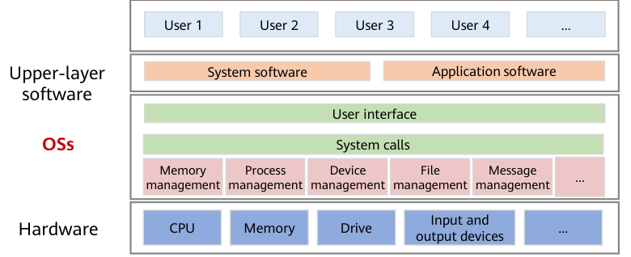
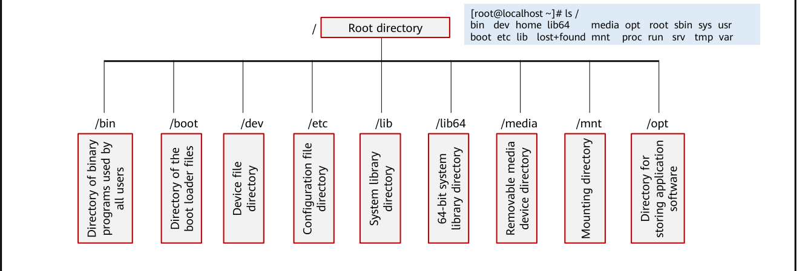

# BIOS vs. UEFI Boot Flows, OS Kernel/Shell & Linux Directory Tree

**Pillar:** HCIA-Computing V3.0 (Kunpeng & Server Ecosystem)  
**Schedule Block:** Hour 04 — RAID Arrays, PCIe Bus, NICs/iNICs, GPU/NPU, Power/Cooling & Server Software (Sprint 4 of 4)  
**Format:** Bite-Sized Lecture (8 mins) - Followed immediately by `08-Exercise-Linux-Root-Directory-Hierarchy-and-Boot-Flow-Lab` (7 mins)  
**Official Material Reference:** `HCIA-Computing V3.0 Training Material.pdf` — Ch.03, pp. 203–219

---

## Learning Objectives
- Compare conventional BIOS and UEFI features and step-by-step boot processes
- Understand OS User Space vs. Kernel Space (Applications/Shell -> Function Libraries -> System Calls -> Kernel)
- Master Unix/Linux history (Multics, Unix, BSD, GNU, MINIX, Linux 1991, openEuler 2019), POSIX.1, and every standard Linux root directory (`/bin` to `/opt`)

---

### 1. BIOS vs. UEFI Overview & Running Processes (pp. 204–206)
- **BIOS (Basic Input/Output System, p. 204)**: Embedded firmware bridging the OS kernel and hardware layer. Core functions: **Hardware detection and initialization**, **OS boot**, and **Advanced power management** (plus software upgrade/loading, basic OAM, serial port management, fault recovery, ECC management, hardware diagnosis).
- **UEFI (Unified Extensible Firmware Interface, p. 205)**: Defines a software interface between the OS and platform firmware as a modern alternative to legacy BIOS.
  - **Six Key UEFI Features**: **Large drive capacity** (GPT >2 TB), **High efficiency**, **64-bit system**, **Easy batch installation**, **Fast boot and recovery from hibernation**, and **Secure startup (Secure Boot)**.
- **Running Processes Comparison (p. 206)**:
  - **Conventional BIOS Process (6 steps)**: Power on & start device > CPU loads BIOS > Initialize hardware > Perform **POST** (Power-On Self-Test) & hardware self-check > Load boot options > Process system instructions.
  - **UEFI Process (4 steps)**: Power on & start device > Initialize UEFI > Boot the OS > Enter the OS.
<!-- PDF_FIGS_START -->

*Figure: Position of BIOS Between Hardware and Operating System (Official Reference: p. 204)*

*Figure: Conventional BIOS vs UEFI Running Process Flowchart (Official Reference: p. 206)*
<!-- PDF_FIGS_END -->

---

### 2. OS Architecture & Unix/Linux Evolution Timeline (pp. 208–218)
- **OS Layered Architecture (p. 210)**:
  - **User Space**: **Applications & Shells** (CLI command interpreter) > **Function Libraries** (encapsulate system calls for complex logic) > **System Calls** (kernel access interface).
  - **Kernel Space**: **Kernel** (manages CPU, memory, file system, processes, and device drivers).
- **Unix & Linux Historical Timeline (pp. 214, 217)**:
  - **1964**: Multics released > **1969**: First Unix > **1973**: C-based Unix v3 > **1977**: BSD > **1979**: Unix System V7 > **Sept 27, 1983 / 1984**: **Richard Stallman** announced **GNU Project** (*"GNU's Not Unix"*) > **1987**: **MINIX** (educational Unix-like OS) > **Sept/Oct 5, 1991**: **Linus Torvalds** (Univ. of Helsinki) released the first **Linux kernel** (10,000 lines of code) > **1993**: Slackware/Debian > **1994**: Red Hat/SUSE 1.0 > **2004**: Ubuntu > **2019**: **EulerOS open-sourced as openEuler**.
- **Linux Core Features (p. 218)**: Multi-platform, Multi-user & multitasking, Free/open-source (**GPL**), **Fully compatible with POSIX.1** (**IEEE 1003 / ISO/IEC 9945**), and **"Everything is a file"** (files, directories, character/block devices, sockets, printers, processes, pipes accessed via `fopen()`, `fclose()`, `fwrite()`, `fread()`).
<!-- PDF_FIGS_START -->

*Figure: OS Kernel Subsystems, System Calls and User Space (Official Reference: p. 208)*
<!-- PDF_FIGS_END -->

---

### 3. Linux File Directory Structure (`/`, p. 219)
| Directory | Official Function in HCIA-Computing (p. 219) |
| :--- | :--- |
| **`/bin`** | Short for **binary**; stores frequently used binary programs/commands used by all users. |
| **`/boot`** | Stores core files used for **starting (booting) the Linux OS**, including connection files and kernel image files. |
| **`/dev`** | Short for **device**; stores **peripheral device files** of Linux. |
| **`/etc`** | Stores all **configuration files** and subdirectories required for system management. |
| **`/lib` & `/lib64`** | Stores the system's most basic **dynamic link libraries (DLLs / shared libraries)** (32-bit and 64-bit). |
| **`/media`** | Removable media devices (USB flash drives, CD-ROMs) **automatically identified and mounted** by Linux. |
| **`/mnt`** | **Temporary mount point** for manual mounting of other file systems (e.g., mounting CD-ROM to `/mnt`). |
| **`/opt`** | Stores **additional third-party application software** installed on the host (e.g., Oracle installation packages); empty by default. |
<!-- PDF_FIGS_START -->

*Figure: Linux Root File Directory Structure Tree (Official Reference: p. 219)*
<!-- PDF_FIGS_END -->

---

## Key Takeaways
- **UEFI supports large drive capacity (>2 TB via GPT), 64-bit systems, fast boot, and secure startup, streamlining the 6-step legacy BIOS boot flow into 4 steps.**
- **OS call hierarchy from top to bottom: Applications & Shells -> Function Libraries -> System Calls -> Kernel -> Hardware.**
- **POSIX is IEEE 1003 / ISO/IEC 9945; GNU stands for 'GNU's Not Unix' (Richard Stallman, 1983); Linus Torvalds released Linux in 1991; EulerOS was open-sourced as openEuler in 2019.**
- **Know the exact Linux directories: /bin (binaries), /boot (boot loader/images), /dev (devices), /etc (config files), /lib & /lib64 (shared libraries), /media (auto-mounted removable media), /mnt (temporary manual mount point), /opt (additional application software).**

## Huawei ICT Competition National Stage Exam Traps
> [!WARNING]
> EXAM TRAP: Do not confuse `/media` (where Linux AUTOMATICALLY identifies and mounts removable USB/CD-ROM devices) with `/mnt` (TEMPORARY mount point used by administrators for manual mounting)!

> [!WARNING]
> EXAM TRAP: Unix is commercial closed-source software (AIX, HP-UX, Solaris) usually bound to specific hardware, whereas Linux is open-source (GPL) and runs across diverse hardware platforms.

---

### Next Step: Immediate Hands-On Exercise
Proceed immediately to **[`08-Exercise-Linux-Root-Directory-Hierarchy-and-Boot-Flow-Lab.html`](./08-Exercise-Linux-Root-Directory-Hierarchy-and-Boot-Flow-Lab.html)** (or [`08-Exercise-Linux-Root-Directory-Hierarchy-and-Boot-Flow-Lab.md`](./08-Exercise-Linux-Root-Directory-Hierarchy-and-Boot-Flow-Lab.md)) to apply this concept in an interactive lab workbench!
