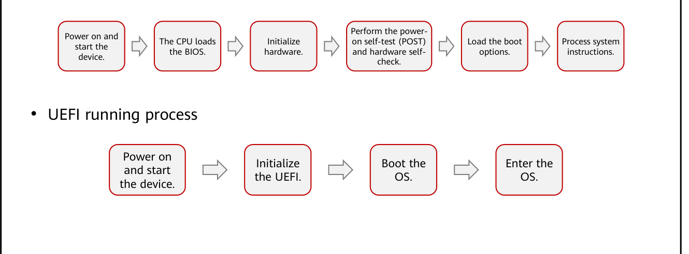
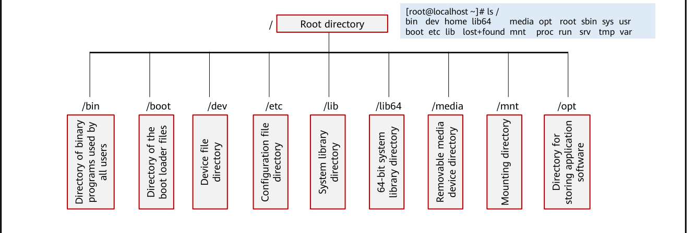

# Hands-On Lab: Linux Root Directory Inspection & OS Call Chain

**Pillar:** HCIA-Computing V3.0 (Kunpeng & Server Ecosystem)  
**Schedule Block:** Hour 04 — RAID Arrays, PCIe Bus, NICs/iNICs, GPU/NPU, Power/Cooling & Server Software (Sprint 4 of 4)  
**Format:** Immediate Hands-On Exercise (7 mins) — Paired with `07-Lecture-BIOS-vs-UEFI-and-Server-Operating-Systems`  
**Interactive Workbench:** Open **[`08-Exercise-Linux-Root-Directory-Hierarchy-and-Boot-Flow-Lab.html`](./08-Exercise-Linux-Root-Directory-Hierarchy-and-Boot-Flow-Lab.html)** or **[`../index.html`](../index.html)** for live execution & auto-grading!

---

## Part A: Practical Lab Scenario
Inspect the openEuler root filesystem (`/`) and verify the exact standard directories for configuration files, peripheral devices, temporary mounts, and third-party software packages.

<!-- PDF_FIGS_START -->
#### Reference Diagrams


*Figure: Conventional BIOS vs UEFI Running Process Flowchart (Official Reference: p. 206)*


*Figure: Linux Root File Directory Structure Tree (Official Reference: p. 219)*
<!-- PDF_FIGS_END -->

### Step-by-Step Instructions
1. Run `ls /` to list the top-level directories under the root filesystem.
2. Set `CONFIG_DIR` to `'/etc'`, `DEVICE_DIR` to `'/dev'`, `TEMP_MOUNT_DIR` to `'/mnt'`, and `THIRD_PARTY_APP_DIR` to `'/opt'`.
3. Set `POSIX_IEEE_STANDARD` to `'IEEE 1003'`.

### Starter Workspace (`root@openeuler:~#`)
```bash
# 1. List all directories under the root filesystem:
___

# 2. Map standard Linux directories and POSIX standard:
CONFIG_DIR="___"
DEVICE_DIR="___"
TEMP_MOUNT_DIR="___"
THIRD_PARTY_APP_DIR="___"
POSIX_IEEE_STANDARD="___"
```

<details>
<summary><strong>Click to View Hints</strong></summary>

- Use `ls /` to list the root directory.
- `/etc` holds configuration files, `/dev` holds device files, `/mnt` is the temporary manual mount directory, `/opt` holds additional application software, and POSIX is IEEE 1003.

</details>

<details>
<summary><strong>Click to Reveal Full Working Solution & Expected Output</strong></summary>

#### Solution Code / Commands:
```bash
# 1. List all directories under the root filesystem:
ls /

# 2. Map standard Linux directories and POSIX standard:
CONFIG_DIR="/etc"
DEVICE_DIR="/dev"
TEMP_MOUNT_DIR="/mnt"
THIRD_PARTY_APP_DIR="/opt"
POSIX_IEEE_STANDARD="IEEE 1003"
```

#### Expected Console / Query Output:
```text
bin   dev  home  lib64       media  opt   root  sbin  sys  usr
boot  etc  lib   lost+found  mnt    proc  run   srv   tmp  var
[OK] Linux root directory hierarchy and IEEE 1003 (POSIX.1) verified.
```
</details>

---

## Part B: National Stage Exam Verification Drill

### Question 1 [Single-Choice]
**In the Linux file directory structure, which directory stores all system management configuration files, and which directory is used to store additional third-party application software (such as an Oracle installation package)?**

- A. /bin (configuration files) and /lib (additional software)
- B. /etc (configuration files) and /opt (additional software)
- C. /dev (configuration files) and /mnt (additional software)
- D. /boot (configuration files) and /media (additional software)

<details>
<summary>[PASS] <strong>Check Answer & Explanation (Question 1)</strong></summary>

- **Correct Answer:** `B`
- **Explanation:** According to Ch.03 p.219, `/etc` stores all configuration files and subdirectories required for system management, and `/opt` stores additional application software installed on the host (empty by default).
</details>

### Question 2 [Multiple-Choice (Select ALL)]
**Which of the following are advantages and features of UEFI compared with conventional BIOS?**

- A. Supports large drive capacities and 64-bit systems
- B. High efficiency, fast boot, and fast recovery from hibernation
- C. Easy batch installation
- D. Secure startup (Secure Boot)

<details>
<summary>[PASS] <strong>Check Answer & Explanation (Question 2)</strong></summary>

- **Correct Answer:** `ABCD`
- **Explanation:** All four options list the official features of UEFI on Ch.03 p.205: Large drive capacity, High efficiency, 64-bit system, Easy batch installation, Fast boot and recovery from hibernation, and Secure startup.
</details>

### Question 3 [Single-Choice]
**Which of the following statements about Unix and Linux is FALSE?**

- A. Unix systems (such as IBM AIX and HP-UX) are commercial software and are usually compatible only with specific hardware.
- B. Linux is an open-source Unix-like OS whose kernel was first released by Linus Torvalds in 1991.
- C. Linux is fully compatible with the POSIX.1 standard (IEEE 1003 / ISO/IEC 9945) and follows the philosophy 'everything is a file'.
- D. EulerOS was open-sourced by Huawei in 1994 and renamed MINIX.

<details>
<summary>[PASS] <strong>Check Answer & Explanation (Question 3)</strong></summary>

- **Correct Answer:** `D`
- **Explanation:** D is false because EulerOS was open-sourced by Huawei in 2019 and named openEuler, whereas MINIX was released in 1987 as an educational Unix-like OS (Ch.03, pp. 214, 217).
</details>
