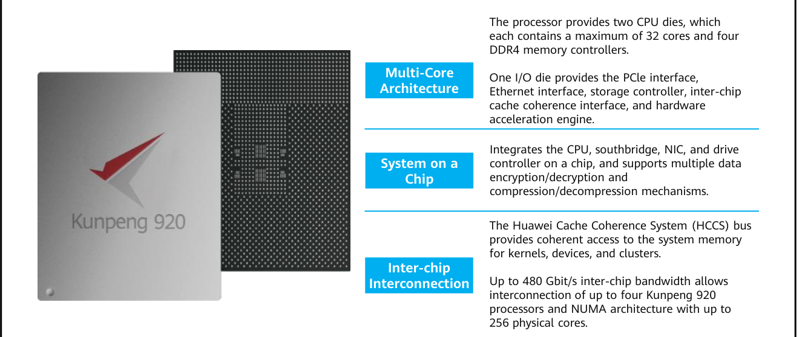

# Hands-On Lab: Kunpeng 920 Die/Cluster/Core Topology & HCCS Verification

**Pillar:** HCIA-Computing V3.0 (Kunpeng & Server Ecosystem)  
**Schedule Block:** Hour 05 — Huawei Kunpeng Processors, TaiShan Servers, openEuler/openGauss & HPC (Sprint 1 of 4)  
**Format:** Immediate Hands-On Exercise (7 mins) — Paired with `01-Lecture-Kunpeng-Processor-Evolution-and-Kunpeng-920-Architecture`  
**Interactive Workbench:** Open **[`02-Exercise-Kunpeng-920-Die-Cluster-Core-and-HCCS-Lab.html`](./02-Exercise-Kunpeng-920-Die-Cluster-Core-and-HCCS-Lab.html)** or **[`../index.html`](../index.html)** for live execution & auto-grading!

---

## Part A: Practical Lab Scenario
Write a Python script that models the internal die, cluster, core, and memory controller topology of a Kunpeng 920 processor and verifies HCCS 4-socket scaling.

<!-- PDF_FIGS_START -->
#### Reference Diagrams


*Figure: Kunpeng 920 Multi-Die Physical Chip Internal Architecture (Official Reference: p. 234)*


*Figure: Kunpeng 920 Dual CPU Dies, 8-Channel DDR4 and HCCS Interconnect (Official Reference: p. 237)*
<!-- PDF_FIGS_END -->

### Step-by-Step Instructions
1. Set `process_nm` to `7`, `cpu_dies` to `2`, and `io_dies` to `1` (total 3 dies).
2. Set `clusters_per_cpu_die` to `8`, `cores_per_cluster` to `4`, and `ddr4_controllers_per_cpu_die` to `4`.
3. Set `hccs_bandwidth_gbps` to `480` and `max_4p_physical_cores` to `256`.

### Starter Workspace (`python3@kunpeng-920:~$`)
```bash
# Kunpeng 920 SoC Topology Model
process_nm = ___
cpu_dies = ___
io_dies = ___
clusters_per_cpu_die = ___
cores_per_cluster = ___
ddr4_controllers_per_cpu_die = ___
hccs_bandwidth_gbps = ___
max_4p_physical_cores = ___

total_cores_1p = cpu_dies * clusters_per_cpu_die * cores_per_cluster
total_ddr4_channels = cpu_dies * ddr4_controllers_per_cpu_die
print(f"Kunpeng 920 ({process_nm}nm): {cpu_dies}+{io_dies} dies, {total_cores_1p} cores, {total_ddr4_channels}ch DDR4, HCCS {hccs_bandwidth_gbps}Gbps, 4P={max_4p_physical_cores} cores")
```

<details>
<summary><strong>Click to View Hints</strong></summary>

- Kunpeng 920 uses a 7nm process with 2 CPU dies and 1 I/O die.
- Each CPU die has 8 clusters × 4 cores = 32 cores and 4 DDR4 controllers; HCCS provides 480 Gbit/s bandwidth up to 256 cores across 4 sockets.

</details>

<details>
<summary><strong>Click to Reveal Full Working Solution & Expected Output</strong></summary>

#### Solution Code / Commands:
```bash
# Kunpeng 920 SoC Topology Model
process_nm = 7
cpu_dies = 2
io_dies = 1
clusters_per_cpu_die = 8
cores_per_cluster = 4
ddr4_controllers_per_cpu_die = 4
hccs_bandwidth_gbps = 480
max_4p_physical_cores = 256

total_cores_1p = cpu_dies * clusters_per_cpu_die * cores_per_cluster
total_ddr4_channels = cpu_dies * ddr4_controllers_per_cpu_die
print(f"Kunpeng 920 ({process_nm}nm): {cpu_dies}+{io_dies} dies, {total_cores_1p} cores, {total_ddr4_channels}ch DDR4, HCCS {hccs_bandwidth_gbps}Gbps, 4P={max_4p_physical_cores} cores")
```

#### Expected Console / Query Output:
```text
Kunpeng 920 (7nm): 2+1 dies, 64 cores, 8ch DDR4, HCCS 480Gbps, 4P=256 cores
[OK] Kunpeng 920 CoWoS 3-die architecture and HCCS interconnect verified.
```
</details>

---

## Part B: National Stage Exam Verification Drill

### Question 1 [Multiple-Choice (Select ALL)]
**(Official Ch.04 Quiz Q1) Which of the following statements are true about the Huawei Kunpeng 920 processor?**

- A. It adopts the 7 nm manufacturing process.
- B. It supports the 8-channel DDR4 controller.
- C. It supports the PCIe 4.0 interface and is compatible with PCIe 3.0/2.0/1.0.
- D. It supports multiple accelerators.

<details>
<summary>[PASS] <strong>Check Answer & Explanation (Question 1)</strong></summary>

- **Correct Answer:** `ABCD`
- **Explanation:** All four statements (ABCD) are true and come directly from the official Chapter 04 Quiz on p. 279.
</details>

### Question 2 [Single-Choice]
**How many dies are encapsulated in a single Kunpeng 920 processor, and how are its cores and clusters organized?**

- A. 1 monolithic die with 16 clusters of 4 cores each
- B. 3 dies (2 CPU dies + 1 I/O die); each CPU die has 8 clusters, and each cluster integrates 4 cores (up to 64 cores total)
- C. 4 CPU dies with 4 clusters of 4 cores each, and no I/O die
- D. 2 dies (1 CPU die + 1 GPU die) with 32 cores total

<details>
<summary>[PASS] <strong>Check Answer & Explanation (Question 2)</strong></summary>

- **Correct Answer:** `B`
- **Explanation:** According to Ch.04 pp. 234 and 237, Kunpeng 920 encapsulates 3 dies (two CPU dies for computing and one I/O die). Each CPU die has 8 clusters of 4 cores (up to 32 cores and 4 DDR4 controllers per CPU die).
</details>

### Question 3 [Single-Choice]
**Which Huawei-developed processor was released in 2016 as the industry's first Arm processor to support multiple sockets (and used in TaiShan 100 servers)?**

- A. K3
- B. Kunpeng 912 (Hi1612)
- C. Kunpeng 916
- D. Kunpeng 920

<details>
<summary>[PASS] <strong>Check Answer & Explanation (Question 3)</strong></summary>

- **Correct Answer:** `C`
- **Explanation:** According to Ch.04 pp. 233, 236, and 245, Kunpeng 912 (Hi1612, 2014) was the first 64-bit Arm processor; Kunpeng 916 (2016) was the industry's first multi-socket Arm processor (powering TaiShan 100); Kunpeng 920 (2019) was the first 7nm data center Arm processor (powering TaiShan 200).
</details>
