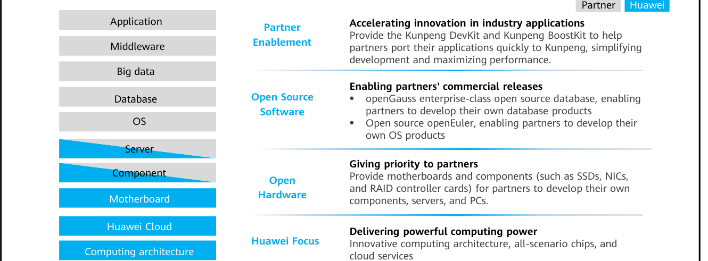
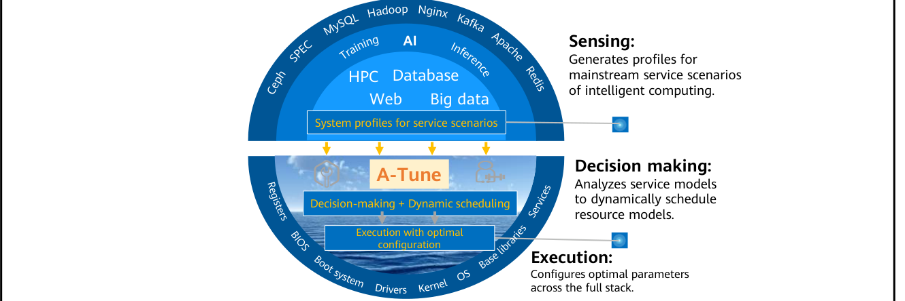

# Kunpeng Software Ecosystem: openEuler & openGauss

**Pillar:** HCIA-Computing V3.0 (Kunpeng & Server Ecosystem)  
**Schedule Block:** Hour 05 — Huawei Kunpeng Processors, TaiShan Servers, openEuler/openGauss & HPC (Sprint 3 of 4)  
**Format:** Bite-Sized Lecture (7 mins) - Followed immediately by `06-Exercise-openEuler-ATune-iSulad-and-openGauss-Lab` (8 mins)  
**Official Material Reference:** `HCIA-Computing V3.0 Training Material.pdf` — Ch.04, pp. 257–269

---

## Learning Objectives
- Understand Huawei's 16-word Kunpeng ecosystem strategy ('open hardware, open source software, partner enablement, and talent cultivation')
- Master openEuler history (2010 EulerOS -> Sept 2019 openEuler -> Nov 9, 2021 OpenAtom Foundation) and technical features (A-Tune, iSulad, Linux kernel 5.10, BiSheng Compiler)
- Master openGauss history (June 30, 2020 open source, Mulan PSL v2) and features (1.5M tpmC, NUMA-aware, SQL bypass, <10s failover, CRC page repair, fully-encrypted DB)

---

### 1. Kunpeng Ecosystem Strategy & openEuler Overview (pp. 258–260)
- **Kunpeng Ecosystem Strategy (p. 258)**: **"Open hardware, open source software, partner enablement, and talent cultivation."**
  - **Open Hardware**: Huawei provides motherboards and components (SSDs, NICs, RAID cards) and prioritizes partners developing their own servers/PCs.
  - **Open Source Software & Partner Enablement**: **openEuler** (OS), **openGauss** (database), **Kunpeng DevKit**, and **Kunpeng BoostKit**.
- **openEuler History (pp. 259–260)**:
  - Named after mathematician **Leonhard Euler**. Introduced as **EulerOS in 2010** (HPC project).
  - **September 2019**: EulerOS was officially open-sourced as **openEuler** (hosted on **Gitee**, docs at `https://www.openeuler.org/en/`).
  - **September 25, 2021**: Released as an open-source digital infrastructure OS covering **IT, CT, and OT** (server, cloud, edge, embedded).
  - **November 9, 2021**: Donated to the **OpenAtom Foundation**.
<!-- PDF_FIGS_START -->

*Figure: Kunpeng Open Hardware and Open Source Software Strategy (Official Reference: p. 258)*
<!-- PDF_FIGS_END -->

---

### 2. openEuler Key Technical Features (pp. 261–264)
- **A-Tune (AI-Driven Automatic Resource Optimization, p. 261)**: Uses non-intrusive system profiling and machine learning clustering/classification across 3 stages — **Sensing** (profiles workloads for Web, Big Data, AI, HPC, Database), **Decision making** (analyzes service models to dynamically schedule resource models), and **Execution** (applies optimal full-stack parameters in real time).
- **iSulad Container Solution (pp. 262–263)**: Unlike Docker (written in Golang), **iSulad** (written in C/C++) is a lightweight universal container engine for CT and IT with fast bootup, low memory overhead, trusted boot, and hitless upgrade. Supports 3 container deployment models:
  1. **Application containers**: Integrates **Moby 18.09** for user-defined apps.
  2. **Secure containers**: Essentially VMs encapsulated with container interfaces; integrates **Kata Containers 1.7** with heterogeneous compute and DPDK/SPDK support.
  3. **System containers**: Lightweight VM alternative isolating user namespaces with dynamic resource adjustment.
- **openEuler 22.03 LTS Features (p. 264)**: Built on **Linux kernel 5.10 LTS** (23M lines of new code); uses **systemd** (compatible with SysV init); supports **Kickstart** automated installation, **BiSheng Compiler** (C, C++, Fortran), and MySQL/Spark/Hive/HBase tuning.
<!-- PDF_FIGS_START -->

*Figure: openEuler A-Tune Sensing-Decision-Execution Closed Loop (Official Reference: p. 261)*
<!-- PDF_FIGS_END -->

---

### 3. openGauss Enterprise-Class Open Source Database (pp. 266–269)
- **Evolution & License (pp. 266–267)**: Internal incubation (2001–2011) \rightarrow Joint productization (2011–2019) \rightarrow **GaussDB global release on May 15, 2019** \rightarrow **openGauss open-sourced on June 30, 2020** under the **Mulan Permissive Software License v2 (Mulan PSL v2)**.
- **Four Core Strengths of openGauss (pp. 268–269)**:
  1. **Superb Performance**: Multi-core concurrency control + Kunpeng optimization reaching **1,500,000 tpmC (1.5M tpmC)** TPC-C benchmark on a **Kunpeng 2-socket server**; **NUMA-aware data structures** in the kernel; **SQL bypass** intelligent engine.
  2. **Constant Availability**: Primary/standby sync, async, and **cascaded standby** deployment; **Data page CRC check** with automatic damaged-page restoration from standby; parallel recovery promoting **standby to primary within 10 seconds (`< 10s` RTO)**.
  3. **Rocksolid Security**: **Fully-encrypted computing**, access control, encryption authentication, database audit, and dynamic data masking.
  4. **Easy O&M**: AI-based parameter tuning, index recommendation, slow SQL diagnosis, and online auto-learning SQL execution time forecasting.

---

## Key Takeaways
- **openEuler timeline: 2010 EulerOS -> Sept 2019 open-sourced as openEuler -> Nov 9, 2021 donated to OpenAtom Foundation. openEuler 22.03 LTS uses Linux kernel 5.10.**
- **A-Tune optimizes system resources through Sensing, Decision making, and Execution. iSulad supports Application containers (Moby), Secure containers (Kata Containers), and System containers.**
- **openGauss went open source on June 30, 2020 under the Mulan Permissive Software License v2 (Mulan PSL v2).**
- **openGauss achieves 1.5M tpmC on a 2-socket Kunpeng server, uses NUMA-aware data structures and SQL bypass, repairs damaged pages via CRC + standby node, and fails over to standby within 10 seconds.**

## Huawei ICT Competition National Stage Exam Traps
> [!WARNING]
> EXAM TRAP: Do not confuse the open-source dates: openEuler was open-sourced in September 2019 (donated to OpenAtom Foundation in Nov 2021), while openGauss was open-sourced on June 30, 2020 (under Mulan PSL v2)!

> [!WARNING]
> EXAM TRAP: In openEuler iSulad, Application containers use Moby 18.09, whereas Secure containers use Kata Containers 1.7 (which are essentially VMs with container interfaces).

---

### Next Step: Immediate Hands-On Exercise
Proceed immediately to **[`06-Exercise-openEuler-ATune-iSulad-and-openGauss-Lab.html`](./06-Exercise-openEuler-ATune-iSulad-and-openGauss-Lab.html)** (or [`06-Exercise-openEuler-ATune-iSulad-and-openGauss-Lab.md`](./06-Exercise-openEuler-ATune-iSulad-and-openGauss-Lab.md)) to apply this concept in an interactive lab workbench!
