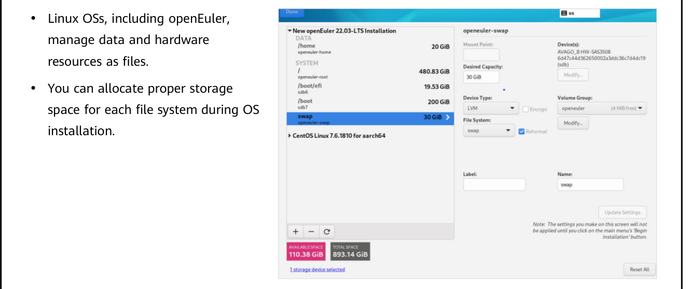

# Hands-On Lab: Virtual DVD-ROM Mounting & openEuler 22.03 LTS Partitioning

**Pillar:** HCIA-Computing V3.0 (Kunpeng & Server Ecosystem)  
**Schedule Block:** Hour 07 — OS Compatibility, openEuler 22.03 LTS Installation, Drivers/Firmware & Service Deployment (Sprint 1 of 4)  
**Format:** Immediate Hands-On Exercise (7 mins) — Paired with `01-Lecture-OS-Compatibility-and-openEuler-2203-LTS-Installation`  
**Interactive Workbench:** Open **[`02-Exercise-Mounting-ISO-and-openEuler-Partitioning-Lab.html`](./02-Exercise-Mounting-ISO-and-openEuler-Partitioning-Lab.html)** or **[`../index.html`](../index.html)** for live execution & auto-grading!

---

## Part A: Practical Lab Scenario
Configure the Kickstart/Anaconda installation parameters for deploying `openEuler-22.03-LTS-aarch64-dvd.iso` on a TaiShan 200 (2280) server via the iBMC Remote Virtual Console.

<!-- PDF_FIGS_START -->
#### Reference Diagrams


*Figure: openEuler Drive Partitioning Scheme on TaiShan 2280 (Official Reference: p. 332)*
<!-- PDF_FIGS_END -->

### Step-by-Step Instructions
1. Set `iso_boot_option` to `'DVD-ROM drive'` and `iso_filename` to `'openEuler-22.03-LTS-aarch64-dvd.iso'`.
2. Set `manual_partition_mode` to `'Custom'`.
3. Specify the EFI partition mount point as `'/boot/efi'` and root partition mount point as `'/'`.

### Starter Workspace (`anaconda@openeuler-installer:~#`)
```bash
# openEuler 22.03 LTS AArch64 Installation Spec
virtual_media_boot:
  iso_filename: "___"
  iso_boot_option: "___"
  post_install_action: "Reboot and ISO file detachment"

storage_partitioning:
  default_partition_mode: "Automatic"
  manual_partition_mode: "___"
  mount_points:
    - "___"
    - "/boot"
    - "swap"
    - "___"
```

<details>
<summary><strong>Click to View Hints</strong></summary>

- Mounting `openEuler-22.03-LTS-aarch64-dvd.iso` uses the 'DVD-ROM drive' boot option (Ch.05 Quiz Q1).
- Manual partitioning is enabled by choosing 'Custom' under Storage Configuration, with `/boot/efi`, `/boot`, `swap`, and `/`.

</details>

<details>
<summary><strong>Click to Reveal Full Working Solution & Expected Output</strong></summary>

#### Solution Code / Commands:
```bash
# openEuler 22.03 LTS AArch64 Installation Spec
virtual_media_boot:
  iso_filename: "openEuler-22.03-LTS-aarch64-dvd.iso"
  iso_boot_option: "DVD-ROM drive"
  post_install_action: "Reboot and ISO file detachment"

storage_partitioning:
  default_partition_mode: "Automatic"
  manual_partition_mode: "Custom"
  mount_points:
    - "/boot/efi"
    - "/boot"
    - "swap"
    - "/"
```

#### Expected Console / Query Output:
```text
[OK] openEuler 22.03 LTS Installation Configuration Verified:
- Boot Option: DVD-ROM drive (openEuler-22.03-LTS-aarch64-dvd.iso)
- Storage Configuration: Custom (/boot/efi, /boot, swap, /)
- Post-Install: Reboot and ISO file detachment.
```
</details>

---

## Part B: National Stage Exam Verification Drill

### Question 1 [Single-Choice]
**(Official Ch.05 Quiz Q1) To install the OS using the openEuler-22.03-LTS-aarch64-dvd.iso file, which of the following boot options needs to be used?**

- A. Hard disk drive
- B. DVD-ROM drive
- C. Floppy drive
- D. PXE

<details>
<summary>[PASS] <strong>Check Answer & Explanation (Question 1)</strong></summary>

- **Correct Answer:** `B`
- **Explanation:** According to Ch.05 p.329 and p.346 Quiz Q1, when mounting an ISO image (`openEuler-22.03-LTS-aarch64-dvd.iso`) via the virtual console, you must select the DVD-ROM drive boot option.
</details>

### Question 2 [Single-Choice]
**Before installing an operating system on a TaiShan 200 (model 2280) server, which two types of compatibility must be verified using the Kunpeng Computing Compatibility Checker?**

- A. Only cabinet color and room lighting compatibility
- B. OS compatibility and component compatibility
- C. Browser font and mouse pad compatibility
- D. Only PS/2 keyboard compatibility

<details>
<summary>[PASS] <strong>Check Answer & Explanation (Question 2)</strong></summary>

- **Correct Answer:** `B`
- **Explanation:** According to Ch.05 pp. 327–328, before installing an OS on a server, you must check the OS compatibility and component compatibility of the server using the Kunpeng Computing Compatibility Checker.
</details>

### Question 3 [True / False]
**During openEuler 22.03 LTS installation, drive partitions are configured automatically by default, and you can select 'Custom' under Storage Configuration if manual partitioning is required.**

- A. True
- B. False

<details>
<summary>[PASS] <strong>Check Answer & Explanation (Question 3)</strong></summary>

- **Correct Answer:** `A`
- **Explanation:** True. According to Ch.05 p.331, partitions are configured automatically by default, and you can choose 'Custom' under Storage Configuration for manual partitioning.
</details>
