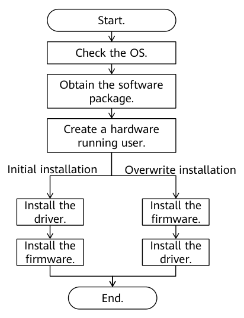

# Hands-On Lab: Driver & Firmware Installation Workflow Sequencer

**Pillar:** HCIA-Computing V3.0 (Kunpeng & Server Ecosystem)  
**Schedule Block:** Hour 07 — OS Compatibility, openEuler 22.03 LTS Installation, Drivers/Firmware & Service Deployment (Sprint 2 of 4)  
**Format:** Immediate Hands-On Exercise (8 mins) — Paired with `03-Lecture-Differences-Between-Drivers-and-Firmware-and-Installation`  
**Interactive Workbench:** Open **[`04-Exercise-Initial-vs-Overwrite-Driver-Firmware-Install-Lab.html`](./04-Exercise-Initial-vs-Overwrite-Driver-Firmware-Install-Lab.html)** or **[`../index.html`](../index.html)** for live execution & auto-grading!

---

## Part A: Practical Lab Scenario
You are writing an automated Ansible playbook for TaiShan 200 accelerator/NIC cards that handles both Initial Installation and Overwrite Installation according to Huawei's official Ch.05 p.335 flowchart.

<!-- PDF_FIGS_START -->
#### Reference Diagrams


*Figure: Driver and Firmware Initial vs Overwrite Installation Decision Flow (Official Reference: p. 335)*
<!-- PDF_FIGS_END -->

### Step-by-Step Instructions
1. Set `driver_serves` to `'software'` and `firmware_serves` to `'hardware'` (stored in `'ROM'`).
2. For `initial_installation_order`, specify `['Install the driver', 'Install the firmware']`.
3. For `overwrite_installation_order`, specify `['Install the firmware', 'Install the driver']`.

### Starter Workspace (`root@openeuler-node:~#`)
```bash
# Driver vs. Firmware Installation Playbook Spec (Ch.05 p.335)
concepts:
  driver_serves: "___"
  firmware_serves: "___"
  firmware_storage_medium: "___"
  install_privilege_required: "root"

workflows:
  common_pre_steps:
    - "Check the OS"
    - "Obtain the software package"
    - "Create a hardware running user"
  initial_installation_order:
    - "___"
    - "___"
  overwrite_installation_order:
    - "___"
    - "___"
```

<details>
<summary><strong>Click to View Hints</strong></summary>

- Drivers serve software; firmware serves hardware and is pre-installed in ROM.
- Initial installation installs the driver first, then the firmware; Overwrite installation installs the firmware first, then the driver (p. 335).

</details>

<details>
<summary><strong>Click to Reveal Full Working Solution & Expected Output</strong></summary>

#### Solution Code / Commands:
```bash
# Driver vs. Firmware Installation Playbook Spec (Ch.05 p.335)
concepts:
  driver_serves: "software"
  firmware_serves: "hardware"
  firmware_storage_medium: "ROM"
  install_privilege_required: "root"

workflows:
  common_pre_steps:
    - "Check the OS"
    - "Obtain the software package"
    - "Create a hardware running user"
  initial_installation_order:
    - "Install the driver"
    - "Install the firmware"
  overwrite_installation_order:
    - "Install the firmware"
    - "Install the driver"
```

#### Expected Console / Query Output:
```text
[OK] Driver & Firmware Installation Workflows Validated (Ch.05 p.335):
- Common Pre-Steps: Check OS -> Obtain Package -> Create Hardware Running User
- Initial Installation: [1] Install the driver -> [2] Install the firmware
- Overwrite Installation: [1] Install the firmware -> [2] Install the driver.
```
</details>

---

## Part B: National Stage Exam Verification Drill

### Question 1 [Single-Choice]
**According to the Driver and Firmware Installation flowchart in Chapter 05 (p. 335), what is the correct installation sequence for 'Initial installation' versus 'Overwrite installation' after creating a hardware running user?**

- A. Initial installation: Install firmware then driver; Overwrite installation: Install driver then firmware
- B. Initial installation: Install driver then firmware; Overwrite installation: Install firmware then driver
- C. Both Initial and Overwrite installations must always install firmware before the driver
- D. Both Initial and Overwrite installations must always install the driver before firmware

<details>
<summary>[PASS] <strong>Check Answer & Explanation (Question 1)</strong></summary>

- **Correct Answer:** `B`
- **Explanation:** According to the official flowchart on Ch.05 p.335, Initial installation installs the driver first and then the firmware; Overwrite installation installs the firmware first and then the driver.
</details>

### Question 2 [Multiple-Choice (Select ALL)]
**Which of the following statements accurately describe the differences between device drivers and firmware?**

- A. Drivers serve software and act as 'bridges between hardware and OSs', whereas firmware serves hardware.
- B. Firmware is pre-installed in the ROM of a hardware product and operates independently of the OS.
- C. While installing a driver and firmware requires root privileges, once installed they can be used by a non-root user to achieve permission isolation.
- D. If driver customization is required, you must reconstruct the driver package and install it.

<details>
<summary>[PASS] <strong>Check Answer & Explanation (Question 2)</strong></summary>

- **Correct Answer:** `ABCD`
- **Explanation:** All four statements come directly from Ch.05 pp. 334–335.
</details>

### Question 3 [Single-Choice]
**Under what condition can a binary driver file be used directly for installation without compiling from source code or reconstructing the driver package?**

- A. Only when driver customization is required
- B. When driver customization is not required and the OS kernel in the environment is in the version mapping table
- C. Only on Windows 95 systems
- D. Never; Linux does not support binary driver files

<details>
<summary>[PASS] <strong>Check Answer & Explanation (Question 3)</strong></summary>

- **Correct Answer:** `B`
- **Explanation:** According to Ch.05 p.335, if driver customization is not required and the kernel in the environment is in the version mapping table, you can use the binary driver file for installation.
</details>
