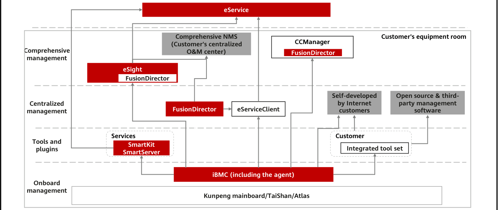
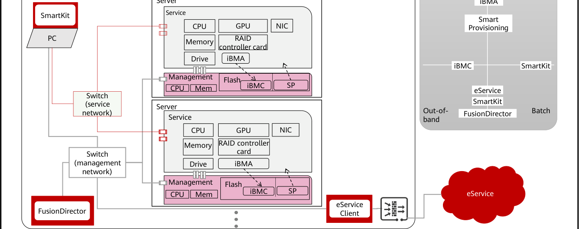
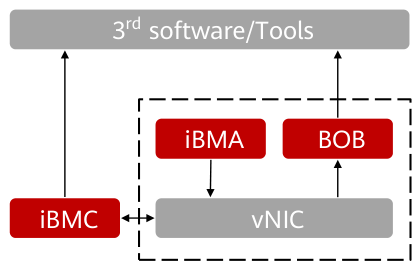
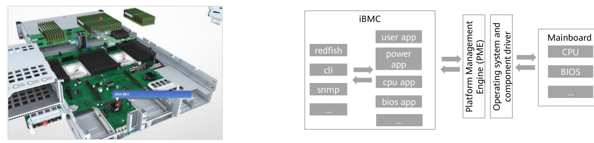
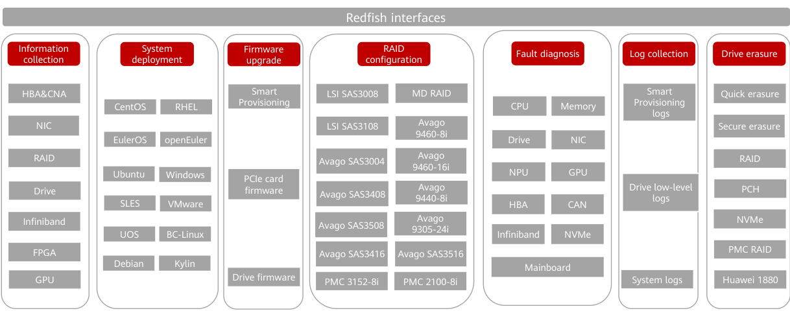

# Computing O&M Architecture & Single-Node Management (iBMA, iBMC, Smart Provisioning)

**Pillar:** HCIA-Computing V3.0 (Kunpeng & Server Ecosystem)  
**Schedule Block:** Hour 08 — Basic O&M of Computing Products: iBMA, iBMC, Smart Provisioning, FusionDirector, eSight, SmartKit & eService (Sprint 1 of 4)  
**Format:** Bite-Sized Lecture (8 mins) - Followed immediately by `02-Exercise-Single-Node-OM-iBMA-BOB-and-Smart-Provisioning-Lab` (7 mins)  
**Official Material Reference:** `HCIA-Computing V3.0 Training Material.pdf` — Ch.06, pp. 354–376

---

## Learning Objectives
- Map each Huawei O&M tool to its exact target scenario and persona (iBMC, iBMA, Smart Provisioning, SmartKit, FusionDirector, eSight, CCManager, eService)
- Distinguish In-Band Management (iBMA + BOB `bobCmd`) from Out-of-Band Management (iBMC on Hi1710/Hi1711 RTOS)
- Master all 6 functions of Smart Provisioning (OS installation, RAID config, Upgrade, Hardware diagnosis, Log collection, Fast vs. Secure Drive erasure)

---

### 1. Evolution & Overall Architecture of Huawei Computing O&M Software (pp. 355–358)
- **Four Evolution Phases of O&M Software (p. 355)**:
  `Manual configuration + Scripts` \rightarrow `Tools` \rightarrow `Automation` \rightarrow `Intelligence` (Note: Intelligence is the ultimate goal, **but the tool-based and automated phases CANNOT be skipped**!).

| Huawei O&M Product | Positioning & Target Scenario / Customer (pp. 356–358) |
| :--- | :--- |
| **iBMC** | **Single-node out-of-band** onboard management controller (basis of all computing O&M; runs on **Hi1710/Hi1711** Arm chip + RTOS + PME). |
| **iBMA 2.0** | **Single-node in-band** management agent running on the host OS; communicates with iBMC via **vNIC** and **BOB**. |
| **Smart Provisioning (SP)** | **Single-node out-of-band extension** of iBMC running a diskless mini-system from iBMC flash in service memory (no CD-ROM needed). |
| **SmartKit** | **Local O&M batch toolbox** installed on **service engineers' laptops** for onsite delivery, maintenance, upgrade, and troubleshooting. |
| **FusionDirector** | **Centralized management platform** for **enterprise customers** (routine server monitoring, batch O&M, and 5 Intelligent Features). |
| **eSight** | **Cross-domain centralized ICT management** for **large-sized customers / carriers** (manages servers, storage, switches, routers, firewalls, WLAN, PON, cameras). |
| **CCManager** | **Cross-stack and cross-domain** management for **data centers**. |
| **eService** | **24/7 Remote O&M platform** for **long-tail customers** (small device counts, unwilling to invest in dedicated O&M; provides **Call Home**). |
| **HMM / IES** | **HMM** (*Hyper Management Module* for X6800/E9000 chassis power/fan/IPMI 2.0); **IES** (*Intelligent Edge System* for Atlas 500 edge station). |
<!-- PDF_FIGS_START -->

*Figure: Overall Architecture of Huawei Computing O&M Software (Official Reference: p. 356)*

*Figure: Computing O&M In-Band and Out-of-Band Deployment Scenarios (Official Reference: p. 357)*
<!-- PDF_FIGS_END -->

---

### 2. Single-Node In-Band (`iBMA`) vs. Out-of-Band (`iBMC`) Management (pp. 359–370)
- **In-Band vs. Out-of-Band Definition (p. 359)**: **In-band management** transmits both network management control info and user carrier service traffic through a **single logical channel**; **Out-of-band management** uses **separate dedicated channels** for each.
- **iBMA & BOB Forwarding Modes (pp. 360–361)**:
  - **Two Data Transmission Paths**: (1) `iBMA --> vNIC --> iBMC --> 3rd-party tool`, or (2) `iBMA --> vNIC --> iBMC --> vNIC --> BOB --> 3rd-party tool`.
  - **BOB (*BMC Out-of-Band*)**: Forwarding tool enabling a remote host on the in-band network to communicate with the local iBMC (via SSH, IPMI, HTTPS, SNMP traps). Managed via **`bobCmd`** CLI (persistent online configuration, does not support independent deployment).
  - **Key iBMA Functions (p. 361)**: System info (OS, NIC, IB, drive, RAID), file upload & driver/software upgrade via Redfish, iBMC event dump to OS logs, NIC config tracing (`log/ethtool_log`), Mellanox NIC internal error detection (`log/common.log`), storage diagnosis (Sense Code, MD SoftRAID), **Memory soft isolation** of faulty physical memory pages via Redfish, and **black box**.
- **iBMC Six WebUI Menus (pp. 363–370)**: **Home**, **System Info**, **Maintenance** (alarms, video/screenshots, PCIe/black box/serial logs, iBMC logs), **User & Security** (Local users, LDAP, Kerberos, 2FA, SSL), **Services** (Port, Web, KVM, Virtual Media, VNC, SNMP), and **iBMC Settings** (Firmware upgrade, Network, iBMA, Smart Provisioning). *Note: Deploying an OS through Redfish requires an **iBMC Advanced Edition license** (p. 364)!*
<!-- PDF_FIGS_START -->

*Figure: iBMA and BOB In-Band vs Out-of-Band Communication Paths (Official Reference: p. 360)*

*Figure: iBMC Embedded Chip (Hi1710/Hi1711) and Software Stack (Official Reference: p. 363)*
<!-- PDF_FIGS_END -->

---

### 3. Smart Provisioning (SP) Six Functions (pp. 371–376)
1. **OS Installation**: UEFI mode; **Recommended** and **Customized** methods for CentOS, EulerOS, openEuler, Ubuntu, SLES, RHEL, Kylin, UOS, BC-Linux, Debian, Windows, VMware.
2. **RAID Configuration**: Hardware RAID (LSI SAS3008/3108, Avago SAS3408/3508/3416, MegaRAID 9440/9460/9560) and **Software RAID**.
3. **Upgrade**: Upgrades **in-band firmware** (**PCIe card firmware** such as RAID/NIC cards and **SAS/SATA/NVMe drive firmware**) plus **Smart Provisioning firmware**.
4. **Toolbox — Hardware Diagnosis**: Diagnoses **processors (CPU), memory, drives, and NICs**.
5. **Toolbox — Log Collection**: Drive low-level logs (Toshiba/HGST), system logs, and Smart Provisioning logs.
6. **Toolbox — Drive Erasure**:
   - **Fast mode**: Erases **partitions of a logical drive**.
   - **Secure mode**: Erases **all data on a physical drive**.
<!-- PDF_FIGS_START -->

*Figure: Smart Provisioning Embedded Capabilities Block Diagram (Official Reference: p. 371)*
<!-- PDF_FIGS_END -->

---

## Key Takeaways
- **In-band management shares a single logical channel with user service traffic (iBMA + BOB); out-of-band management uses a dedicated management channel (iBMC + Smart Provisioning).**
- **iBMA provides two transmission paths (`iBMA->vNIC->iBMC->3rd` and `iBMA->vNIC->iBMC->vNIC->BOB->3rd`), uses `bobCmd` for BOB CLI, traces ethtool in `log/ethtool_log`, and supports soft isolation of faulty physical memory pages over Redfish.**
- **Deploying an OS via Redfish requires the iBMC Advanced Edition license.**
- **Smart Provisioning runs a small system in service memory from iBMC flash and provides 6 functions: OS installation (UEFI only), RAID configuration, Firmware upgrade (PCIe cards, drives, SP), Hardware diagnosis (CPU, memory, drive, NIC), Log collection, and Drive erasure (Fast = logical drive partitions; Secure = all data on physical drive).**

## Huawei ICT Competition National Stage Exam Traps
> [!WARNING]
> EXAM TRAP: In Smart Provisioning Drive Erasure (p. 376), 'Fast mode' erases partitions of a LOGICAL drive, whereas 'Secure mode' erases all data on a PHYSICAL drive!

> [!WARNING]
> EXAM TRAP: Smart Provisioning only supports OS installation in UEFI mode (not Legacy BIOS MBR mode) (p. 373).

---

### Next Step: Immediate Hands-On Exercise
Proceed immediately to **[`02-Exercise-Single-Node-OM-iBMA-BOB-and-Smart-Provisioning-Lab.html`](./02-Exercise-Single-Node-OM-iBMA-BOB-and-Smart-Provisioning-Lab.html)** (or [`02-Exercise-Single-Node-OM-iBMA-BOB-and-Smart-Provisioning-Lab.md`](./02-Exercise-Single-Node-OM-iBMA-BOB-and-Smart-Provisioning-Lab.md)) to apply this concept in an interactive lab workbench!
