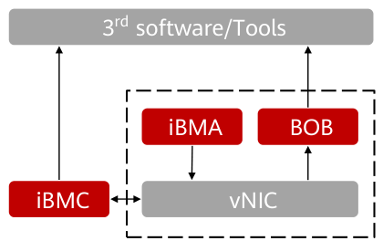

# Hands-On Lab: Single-Node O&M (iBMA, iBMC & Smart Provisioning) Configuration

**Pillar:** HCIA-Computing V3.0 (Kunpeng & Server Ecosystem)  
**Schedule Block:** Hour 08 — Basic O&M of Computing Products: iBMA, iBMC, Smart Provisioning, FusionDirector, eSight, SmartKit & eService (Sprint 1 of 4)  
**Format:** Immediate Hands-On Exercise (7 mins) — Paired with `01-Lecture-Computing-OM-Architecture-iBMA-iBMC-and-Smart-Provisioning`  
**Interactive Workbench:** Open **[`02-Exercise-Single-Node-OM-iBMA-BOB-and-Smart-Provisioning-Lab.html`](./02-Exercise-Single-Node-OM-iBMA-BOB-and-Smart-Provisioning-Lab.html)** or **[`../index.html`](../index.html)** for live execution & auto-grading!

---

## Part A: Practical Lab Scenario
Configure the single-node O&M mapping for iBMA, BOB, iBMC Advanced Edition, and Smart Provisioning toolbox operations.

<!-- PDF_FIGS_START -->
#### Reference Diagrams


*Figure: iBMA and BOB In-Band vs Out-of-Band Communication Paths (Official Reference: p. 360)*
<!-- PDF_FIGS_END -->

### Step-by-Step Instructions
1. Set `bob_cli_command` to `'bobCmd'` and `redfish_os_deploy_license` to `'Advanced Edition'`.
2. Set `sp_fast_erase_target` to `'partitions of a logical drive'` and `sp_secure_erase_target` to `'all data on a physical drive'`.
3. Set `ibmc_arm_chip` to `'Hi1710'`.

### Starter Workspace (`om-eng@taishan-node:~#`)
```bash
# Single-Node Management (iBMA, iBMC, Smart Provisioning)
in_band_ibma:
  bob_cli_command: "___"
  nic_trace_dir: "log/ethtool_log"
  mellanox_error_log: "log/common.log"

out_of_band_ibmc_sp:
  ibmc_arm_chip: "___"
  redfish_os_deploy_license: "___"
  sp_os_boot_mode: "UEFI"
  sp_fast_erase_target: "___"
  sp_secure_erase_target: "___"
```

<details>
<summary><strong>Click to View Hints</strong></summary>

- BOB provides the `bobCmd` CLI; Redfish OS deployment requires the iBMC Advanced Edition license.
- Smart Provisioning Fast erasure erases 'partitions of a logical drive', while Secure erasure erases 'all data on a physical drive'.

</details>

<details>
<summary><strong>Click to Reveal Full Working Solution & Expected Output</strong></summary>

#### Solution Code / Commands:
```bash
# Single-Node Management (iBMA, iBMC, Smart Provisioning)
in_band_ibma:
  bob_cli_command: "bobCmd"
  nic_trace_dir: "log/ethtool_log"
  mellanox_error_log: "log/common.log"

out_of_band_ibmc_sp:
  ibmc_arm_chip: "Hi1710"
  redfish_os_deploy_license: "Advanced Edition"
  sp_os_boot_mode: "UEFI"
  sp_fast_erase_target: "partitions of a logical drive"
  sp_secure_erase_target: "all data on a physical drive"
```

#### Expected Console / Query Output:
```text
[OK] Single-Node O&M Configuration Verified:
- iBMA 2.0: In-band agent | BOB CLI: bobCmd | Memory Soft Isolation via Redfish
- iBMC: Out-of-band (Hi1710/Hi1711 + RTOS + PME) | Advanced Edition License -> Redfish OS Deploy
- Smart Provisioning: UEFI OS Install, RAID Config, Upgrade, Diagnosis, Logs, Drive Erasure (Fast=Logical, Secure=Physical).
```
</details>

---

## Part B: National Stage Exam Verification Drill

### Question 1 [Single-Choice]
**What is the technical difference between in-band management and out-of-band management in server O&M?**

- A. In-band management transmits both management control information and user service traffic through a single logical channel, while out-of-band management uses separate channels for each.
- B. Out-of-band management shares the service NIC and OS kernel, while in-band management uses a dedicated physical management port.
- C. In-band management can operate when the server OS crashes or the server is powered off.
- D. Out-of-band management is implemented exclusively by iBMA without iBMC.

<details>
<summary>[PASS] <strong>Check Answer & Explanation (Question 1)</strong></summary>

- **Correct Answer:** `A`
- **Explanation:** According to Ch.06 pp. 359 and 362, in-band management transmits both network management control information and carrier service information through a single logical channel, whereas out-of-band management uses separate channels for each.
</details>

### Question 2 [Single-Choice]
**In the Smart Provisioning Toolbox's Drive Erasure function (Ch.06, p. 376), what is the difference between 'Fast mode' and 'Secure mode'?**

- A. Fast mode erases all data on a physical drive; Secure mode erases only the BIOS boot sector.
- B. Fast mode erases partitions of a logical drive; Secure mode erases all data on a physical drive.
- C. Fast mode formats only USB drives; Secure mode formats only CD-ROMs.
- D. There is no difference between Fast mode and Secure mode.

<details>
<summary>[PASS] <strong>Check Answer & Explanation (Question 2)</strong></summary>

- **Correct Answer:** `B`
- **Explanation:** According to Ch.06 p.376, Fast mode erases partitions of a logical drive, while Secure mode erases all data on a physical drive.
</details>

### Question 3 [Multiple-Choice (Select ALL)]
**Which of the following functions are supported by Huawei's in-band management agent iBMA 2.0 (Ch.06, p. 361)?**

- A. Obtaining OS, NIC, IB card, drive, and RAID controller card information and reporting it to iBMC
- B. Allowing soft isolation over the Redfish interface to be performed on physical memory pages where the OS is faulty
- C. Dumping iBMC events to system log files on Linux/Windows and providing a black box function
- D. Forwarding in-band requests to the local iBMC via BOB (managed using the bobCmd CLI)

<details>
<summary>[PASS] <strong>Check Answer & Explanation (Question 3)</strong></summary>

- **Correct Answer:** `ABCD`
- **Explanation:** All four functions are explicitly listed in the iBMA Functions table on Ch.06 pp. 360–361.
</details>
