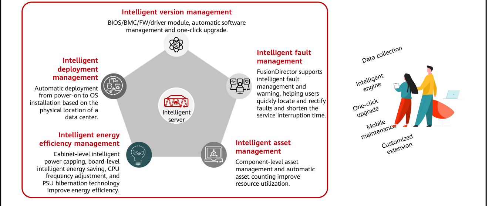

# Hands-On Lab: FusionDirector Batch Provisioning & Intelligent Policy Config

**Pillar:** HCIA-Computing V3.0 (Kunpeng & Server Ecosystem)  
**Schedule Block:** Hour 08 — Basic O&M of Computing Products: iBMA, iBMC, Smart Provisioning, FusionDirector, eSight, SmartKit & eService (Sprint 2 of 4)  
**Format:** Immediate Hands-On Exercise (8 mins) — Paired with `03-Lecture-Centralized-Management-FusionDirector-and-Five-Intelligent-Features`  
**Interactive Workbench:** Open **[`04-Exercise-FusionDirector-Device-Adding-and-Intelligent-Features-Lab.html`](./04-Exercise-FusionDirector-Device-Adding-and-Intelligent-Features-Lab.html)** or **[`../index.html`](../index.html)** for live execution & auto-grading!

---

## Part A: Practical Lab Scenario
Configure FusionDirector batch management limits, Server Profile lifecycle constraints, and OS deployment parameters for a Kunpeng data center.

<!-- PDF_FIGS_START -->
#### Reference Diagrams


*Figure: FusionDirector Five Intelligent Management Features (Official Reference: p. 382)*
<!-- PDF_FIGS_END -->

### Step-by-Step Instructions
1. Set `max_log_export_servers` to `100` and `max_concurrent_os_deployments` to `30` (with `os_deploy_timeout_hours: 2`).
2. Set `ssdp_discovery_network_requirement` to `'L2'`.
3. Set `delete_profile_condition` to `'not bound'` and `modify_profile_condition` to `'not applied'`.

### Starter Workspace (`admin@fusiondirector:~#`)
```bash
# FusionDirector Batch & Intelligent Deployment Policy
batch_limits:
  max_log_export_servers: ___
  max_concurrent_os_deployments: ___
  os_deploy_timeout_hours: 2
  ssdp_discovery_network_requirement: "___"

server_profile_rules:
  bind_before_apply: True
  delete_profile_condition: "___"
  modify_profile_condition: "___"
  online_update_platform: "HOUP"
```

<details>
<summary><strong>Click to View Hints</strong></summary>

- FusionDirector exports logs for up to 100 servers at a time and deploys OSs to up to 30 devices concurrently; SSDP requires an L2 network.
- A profile can be deleted only when 'not bound' to any server, and modified only when 'not applied' to any server.

</details>

<details>
<summary><strong>Click to Reveal Full Working Solution & Expected Output</strong></summary>

#### Solution Code / Commands:
```bash
# FusionDirector Batch & Intelligent Deployment Policy
batch_limits:
  max_log_export_servers: 100
  max_concurrent_os_deployments: 30
  os_deploy_timeout_hours: 2
  ssdp_discovery_network_requirement: "L2"

server_profile_rules:
  bind_before_apply: True
  delete_profile_condition: "not bound"
  modify_profile_condition: "not applied"
  online_update_platform: "HOUP"
```

#### Expected Console / Query Output:
```text
[OK] FusionDirector Policies Validated:
- Device Discovery: Manual (consecutive IPs), Batch Import, DHCP Relay, SSDP (Same L2 network)
- Batch Capacities: Log Export <= 100 servers | Concurrent OS Deploy <= 30 servers (2h timeout, requires Smart Provisioning)
- Profile Rules: Delete requires 'not bound'; Modify requires 'not applied'.
```
</details>

---

## Part B: National Stage Exam Verification Drill

### Question 1 [Single-Choice]
**In Huawei FusionDirector, what are the restrictions on deleting and modifying a Server Profile (Ch.06, p. 383)?**

- A. You can delete a profile at any time, even when bound and applied to running servers.
- B. You can delete a profile only when it is NOT bound to any server, and you can modify a profile only when it is NOT applied to any server.
- C. You can delete a profile only when it is applied to a server, and modify it only after reinstalling FusionDirector.
- D. Server Profiles cannot be edited or deleted once created.

<details>
<summary>[PASS] <strong>Check Answer & Explanation (Question 1)</strong></summary>

- **Correct Answer:** `B`
- **Explanation:** According to Ch.06 p.383 (and p.414 for eSight), you can delete a profile only when the profile is not bound to any server, and you can modify a profile only when the profile is not applied to any server.
</details>

### Question 2 [Multiple-Choice (Select ALL)]
**Which of the following belong to the 'Five Intelligent Features' of Huawei FusionDirector (Ch.06, p. 382)?**

- A. Intelligent deployment management and Intelligent asset management
- B. Intelligent version management
- C. Intelligent fault management (Disk and Memory fault prediction)
- D. Intelligent energy efficiency management

<details>
<summary>[PASS] <strong>Check Answer & Explanation (Question 2)</strong></summary>

- **Correct Answer:** `ABCD`
- **Explanation:** All five — Intelligent deployment, Intelligent asset, Intelligent version, Intelligent fault, and Intelligent energy efficiency management — constitute the Five Intelligent Features of FusionDirector (Ch.06, p.382).
</details>

### Question 3 [Single-Choice]
**When using SSDP automatic discovery in FusionDirector to discover devices and allocate IP addresses, what network restriction must be satisfied?**

- A. FusionDirector and the devices must be separated by at least three Layer 3 BGP routers.
- B. FusionDirector and the devices must be on the same Layer 2 (L2) network.
- C. All devices must already be connected to the public Internet via NAT.
- D. SSDP only works over serial RS-232 cables.

<details>
<summary>[PASS] <strong>Check Answer & Explanation (Question 3)</strong></summary>

- **Correct Answer:** `B`
- **Explanation:** According to Ch.06 p.379, if SSDP automatic discovery is used, FusionDirector and the devices must be on the same L2 network.
</details>
