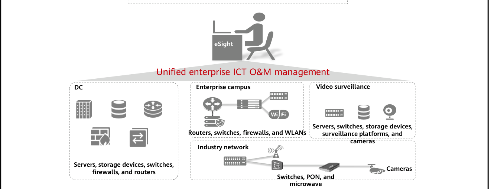
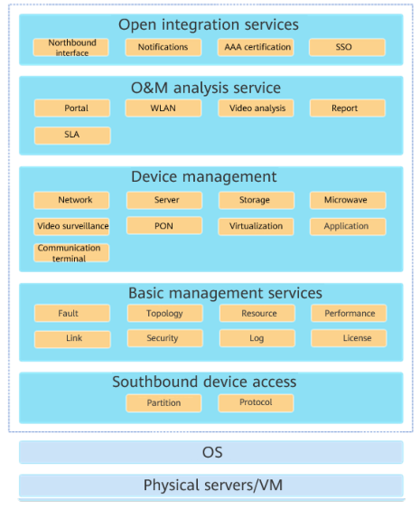
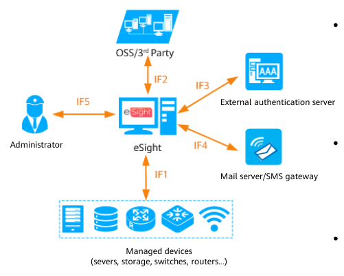

# Centralized Management: eSight Architecture, Interfaces (IF1–IF5) & Batch Specs

**Pillar:** HCIA-Computing V3.0 (Kunpeng & Server Ecosystem)  
**Schedule Block:** Hour 08 — Basic O&M of Computing Products: iBMA, iBMC, Smart Provisioning, FusionDirector, eSight, SmartKit & eService (Sprint 3 of 4)  
**Format:** Bite-Sized Lecture (7 mins) - Followed immediately by `06-Exercise-eSight-Interfaces-IF1-to-IF5-and-Batch-Specs-Lab` (7 mins)  
**Official Material Reference:** `HCIA-Computing V3.0 Training Material.pdf` — Ch.06, pp. 401–414

---

## Learning Objectives
- Understand eSight's cross-domain ICT scope (Huawei + third-party HP/Cisco/H3C devices), B/S architecture, and HA deployment modes
- Master eSight's five external interfaces (IF1 Southbound, IF2 Northbound, IF3 External Auth, IF4 Notification, IF5 UI)
- Memorize eSight's exact numerical specifications for Batch Import (500), Power-on/off priorities (1–10), OS Deployment (200/task, 40 concurrent), Firmware Upgrade (1000/schedule, 100 concurrent), and Profile Binding (2000 bound, 1000 applied)

---

### 1. eSight Overview & Service-Oriented Architecture (pp. 402–404)
- **Unified Enterprise ICT O&M (pp. 402–403)**: Centrally manages switches, routers, WLAN, firewalls, video surveillance/cameras, storage, microwave, PON devices, **servers, and server OSs**, plus pre-integrates third-party devices (**HP, Cisco, H3C**).
- **Architecture Highlights (p. 403)**:
  - **B/S (Browser/Server) structure**: Clients access eSight via web browser without plugins; only the server needs upgrading during maintenance.
  - **Deployment Modes**: Supports **single-node**, **two-node active/standby**, and **multi-node multi-active** deployment with scale-out from dozens to tens of thousands of devices.
- **Five External Interfaces of eSight (`IF1` to `IF5`, p. 404 — High-Yield Exam Topic!)**:

| Interface | Direction / Role | Supported Protocols & Details (p. 404) |
| :---: | :--- | :--- |
| **`IF1`** | **Southbound Interface** (connects to & manages devices) | **SNMP, STelnet, FTP, SFTP, IPMI, HTTP/HTTPS (REST/Redfish), WebSocket, SocketPing, ICMP, WebPing, WebTrace, SSDP, Syslog, WebTelnet, Netconf, TR069** |
| **`IF2`** | **Northbound Interface** (integrates with upper-layer OSS / 3rd-party NMS & Syslog) | **RESTful, SNMP, FTP, Kafka** (for resources, alarms, performance) + **Syslog** forwarding |
| **`IF3`** | **External Authentication Server Interface** | **LDAP, RADIUS, and SSO** |
| **`IF4`** | **Notification Interface** (sends alarms, events, reports) | Connects to enterprise **Mail servers (Email)** and **SMS gateways (SMS)** |
| **`IF5`** | **User Interface (UI)** | Invoked by system administrators and operators via Web browser |
<!-- PDF_FIGS_START -->

*Figure: eSight Unified Enterprise ICT O&M Topology (Official Reference: p. 402)*

*Figure: eSight Modular Software Architecture (Official Reference: p. 403)*

*Figure: External Interfaces of eSight (IF1 through IF5) (Official Reference: p. 404)*
<!-- PDF_FIGS_END -->

---

### 2. eSight Server Device Management & Alarm/Power Management (pp. 405–411)
- **Discovery & Management Protocols by Server Type (p. 406)**:
  - **Rack, High-density, and TaiShan servers**: Discovery = **Redfish/SNMP**; Management = **Redfish/SNMP**.
  - **Blade servers**: Discovery = **Redfish/SNMP**; Management = **Redfish/SNMP/SSH**.
  - **Heterogeneous servers**: Discovery = **Redfish**; Management = **Redfish**.
- **Alarm Display Colors (p. 410)**: Alarms with a **white background are NOT cleared**; alarms with a **light green background ARE cleared**.
- **Device Power-On / Power-Off Task Management (p. 411)**:
  - Supports batch power-on/off tasks (once, daily, weekly, monthly, yearly) with **priorities from 1 to 10 in descending order** (**1 = highest priority**, powered on/off first). Real-time power status updates depend on **device alarm reporting** (otherwise click **Synchronize**).

---

### 3. eSight Server Service Management Batch Specifications (pp. 406, 412–414)
| eSight Feature | Exact Official Numerical Specification (pp. 406, 412–414) |
| :--- | :--- |
| **Batch Import (Excel)** | Up to **500 devices** added at a time via Excel file |
| **OS Deployment** | Up to **200 devices per task** and **40 devices deployed concurrently** (2-hour timeout; requires **Smart Provisioning**; can optionally deploy **iBMA**) |
| **Software & Firmware Upgrade** | Up to **1,000 devices per upgrade schedule** and **100 devices upgraded concurrently** (connects to **HOUP** for baselines) |
| **Server Profile Configuration** | A single profile can be **bound to up to 2,000 devices**, and **up to 1,000 devices** can be selected at a time for **applying** a profile (Delete = not bound; Modify = not applied) |

---

## Key Takeaways
- **eSight external interfaces: IF1 = Southbound (SNMP, Redfish, IPMI, Netconf, TR069, etc.), IF2 = Northbound (RESTful, SNMP, FTP, Kafka, Syslog), IF3 = External Auth (LDAP, RADIUS, SSO), IF4 = Notification (Mail/SMS), IF5 = UI.**
- **On the eSight alarm panel, a white background indicates an uncleared alarm, while a light green background indicates a cleared alarm.**
- **eSight batch limits: Excel batch import = 500 devices; OS deployment = 200 devices/task (40 concurrent); Firmware upgrade = 1,000 devices/schedule (100 concurrent); Server Profile = 2,000 bound (1,000 applied at a time).**

## Huawei ICT Competition National Stage Exam Traps
> [!WARNING]
> EXAM TRAP: Compare Concurrent OS Deployment limits between FusionDirector and eSight: FusionDirector supports 30 concurrent OS deployments (p. 384), whereas eSight supports up to 200 devices per task and 40 concurrent OS deployments (p. 412)!

> [!WARNING]
> EXAM TRAP: Do not mix up eSight interfaces IF1 through IF5 — IF1 is Southbound (to managed devices), IF2 is Northbound (RESTful/SNMP/FTP/Kafka to upper-layer OSS), IF3 is LDAP/RADIUS/SSO authentication, and IF4 is Email/SMS notification.

---

### Next Step: Immediate Hands-On Exercise
Proceed immediately to **[`06-Exercise-eSight-Interfaces-IF1-to-IF5-and-Batch-Specs-Lab.html`](./06-Exercise-eSight-Interfaces-IF1-to-IF5-and-Batch-Specs-Lab.html)** (or [`06-Exercise-eSight-Interfaces-IF1-to-IF5-and-Batch-Specs-Lab.md`](./06-Exercise-eSight-Interfaces-IF1-to-IF5-and-Batch-Specs-Lab.md)) to apply this concept in an interactive lab workbench!
