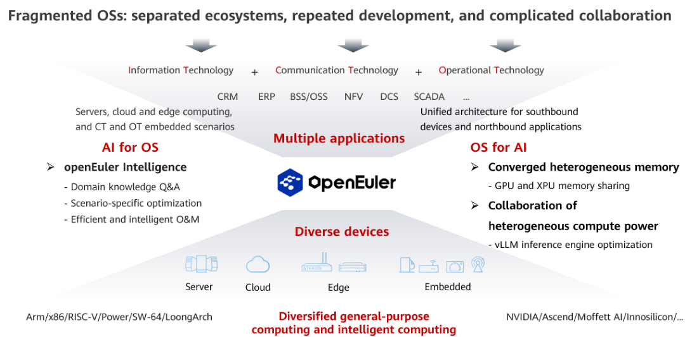
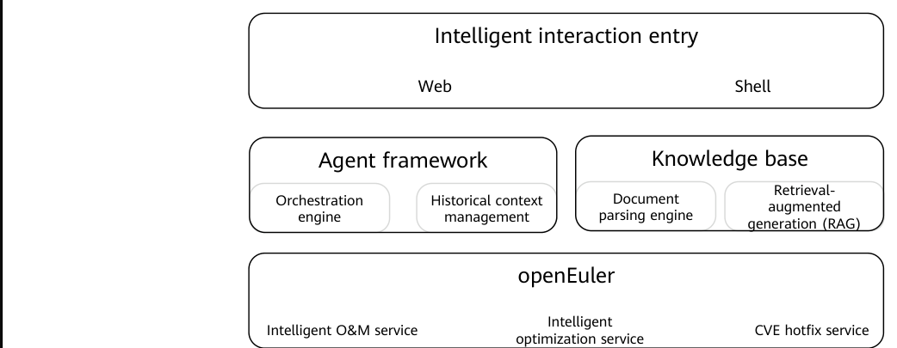

# OS for the AI Era & openEuler Intelligence Architecture

**Pillar:** HCIA-openEuler V2.0 (Operating System & Cloud-Native iSula)  
**Schedule Block:** Hour 01 — OS for the AI Era & Getting Started with openEuler (Sprint 1 of 4)  
**Format:** Bite-Sized Lecture (7 mins) - Followed immediately by `02-Exercise-openEuler-Intelligence-Architecture-Lab` (8 mins)  
**Official Material Reference:** `HCIA-openEuler V2.0 Training Material.pdf` — Ch.01, pp. 1–22

---

## Learning Objectives
- Define Artificial Intelligence (John McCarthy, 1956) and trace the 5-layer AI hierarchy from OS/Infrastructure to Industry Solutions
- Explain the openEuler Intelligence ('AI for OS') architecture, including its two interaction entries (Web entry and Intelligent Shell entry)
- Differentiate the 5 core functions of openEuler Intelligence: Intelligent Q&A, AI Application Development Framework, Intelligent Optimization, Intelligent Diagnosis, and Intelligent Container Image

---

### 1. Evolution of AI and the 5-Layer AI Hierarchy
The term **Artificial Intelligence (AI)** was coined by **John McCarthy in 1956** as the *"science and engineering of making intelligent machines, especially intelligent computer programs."* In the modern computing stack, AI is structured into five hierarchical layers built upon the Operating System:

| Hierarchy Layer | Core Components & Examples |
| :--- | :--- |
| **5. Industry Solution** | Finance, Healthcare, Security, Transportation, Gaming (autonomous driving, smart home, VR/AR, UAVs) |
| **4. Technology** | Perception & Analysis, Understanding & Thinking, Decision-making & Interaction (Speech/Image/Video recognition, NLP, Knowledge Graph) |
| **3. Technical Direction** | Speech processing, Computer vision, Natural Language Processing (NLP), Decision-making systems, Big data/Statistical analysis |
| **2. Algorithm** | Machine learning (ML) and Deep learning (DL) |
| **1. Infrastructure & OS** | **openEuler and other OSs**, Hardware/Computing capability, and Big Data |

---

### 2. openEuler Intelligence Architecture ("AI for OS")
**openEuler Intelligence** integrates Large Language Model (LLM) capabilities and a rich knowledge base of openEuler source code and O&M data into the OS toolchain.
* **Two Interaction Entries (Official Ch.01 Quiz Point):**
  1. **Web Entry:** Easy-to-use browser portal providing openEuler knowledge, community announcements, and O&M solutions via intelligent agents.
  2. **Intelligent Shell Entry:** Allows O&M engineers and developers to interact with openEuler in the terminal using **natural human language** for heuristic tuning and fault diagnosis.
* **Core Backend Components:** Orchestration Engine, Historical Context Management, Agent Framework (Intelligent O&M, Intelligent Optimization, CVE Hotfix services), Document Parsing Engine, and **Retrieval-Augmented Generation (RAG)** Knowledge Base.
<!-- PDF_FIGS_START -->

*Figure: openEuler OS for AI and AI for OS Architecture (Official Reference: p. 7)*

*Figure: AI for OS Agent Framework and Knowledge Base Stack (Official Reference: p. 8)*
<!-- PDF_FIGS_END -->

---

### 3. Five Core Functions of openEuler Intelligence
1. **Intelligent Q&A:**
   * **Workflow Scheduling:** Combines multiple agent steps into an inseparable **atomic operation** with user-defined error recovery, real-time data transfer between steps, and proactive clarification of vague user prompts.
   * **Task Recommendation:** Semantic intent recognition and next-step guidance based on user habits.
   * **Enhanced RAG:** Pre-processing query rewriting/routing, fragment vectorization/keyword indexing, and **multi-channel retrieval** (vectorized, keyword, and **Chat2DB** with re-ranking/fusion).
   * **Corpus Governance:** Fragment relationship extraction, fragment derivative construction (digests), and **OCR** for hybrid image-text documents.
2. **AI Application Development Framework:** Provides Multi-channel RAG, document governance (deduplication, sensitive data masking, standardization), and **embedding model fine-tuning** (e.g., **BGE models**).
3. **Intelligent Optimization:** Achieves **heuristic system optimization** by collecting and analyzing performance data via natural language interaction.
4. **Intelligent Diagnosis (3 Agents):**
   * **Inspection Agent:** Checks designated IP addresses and outputs an abnormality list (associated container IDs, abnormal CPU/memory metrics).
   * **Demarcation Agent:** Analyzes a selected abnormality and outputs the **top 3 root cause metrics**.
   * **Detection (Location) Agent:** Performs profiling location on root cause metrics and outputs hotspot stack, system time, and performance metrics.
5. **Intelligent Container Image:** Uses natural language to pull images from Docker Hub across **3 container layers**:
   * **Tier 1 (SDK layer):** Hardware enablement libraries only (e.g., **CUDA**, **CANN**).
   * **Tier 2 (SDKs + training/inference frameworks):** Adds TensorFlow/PyTorch (e.g., `tensorflow2.15.0-cuda12.2.0`, `pytorch2.1.0.a1-cann7.0.RC1`).
   * **Tier 3 (SDKs + frameworks + LLMs):** Encapsulates pre-integrated foundation models (e.g., `llama2-7b`, `chatglm2-13b`).

---

## Key Takeaways
- **openEuler Intelligence supports exactly TWO interaction entries: Web entry and Intelligent shell entry (Ch.01 Quiz Q1).**
- **Intelligent Diagnosis relies on three specialized agents in sequence: Inspection Agent (checks IP/container abnormalities) -> Demarcation Agent (outputs top 3 root cause metrics) -> Detection Agent (profiling location & stack hotspots).**
- **Intelligent Container Images are organized into 3 tiers: (1) SDK layer (CUDA/CANN), (2) SDK + Frameworks (PyTorch/TensorFlow), and (3) SDK + Frameworks + LLMs (llama2-7b, chatglm2-13b).**

## Huawei ICT Competition National Stage Exam Traps
> [!WARNING]
> EXAM TRAP: Do not confuse the three Intelligent Diagnosis agents! Inspection finds abnormal IPs/containers; Demarcation narrows down to the Top 3 root cause metrics; Detection/Location profiles the stack and hotspots.

> [!WARNING]
> EXAM TRAP: In openEuler Intelligence RAG, Corpus Governance specifically includes three techniques: (1) Fragment relationship extraction, (2) Fragment derivative construction, and (3) Optical Character Recognition (OCR).

---

### Next Step: Immediate Hands-On Exercise
Proceed immediately to **[`02-Exercise-openEuler-Intelligence-Architecture-Lab.html`](./02-Exercise-openEuler-Intelligence-Architecture-Lab.html)** (or [`02-Exercise-openEuler-Intelligence-Architecture-Lab.md`](./02-Exercise-openEuler-Intelligence-Architecture-Lab.md)) to apply this concept in an interactive lab workbench!
