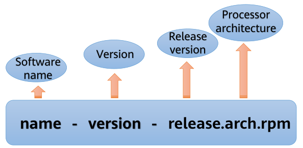

# Hands-On Lab: Auditing Installed RPMs and Building a Local Repository with `createrepo`

**Pillar:** HCIA-openEuler V2.0 (Operating System & Cloud-Native iSula)  
**Schedule Block:** Hour 05 — Software Packages, systemd Services, Processes & Scheduled Tasks (Sprint 1 of 4)  
**Format:** Immediate Hands-On Exercise (8 mins) — Paired with `01-Lecture-RPM-Package-Management-and-DNF-Repositories`  
**Interactive Workbench:** Open **[`02-Exercise-RPM-Queries-and-Local-Repo-Creation-Lab.html`](./02-Exercise-RPM-Queries-and-Local-Repo-Creation-Lab.html)** or **[`../index.html`](../index.html)** for live execution & auto-grading!

---

## Part A: Practical Lab Scenario
You need to audit which RPM package owns `/etc/passwd`, list all configuration files belonging to the `bash` RPM package, and initialize a local software repository in `/mnt/local_repo` using `createrepo`.

<!-- PDF_FIGS_START -->
#### Reference Diagrams


*Figure: RPM Package Naming Convention Anatomy (name-version-release.arch.rpm) (Official Reference: p. 195)*
<!-- PDF_FIGS_END -->

### Step-by-Step Instructions
1. Step 1: Query which RPM package owns `/etc/passwd` using `rpm -qf /etc/passwd`.
2. Step 2: Query all configuration files installed by the `bash` package using `rpm -qc bash`.
3. Step 3: Initialize the local repository database in `/mnt/local_repo` using `createrepo --database /mnt/local_repo`.

### Starter Workspace (`root@openEuler:~#`)
```bash
# Step 1: Query which RPM package owns /etc/passwd
<rpm_qf_command>

# Step 2: Query configuration files in the bash RPM package
<rpm_qc_command>

# Step 3: Create local repository metadata in /mnt/local_repo
<createrepo_command>
```

<details>
<summary><strong>Click to View Hints</strong></summary>

- Use `rpm -qf /etc/passwd` to find the owning RPM package.
- Use `rpm -qc bash` to list configuration files.
- Use `createrepo --database /mnt/local_repo` (exact command from Ch.04 p.206).

</details>

<details>
<summary><strong>Click to Reveal Full Working Solution & Expected Output</strong></summary>

#### Solution Code / Commands:
```bash
# Step 1: Query which RPM package owns /etc/passwd
rpm -qf /etc/passwd

# Step 2: Query configuration files in the bash RPM package
rpm -qc bash

# Step 3: Create local repository metadata in /mnt/local_repo
createrepo --database /mnt/local_repo
```

#### Expected Console / Query Output:
```text
setup-2.14.5-2.oe2403.noarch

/etc/skel/.bash_logout
/etc/skel/.bash_profile
/etc/skel/.bashrc

Directory walk started
Directory walk done - 42 packages
Temporary output repo path: /mnt/local_repo/.repodata/
Preparing sqlite DBs
Pool started (with 5 workers)
Pool finished
```
</details>

---

## Part B: National Stage Exam Verification Drill

### Question 1 [Single-Choice]
**Which `rpm` command option queries which installed RPM package a specific server file (such as `/etc/passwd`) belongs to, and which option lists only the configuration files in an installed RPM package?**

- A. `rpm -ql` and `rpm -qi`
- B. `rpm -qf` and `rpm -qc`
- C. `rpm -qa` and `rpm -qd`
- D. `rpm -qp` and `rpm -Va`

<details>
<summary>[PASS] <strong>Check Answer & Explanation (Question 1)</strong></summary>

- **Correct Answer:** `B`
- **Explanation:** Per Ch.04 (pp.195, 200), `rpm -qf` searches for the RPM package to which a specified file belongs, and `rpm -qc` queries the configuration files in an installed software package.
</details>

### Question 2 [Single-Choice]
**In the global DNF configuration file `/etc/dnf/dnf.conf`, what is the default value of `installonly_limit`, and what does `clean_requirements_on_remove=True` do?**

- A. `installonly_limit=1`; deletes `/etc/yum.repos.d/` on package removal
- B. `installonly_limit=3`; deletes dependencies that are no longer used during `dnf remove`
- C. `installonly_limit=5`; disables GPG signature checks
- D. `installonly_limit=10`; clears the RPM database cache every hour

<details>
<summary>[PASS] <strong>Check Answer & Explanation (Question 2)</strong></summary>

- **Correct Answer:** `B`
- **Explanation:** Per Ch.04 (p.204), `installonly_limit` defaults to 3, and `clean_requirements_on_remove` (default True) deletes dependencies that were installed automatically and are no longer needed during `dnf remove`.
</details>

### Question 3 [Multiple-Choice (Select ALL)]
**Which of the following statements about DNF and software repositories on openEuler are TRUE?**

- A. DNF leverages the `libsolv` library for faster dependency resolution and supports a plugin system based on Python 3.
- B. By default, `.repo` configuration files in openEuler are stored in the `/etc/yum.repos.d/` directory.
- C. The `baseurl` parameter in a `.repo` file supports `http://`, `ftp://`, and `file:///` protocols.
- D. The `createrepo --database <dir>` command initializes metadata for a local RPM software repository.

<details>
<summary>[PASS] <strong>Check Answer & Explanation (Question 3)</strong></summary>

- **Correct Answer:** `ABCD`
- **Explanation:** Per Ch.04 (pp.202–206), all four statements are explicitly stated in the official training material.
</details>
