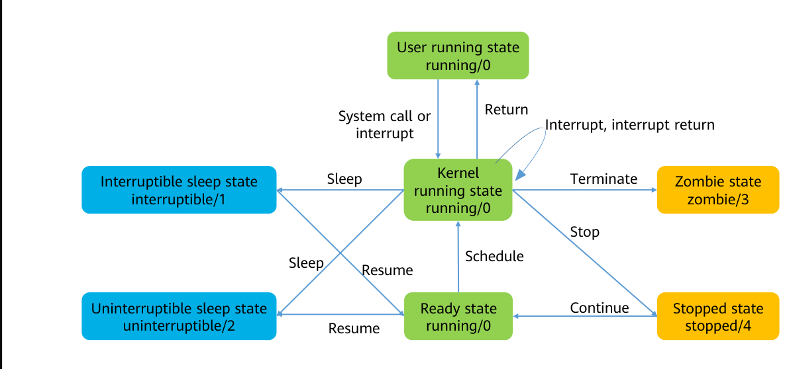

# Hands-On Lab: Adjusting Process Priority (`renice`), Sending Signals (`kill`) & Scheduling (`at`/`crontab`)

**Pillar:** HCIA-openEuler V2.0 (Operating System & Cloud-Native iSula)  
**Schedule Block:** Hour 05 — Software Packages, systemd Services, Processes & Scheduled Tasks (Sprint 4 of 4)  
**Format:** Immediate Hands-On Exercise (8 mins) — Paired with `07-Lecture-Process-Management-and-Scheduled-Tasks`  
**Interactive Workbench:** Open **[`08-Exercise-Top-Nice-Kill-At-and-Crontab-Lab.html`](./08-Exercise-Top-Nice-Kill-At-and-Crontab-Lab.html)** or **[`../index.html`](../index.html)** for live execution & auto-grading!

---

## Part A: Practical Lab Scenario
You are tuning process priorities and configuring scheduled maintenance on openEuler. Adjust the `nice` value of PID `9700` to `12` using `renice`, send the `HUP` signal to PID `3389` using `kill`, schedule `example.sh` to run once at `15:00` using `at`, and write a crontab entry that runs `/usr/local/bin/backup.sh` every Monday at `08:00` AM.

<!-- PDF_FIGS_START -->
#### Reference Diagrams


*Figure: Process State Transition State Machine (R, S, D, T, Z) (Official Reference: p. 227)*
<!-- PDF_FIGS_END -->

### Step-by-Step Instructions
1. Step 1: Change the nice value of running process PID `9700` to `12` using `renice -n 12 -p 9700` and send the `HUP` signal to PID `3389` using `kill -s HUP 3389`.
2. Step 2: Schedule the script `example.sh` to run once at `15:00` using `at -f example.sh 15:00` and list the queue with `atq`.
3. Step 3: Write the 5-field crontab schedule for every Monday at 08:00 AM: `00 08 * * 1 /usr/local/bin/backup.sh`.

### Starter Workspace (`root@openEuler:~#`)
```bash
# Step 1: Set nice value of PID 9700 to 12 and send HUP signal to PID 3389
<renice_command>
<kill_hup_command>

# Step 2: Schedule example.sh at 15:00 using at and view queue
<at_command>
atq

# Step 3: Crontab line for every Monday at 08:00 AM
# minute hour dom month dow command
<crontab_line>
```

<details>
<summary><strong>Click to View Hints</strong></summary>

- Use `renice -n 12 -p 9700` (Ch.04 p.230) and `kill -s HUP 3389` (Ch.04 p.235).
- Use `at -f example.sh 15:00` (Ch.04 p.242).
- Use `00 08 * * 1 /usr/local/bin/backup.sh` (Ch.04 p.246).

</details>

<details>
<summary><strong>Click to Reveal Full Working Solution & Expected Output</strong></summary>

#### Solution Code / Commands:
```bash
# Step 1: Set nice value of PID 9700 to 12 and send HUP signal to PID 3389
renice -n 12 -p 9700
kill -s HUP 3389

# Step 2: Schedule example.sh at 15:00 using at and view queue
at -f example.sh 15:00
atq

# Step 3: Crontab line for every Monday at 08:00 AM
# minute hour dom month dow command
00 08 * * 1 /usr/local/bin/backup.sh
```

#### Expected Console / Query Output:
```text
9700 (process ID) old priority -18, new priority 12
[OK] Signal SIGHUP (1) delivered to PID 3389

warning: commands will be executed using /bin/sh
job 1 at Tue Nov 17 15:00:00 2026
1	Tue Nov 17 15:00:00 2026 a root

[Crontab Registered] 00 08 * * 1 /usr/local/bin/backup.sh
```
</details>

---

## Part B: National Stage Exam Verification Drill

### Question 1 [Single-Choice]
**[Official Ch.04 Quiz Q1] Which of the following commands can be used to dynamically check the host resource usage?**

- A. ps
- B. top
- C. free
- D. lscpu

<details>
<summary>[PASS] <strong>Check Answer & Explanation (Question 1)</strong></summary>

- **Correct Answer:** `B`
- **Explanation:** Official Ch.04 Quiz Q1 (p.249): B (`top`). While `ps` statically displays process information at a point in time, `top` dynamically displays host resource usage and processes in real time.
</details>

### Question 2 [Single-Choice]
**When `kill PID` is executed without specifying a signal option (`-s`), which signal is sent by default, and which signal number forces unconditional termination?**

- A. Default: 1 (HUP); Unconditional termination: 2 (INT)
- B. Default: 15 (TERM); Unconditional termination: 9 (KILL)
- C. Default: 9 (KILL); Unconditional termination: 15 (TERM)
- D. Default: 18 (TSTP); Unconditional termination: 19 (CONT)

<details>
<summary>[PASS] <strong>Check Answer & Explanation (Question 2)</strong></summary>

- **Correct Answer:** `B`
- **Explanation:** Per Ch.04 (pp.234–235), `kill PID` sends the `TERM` (15) signal by default, while signal `9` (`KILL`) performs unconditional termination.
</details>

### Question 3 [Multiple-Choice (Select ALL)]
**Which of the following statements about `at` and `crontab` scheduled tasks in openEuler are TRUE?**

- A. `atq` views the pending `at` job queue, and `atrm <job_ID>` deletes a scheduled `at` job.
- B. The five time fields in a `crontab` entry are: `minute hour day-of-month month-of-year day-of-week`.
- C. User crontab files are stored in `/var/spool/cron/` named after the user, while system-wide cron tasks are in `/etc/crontab`.
- D. You do NOT need to restart the `cron` service after modifying a crontab file because `cron` checks the files every minute.

<details>
<summary>[PASS] <strong>Check Answer & Explanation (Question 3)</strong></summary>

- **Correct Answer:** `ABCD`
- **Explanation:** Per Ch.04 (pp.241–248), all four statements are explicitly verified in the official training material.
</details>
