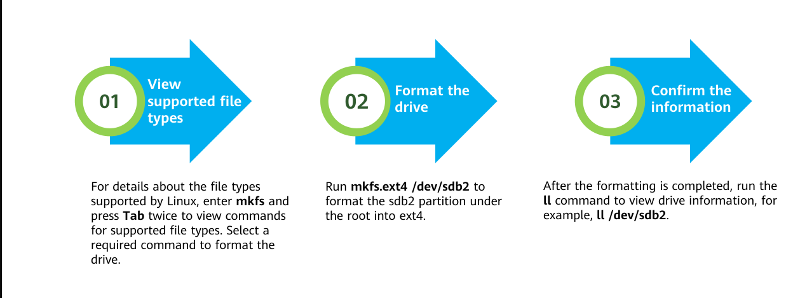
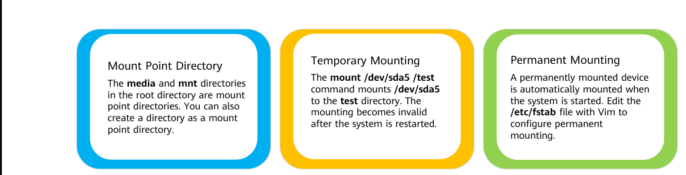

# Drive Formatting (`mkfs`), Mounting (`mount`/`umount`) & `/etc/fstab` Persistence

**Pillar:** HCIA-openEuler V2.0 (Operating System & Cloud-Native iSula)  
**Schedule Block:** Hour 06 — openEuler Disk Partitioning, LVM & Network Management (Sprint 2 of 4)  
**Format:** Bite-Sized Lecture (7 mins) - Followed immediately by `04-Exercise-Mkfs-Mount-and-Fstab-Persistence-Lab` (8 mins)  
**Official Material Reference:** `HCIA-openEuler V2.0 Training Material.pdf` — Ch.05, pp. 277–282, 318

---

## Learning Objectives
- Format partitions using `mkfs -t ext4 <device>` (Official Ch.05 Quiz Q2!) or `mkfs.ext4` and understand `mkfs` options (`-V`, `-t`, `-c`, `-l`)
- Distinguish temporary mounting (`mount <device> <dir>`) vs. permanent boot-time mounting via `/etc/fstab`
- Configure all 6 fields of `/etc/fstab` (`<file system> <dir> <type> <options> <dump> <pass>`) and fsck `pass` priorities (`0`, `1`, `2`)

---

### 1. Drive Formatting with `mkfs`
Formatting initializes a partition with a file system structure (deleting existing data on that partition).
* **Viewing Supported File System Formatters:** Type `mkfs` and press **`Tab` twice** to list all `mkfs.*` utilities (`mkfs.ext4`, `mkfs.xfs`, `mkfs.vfat`, etc.).
* **Syntax & Equivalent Forms (Official Ch.05 Quiz Q2!):**
  ```bash
  mkfs [-V] [-t fstype] [fs-options] filesys [blocks]
  # Example 1 (Ch.05 Quiz Q2 exact answer):
  mkfs -t ext4 /dev/hdb6
  # Example 2:
  mkfs.ext4 /dev/sdb2
  ```
* **Key `mkfs` Options (Ch.05, p.279):**
  * **`-t <fstype>`:** Specifies the file system type to build. (**Note:** If `-t` is omitted in plain `mkfs`, the default value for Linux is **`ext2`**!).
  * **`-c`:** Checks the partition for **bad blocks** before building the file system.
  * **`-l bad_blocks_file`:** Reads bad block information from `bad_blocks_file`.
  * **`-V`:** Produces verbose output.
<!-- PDF_FIGS_START -->

*Figure: Drive Formatting Workflow (View, Format mkfs, Confirm) (Official Reference: p. 278)*
<!-- PDF_FIGS_END -->


---

### 2. Temporary Mounting (`mount`) vs. Permanent Mounting (`/etc/fstab`)
Because Linux follows the *"Everything is a file"* design, a formatted partition must be linked to a directory (**mount point**, such as `/mnt`, `/media`, or a custom directory) before it can be accessed:
* **Temporary Mounting:**
  ```bash
  mount /dev/sda5 /test
  ```
  Mounts `/dev/sda5` to `/test` immediately, **but becomes invalid after the system is restarted!**
* **Permanent Mounting (`/etc/fstab`):**
  The OS automatically reads **`/etc/fstab`** at boot (or when **`mount -a`** is run) and mounts all listed file systems.
<!-- PDF_FIGS_START -->

*Figure: Temporary Mounting (mount) vs Permanent Mounting (/etc/fstab) (Official Reference: p. 280)*
<!-- PDF_FIGS_END -->


---

### 3. The 6 Fields of `/etc/fstab`
```text
<file system>   <dir>   <type>   <options>           <dump>  <pass>
tmpfs           /tmp    tmpfs    nodev,nosuid        0       0
/dev/sda1       /       ext4     defaults,noatime    0       1
/dev/sda2       none    swap     defaults            0       0
```
1. **`<file system>`:** Device path (`/dev/sda1`) or `UUID=...` (from `blkid`).
2. **`<dir>`:** Mount point directory (`/` or `none` for `swap`).
3. **`<type>`:** File system type (`ext4`, `xfs`, `swap`, `tmpfs`).
4. **`<options>`:** Mount parameters: **`defaults`**, **`auto`** (mounts at boot or `mount -a`), **`ro`** / **`rw`**, **`user`** / **`nouser`**, **`dev`** / **`nodev`**, **`suid`** / **`nosuid`**, **`sync`** / **`async`**, **`noatime`** / **`nodiratime`** (skips updating inode access times to improve performance).
5. **`<dump>`:** Backup flag (`0` = do not back up with `dump` [recommended]; `1` = back up).
6. **`<pass>` (`fsck` check priority):**
   * **`0`**: Device is **not checked** by `fsck`.
   * **`1`**: **Root partition (`/`)** — checked first!
   * **`2`**: **Other devices** that need to be checked after root.

---

## Key Takeaways
- **Format a partition into ext4 using 'mkfs -t ext4 /dev/hdb6' (Official Ch.05 Quiz Q2) or 'mkfs.ext4 /dev/hdb6'; there is NO 'format' or 'makefile' command in Linux!**
- **Mounting with 'mount /dev/sda5 /test' is temporary and lost on reboot; configure permanent mounting in /etc/fstab.**
- **The 6 fields of /etc/fstab are: <file system> <dir> <type> <options> <dump> <pass>, where <pass> is 1 for root (/), 2 for other checked partitions, and 0 for no fsck check.**

## Huawei ICT Competition National Stage Exam Traps
> [!WARNING]
> EXAM TRAP (Official Ch.05 Quiz Q2): 'Which of the following commands can be used to format the /dev/hdb6 partition?' -> A. mkfs -t ext4 /dev/hdb6. Distractors like 'format -t ext4' or 'makefile -t ext4' do not exist!

> [!WARNING]
> EXAM TRAP: If you run 'mkfs /dev/sdb1' WITHOUT '-t fstype', mkfs defaults to 'ext2' (whereas openEuler's default OS file system is 'ext4'). Always specify '-t ext4' or 'mkfs.ext4'!

---

### Next Step: Immediate Hands-On Exercise
Proceed immediately to **[`04-Exercise-Mkfs-Mount-and-Fstab-Persistence-Lab.html`](./04-Exercise-Mkfs-Mount-and-Fstab-Persistence-Lab.html)** (or [`04-Exercise-Mkfs-Mount-and-Fstab-Persistence-Lab.md`](./04-Exercise-Mkfs-Mount-and-Fstab-Persistence-Lab.md)) to apply this concept in an interactive lab workbench!
