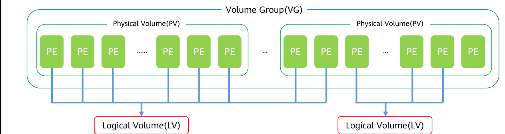
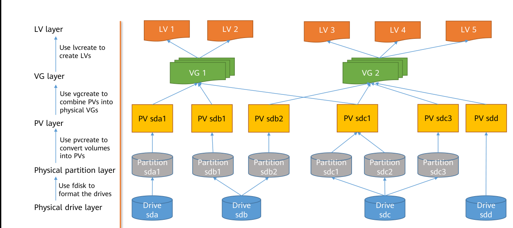

# Hands-On Lab: Creating PV, VG, LV and Performing Online Capacity Expansion

**Pillar:** HCIA-openEuler V2.0 (Operating System & Cloud-Native iSula)  
**Schedule Block:** Hour 06 — openEuler Disk Partitioning, LVM & Network Management (Sprint 3 of 4)  
**Format:** Immediate Hands-On Exercise (8 mins) — Paired with `05-Lecture-LVM-Creation-Expansion-and-Reduction`  
**Interactive Workbench:** Open **[`06-Exercise-LVM-PV-VG-LV-and-Resize-Lab.html`](./06-Exercise-LVM-PV-VG-LV-and-Resize-Lab.html)** or **[`../index.html`](../index.html)** for live execution & auto-grading!

---

## Part A: Practical Lab Scenario
You are building an LVM storage pool on openEuler using `/dev/sdb1` and `/dev/sdb2` (following Ch.05 pp. 290–300). Initialize both partitions as PVs, combine them into volume group `vg1000`, create a `200M` logical volume on `vg1000`, and expand `/dev/vg1000/lvol0` online by `+200M` followed by `resize2fs`.

<!-- PDF_FIGS_START -->
#### Reference Diagrams


*Figure: LVM Physical Structure: PE to Physical Volume (PV), VG and LV (Official Reference: p. 285)*


*Figure: LVM Layer Creation Stack (Drive, Partition, PV, VG, LV) (Official Reference: p. 288)*
<!-- PDF_FIGS_END -->

### Step-by-Step Instructions
1. Step 1: Initialize `/dev/sdb1` and `/dev/sdb2` as PVs (`pvcreate /dev/sdb1 /dev/sdb2`) and create volume group `vg1000` (`vgcreate vg1000 /dev/sdb1 /dev/sdb2`).
2. Step 2: Create a `200M` logical volume on `vg1000` using `lvcreate -L 200M vg1000`.
3. Step 3: Expand `/dev/vg1000/lvol0` by `+200M` using `lvextend -L +200M /dev/vg1000/lvol0` (or `lvresize`) and resize the file system using `resize2fs /dev/vg1000/lvol0`.

### Starter Workspace (`root@openEuler:~#`)
```bash
# Step 1: Create PVs and combine them into VG vg1000
<pvcreate_command>
<vgcreate_command>

# Step 2: Create a 200M LV on vg1000
<lvcreate_command>

# Step 3: Expand /dev/vg1000/lvol0 by +200M and resize the file system
<lvextend_command>
<resize2fs_command>
```

<details>
<summary><strong>Click to View Hints</strong></summary>

- Use `pvcreate /dev/sdb1 /dev/sdb2` and `vgcreate vg1000 /dev/sdb1 /dev/sdb2` (Ch.05 p.293).
- Use `lvcreate -L 200M vg1000` (Ch.05 p.296).
- Use `lvextend -L +200M /dev/vg1000/lvol0` and `resize2fs /dev/vg1000/lvol0` (Ch.05 p.298).

</details>

<details>
<summary><strong>Click to Reveal Full Working Solution & Expected Output</strong></summary>

#### Solution Code / Commands:
```bash
# Step 1: Create PVs and combine them into VG vg1000
pvcreate /dev/sdb1 /dev/sdb2
vgcreate vg1000 /dev/sdb1 /dev/sdb2

# Step 2: Create a 200M LV on vg1000
lvcreate -L 200M vg1000

# Step 3: Expand /dev/vg1000/lvol0 by +200M and resize the file system
lvextend -L +200M /dev/vg1000/lvol0
resize2fs /dev/vg1000/lvol0
```

#### Expected Console / Query Output:
```text
Physical volume "/dev/sdb1" successfully created.
  Physical volume "/dev/sdb2" successfully created.
  Volume group "vg1000" successfully created
  Logical volume "lvol0" created.
  Size of logical volume vg1000/lvol0 changed from 200.00 MiB (50 extents) to 400.00 MiB (100 extents).
  Logical volume vg1000/lvol0 successfully resized.
resize2fs 1.46.5 (30-Dec-2021)
The filesystem on /dev/vg1000/lvol0 is now 409600 (1k) blocks long.
```
</details>

---

## Part B: National Stage Exam Verification Drill

### Question 1 [Single-Choice]
**In openEuler Logical Volume Management (LVM), what is the smallest unit that can be addressed by LVM, and what is its default size?**

- A. Physical Volume (PV); default 1 GB
- B. Physical Extent (PE); default 4 MB
- C. Volume Group (VG); default 100 MB
- D. Inode Block; default 512 Bytes

<details>
<summary>[PASS] <strong>Check Answer & Explanation (Question 1)</strong></summary>

- **Correct Answer:** `B`
- **Explanation:** Per Ch.05 (p.284), a Physical Extent (PE) with a unique number is the smallest unit that can be addressed by LVM, with 4 MB being the default size.
</details>

### Question 2 [Single-Choice]
**What is the correct 5-step sequence for safely REDUCING the capacity of an `ext4` Logical Volume in openEuler?**

- A. `lvreduce` -> `resize2fs` -> `e2fsck -f` -> `umount` -> `mount`
- B. Determine target size -> `umount` and `e2fsck -f` -> `resize2fs` -> `lvreduce` -> `mount`
- C. `lvextend` -> `resize2fs` -> `mount -a`
- D. `vgreduce` -> `pvremove` -> `lvreduce` (online without unmounting)

<details>
<summary>[PASS] <strong>Check Answer & Explanation (Question 2)</strong></summary>

- **Correct Answer:** `B`
- **Explanation:** Per Ch.05 (p.299), the 5 steps to reduce LV capacity are: (1) Determine target size, (2) Run `umount` and `e2fsck -f`, (3) Run `resize2fs` to shrink the file system, (4) Run `lvreduce` to shrink the LV, and (5) Mount the file system again.
</details>

### Question 3 [Multiple-Choice (Select ALL)]
**Which of the following statements about LVM commands and options are TRUE?**

- A. In `lvcreate`, `-L` specifies the size of the LV (in K, M, G, or T), whereas `-l` specifies the number of Logical Extents (LEs).
- B. `vgextend` adds one or more PVs to an existing VG, while `vgreduce` removes a PV from a VG.
- C. Expanding an LV (`vgs` -> `lvextend -L +SIZE` -> `resize2fs`) supports online capacity expansion without unmounting.
- D. `lvcreate -s` creates an LV snapshot.

<details>
<summary>[PASS] <strong>Check Answer & Explanation (Question 3)</strong></summary>

- **Correct Answer:** `ABCD`
- **Explanation:** Per Ch.05 (pp.294–298), all four statements accurately reflect LVM management in openEuler.
</details>
