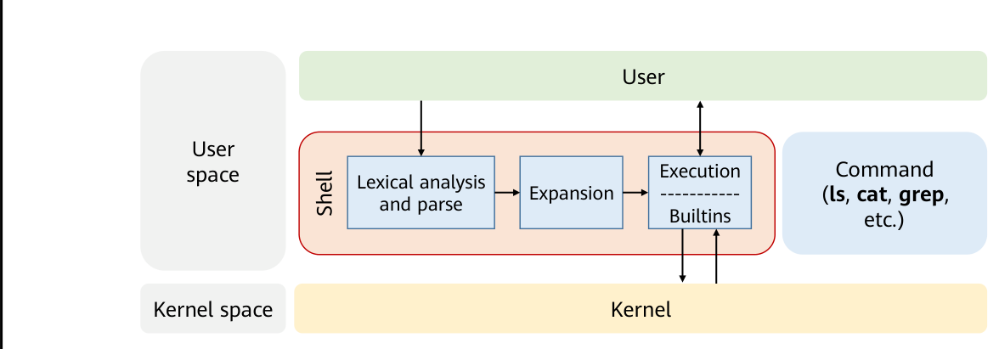

# Shell Basics, Script Execution (`nohup`), Text Streams, Redirection & Pipes

**Pillar:** HCIA-openEuler V2.0 (Operating System & Cloud-Native iSula)  
**Schedule Block:** Hour 07 — Shell Scripting, Variables, Control Flow & Automation (Sprint 1 of 4)  
**Format:** Bite-Sized Lecture (7 mins) - Followed immediately by `02-Exercise-Script-Execution-Nohup-and-Redirection-Lab` (8 mins)  
**Official Material Reference:** `HCIA-openEuler V2.0 Training Material.pdf` — Ch.06, pp. 326–341

---

## Learning Objectives
- Trace the history of Unix/Linux shells (V6 shell, sh, csh, tcsh, ksh, bash) and inspect shells via `/etc/shells`, `SHELL`, and `0`
- Execute scripts via `sh script.sh`, `./script.sh` (`chmod +x`), `$PATH`, and persistent background mode (`nohup ./my_script.sh &`)
- Redirect standard input/output/error streams (`>`, `>>`, `<`, `<< EOF`) and chain processes with IPC pipes (`|`)

---

### 1. Shell Evolution & Inspecting Shells in openEuler
The **Shell** is the command interpreter in user space that parses user commands, expands variables, and invokes the Linux kernel.
* **Milestones in Shell History (Ch.06, p.327):**
  * **1971:** **Ken Thompson** (Bell Labs) develops the first Unix shell (**V6 shell**).
  * **1977:** **Steven Bourne** (Bell Labs) creates the **Bourne shell (`sh`)** for Unix V7.
  * **1978:** **Bill Joy** (UC Berkeley) develops the **C shell (`csh`)** for BSD.
  * **1983:** **Ken Greer** (CMU) develops **`tcsh`**; **David Korn** (Bell Labs) creates **KornShell (`ksh`)**.
  * **1989:** **Brian Fox** (GNU Project) develops the **Bourne Again Shell (`bash`)**, compatible with `sh`, `csh`, and `ksh`, and the **default shell of Linux/openEuler**.
* **Inspecting Shells (Ch.06, p.328):**
  * View all installed shells in the system: **`cat /etc/shells`**
  * View default shell of the current login user: **`echo $SHELL`**
  * View the currently running shell: **`echo $0`**
<!-- PDF_FIGS_START -->

*Figure: Shell Command Parsing, Expansion and Kernel Execution Diagram (Official Reference: p. 326)*
<!-- PDF_FIGS_END -->

---

### 2. Specifying an Interpreter (`#!`) & Running Shell Scripts
* **Shebang (`#!`):** The first line of a script specifies the interpreter, e.g., **`#!/bin/bash`** or `#!/bin/csh`.
* **Execution Modes:**
  1. **`sh script_name.sh`:** Invokes the interpreter directly (does not require `x` permission on the file).
  2. **`./script_name.sh` (or via `PATH`):** Requires execute permission (**`chmod +x script_name.sh`**). To invoke by name from any directory, add its directory to `PATH` (persist by adding `export PATH="$PATH:/new/path"` to `.bashrc` or `.bash_profile`).
* **Background Execution (`&` vs. `nohup` — Ch.06, p.336):**
  * **`./my_script.sh &`:** Runs in the background, **but stops if you exit the shell!**
  * **`nohup ./my_script.sh &`:** Keeps the script running even after exiting the shell! Standard output and standard error are automatically redirected to **`nohup.out`**. View background jobs with **`jobs`**.

---

### 3. Text Streams, Redirection (`>`, `>>`, `<`, `<<`) & Pipes (`|`)
Every Linux process opens **three text stream interfaces**: **Standard Input (stdin)**, **Standard Output (stdout)**, and **Standard Error (stderr)**.
* **Output Redirection:**
  * **`ls > dir_log`:** Redirects stdout to `dir_log`, **overwriting** previous contents.
  * **`ls >> dir_log`:** Redirects stdout to `dir_log`, **appending** to the end of the file.
* **Input Redirection:**
  * **`command < inputfile`:** Uses `inputfile` as standard input (e.g., `wc -l < /dev/null`).
  * **`command << marker` (Inline Input Redirection / Here-Document):** Uses instant inline text as standard input until `marker` (commonly **`EOF`**) is encountered (`command << EOF > file`).
* **Pipe (`|`):** Inter-Process Communication (IPC) mechanism that connects the `stdout` of `command1` directly to the `stdin` of `command2` (`ls /bin/ | grep python | less`).

---

## Key Takeaways
- **Check installed shells with 'cat /etc/shells', default login shell with 'echo SHELL', and current shell with 'echo 0'.**
- **Running './my_script.sh &' stops when the shell exits, whereas 'nohup ./my_script.sh &' keeps running after logout and redirects stdout/stderr to nohup.out.**
- **'>' overwrites a file, '>>' appends to a file, '<' redirects file input, '<< EOF' provides inline input redirection (Here-Document), and '|' is an IPC pipe.**

## Huawei ICT Competition National Stage Exam Traps
> [!WARNING]
> EXAM TRAP: Running './script.sh' on a newly created file fails with 'Permission denied' unless you first grant execute permission with 'chmod +x script.sh' (or run it via 'sh script.sh').

> [!WARNING]
> EXAM TRAP: In inline input redirection ('command << EOF'), the marker 'EOF' marks the start and end of standard input and is NOT included in the standard input content itself!

---

### Next Step: Immediate Hands-On Exercise
Proceed immediately to **[`02-Exercise-Script-Execution-Nohup-and-Redirection-Lab.html`](./02-Exercise-Script-Execution-Nohup-and-Redirection-Lab.html)** (or [`02-Exercise-Script-Execution-Nohup-and-Redirection-Lab.md`](./02-Exercise-Script-Execution-Nohup-and-Redirection-Lab.md)) to apply this concept in an interactive lab workbench!
