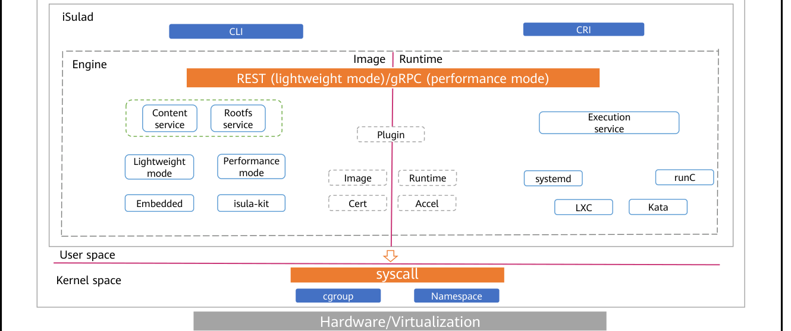

# Hands-On Lab: Verifying Kernel `cgroups` Mounts and iSula Architecture Specifications

**Pillar:** HCIA-openEuler V2.0 (Operating System & Cloud-Native iSula)  
**Schedule Block:** Hour 08 — openEuler Native Container Engine iSula (iSulad) (Sprint 1 of 4)  
**Format:** Immediate Hands-On Exercise (8 mins) — Paired with `01-Lecture-Container-Primitives-and-iSula-Architecture`  
**Interactive Workbench:** Open **[`02-Exercise-Namespaces-Cgroups-and-iSula-Specs-Lab.html`](./02-Exercise-Namespaces-Cgroups-and-iSula-Specs-Lab.html)** or **[`../index.html`](../index.html)** for live execution & auto-grading!

---

## Part A: Practical Lab Scenario
You are preparing an engineering specification for migrating edge and cloud workloads from Docker to openEuler iSula. Complete the specification mapping kernel primitives, `iSulad` implementation language, default runtime, and toolkit components.

<!-- PDF_FIGS_START -->
#### Reference Diagrams


*Figure: iSula Container Engine Architecture Stack (isulad, CRI, sysCall) (Official Reference: p. 394)*
<!-- PDF_FIGS_END -->

### Step-by-Step Instructions
1. Step 1: Specify the kernel feature for resource isolation (`Namespaces`) and the `/sys/fs/cgroup` feature for resource limitation (`cgroups`), plus the namespace that isolates hostnames (`UTS`).
2. Step 2: Specify the programming language of `iSulad` (`C/C++`) and its default OCI runtime (`LCR`).
3. Step 3: Specify the DAG-based image builder (`isula-build`) and Docker container migration tool (`isula-transform`).

### Starter Workspace (`root@openEuler:~#`)
```bash
# iSula & Kernel Container Specification
RESOURCE_ISOLATION="<kernel_isolation_feature>"
HOSTNAME_NAMESPACE="<namespace_for_hostnames>"
RESOURCE_LIMITATION="<kernel_limitation_feature> (/sys/fs/cgroup)"
ISULAD_LANGUAGE="<programming_language>"
DEFAULT_OCI_RUNTIME="<default_runtime>"
CONTAINER_TOOLKIT="<image_builder>, <migration_tool>"
```

<details>
<summary><strong>Click to View Hints</strong></summary>

- Namespaces handle resource isolation (`UTS` isolates hostnames/domain names) and `cgroups` handle resource limitation.
- `iSulad` is written in `C/C++` and uses `LCR` (Lightweight Container Runtime) by default.
- The two container toolkit utilities are `isula-build` and `isula-transform`.

</details>

<details>
<summary><strong>Click to Reveal Full Working Solution & Expected Output</strong></summary>

#### Solution Code / Commands:
```bash
# iSula & Kernel Container Specification
RESOURCE_ISOLATION="Namespaces"
HOSTNAME_NAMESPACE="UTS"
RESOURCE_LIMITATION="cgroups (/sys/fs/cgroup)"
ISULAD_LANGUAGE="C/C++"
DEFAULT_OCI_RUNTIME="LCR"
CONTAINER_TOOLKIT="isula-build, isula-transform"
```

#### Expected Console / Query Output:
```text
[OK] Kernel Primitives Verified: Namespaces (PID, Mount, Network, User, UTS, IPC) + cgroups (/sys/fs/cgroup)
[OK] iSulad Engine: C/C++ implementation | Default Runtime: LCR | Modes: REST (Lightweight) & gRPC (Performance)
[OK] Container Toolkit: isula-build (15% faster DAG build) & isula-transform (Docker migration)
```
</details>

---

## Part B: National Stage Exam Verification Drill

### Question 1 [Single-Choice]
**In the Linux kernel, what are the respective functions of `Namespaces` and `cgroups` in container virtualization?**

- A. Namespaces limit CPU/memory usage; cgroups isolate hostnames and process IDs
- B. Namespaces implement resource isolation; cgroups implement resource limitation (CPU, memory, block I/O)
- C. Both Namespaces and cgroups are used exclusively for formatting ext4 partitions
- D. Namespaces encrypt network traffic; cgroups compile C/C++ code

<details>
<summary>[PASS] <strong>Check Answer & Explanation (Question 1)</strong></summary>

- **Correct Answer:** `B`
- **Explanation:** Per Ch.07 (pp.391–392), Namespaces provide resource isolation (PID, Mount, Network, User, UTS, IPC), while `cgroups` (organized in `/sys/fs/cgroup`) limit the system resources (CPU, memory, block I/O) available to a set of processes.
</details>

### Question 2 [Single-Choice]
**Which Linux Namespace type (`CLONE_NEWUTS`) is responsible for isolating host names and domain names for a container?**

- A. PID namespace
- B. IPC namespace
- C. UTS namespace
- D. Mount namespace

<details>
<summary>[PASS] <strong>Check Answer & Explanation (Question 2)</strong></summary>

- **Correct Answer:** `C`
- **Explanation:** Per Ch.07 (p.391), the UTS namespace (`CLONE_NEWUTS`) isolates host names and domain names.
</details>

### Question 3 [Multiple-Choice (Select ALL)]
**Which of the following statements about openEuler's native container engine `iSula` (`iSulad`) are TRUE?**

- A. Unlike Go-based Docker, `iSula` is implemented in C/C++ and uses LCR as its default southbound OCI runtime.
- B. Compared with Docker, `iSula` reduces the stable memory usage of 100 containers by more than 68% and achieves 35% faster concurrent container startup.
- C. `isula-build` uses DAG-based image building and does not start a container for every Dockerfile instruction.
- D. `iSula` supports Lightweight mode (REST interface) and Performance mode (gRPC interface).

<details>
<summary>[PASS] <strong>Check Answer & Explanation (Question 3)</strong></summary>

- **Correct Answer:** `ABCD`
- **Explanation:** Per Ch.07 (pp.393–398), all four statements are core technical highlights of `iSula` in the official Huawei training material.
</details>
