# Transactions (ACID), NoSQL vs NewSQL & Database Deployment Architectures

**Pillar:** HCIA-openGauss V2.0 (Enterprise Relational Database & GaussDB)  
**Schedule Block:** Hour 01 — openGauss Overview & Database Fundamentals (Sprint 2 of 4)  
**Format:** Bite-Sized Lecture (7 mins) - Followed immediately by `04-Exercise-Transaction-ACID-and-Architecture-Lab` (8 mins)  
**Official Material Reference:** `HCIA-openGauss V2.0 Training Material.pdf` — Ch.01, pp. 20–41

---

## Learning Objectives
- Trace the 5 transaction execution states and explain the 4 ACID properties
- Compare Relational Databases, NoSQL (CAP Theorem), and NewSQL
- Contrast Single-Node, Master/Backup, Master/Slave, Multi-Master, Shared-Disk, Sharding, Shared-Nothing MPP, and OLTP vs OLAP

---

### 1. Database Transactions & ACID Properties
A **transaction** is an indivisible logical unit of work used for database recovery and concurrency control.
- **5 Transaction States (p. 21)**:
  1. **Active**: Initial state while statements are executing.
  2. **Partially committed**: Immediately after the final statement executes, before disk flush completes.
  3. **Failed**: Normal execution can no longer proceed.
  4. **Aborted**: Transaction is rolled back and database is restored to its pre-transaction state.
  5. **Committed**: All operations succeeded and changes are permanently stored.
- **ACID Properties (p. 22)**:
  - **Atomicity (A)**: Either all operations in the transaction succeed or none do (all-or-nothing rollback on failure).
  - **Consistency (C)**: A transaction transitions the database from one valid/consistent state to another (e.g., total money across accounts before and after transfer remains invariant).
  - **Isolation (I)**: Concurrent transactions execute independently without interfering with each other or exposing uncommitted intermediate states.
  - **Durability (D)**: Once committed, changes are permanent and survive power loss or system crashes (implemented via **WAL — Write-Ahead Logging**).
<!-- PDF_FIGS_START -->
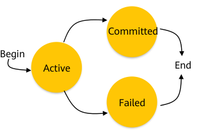
*Figure: Database Transaction Execution State Machine (Active, Committed, Failed, End) (Official Reference: p. 20)*

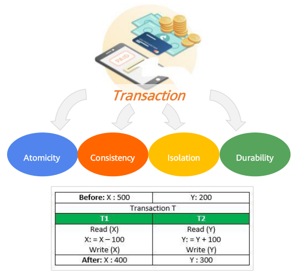
*Figure: ACID Isolation Concurrent Transactions (T1 and T2) (Official Reference: p. 22)*
<!-- PDF_FIGS_END -->

---

### 2. NoSQL (CAP Theory) vs. NewSQL
- **NoSQL ("Not Only SQL")**: Designed for ultra-large-scale concurrent access without fixed schemas:
  1. **Key-Value**: Redis, Memcached, DynamoDB.
  2. **Document (JSON)**: MongoDB, CouchDB, Couchbase.
  3. **Search Engine**: Elasticsearch, Solr, Splunk.
  4. **Wide-Column / Distributed**: HBase, Cassandra.
- **CAP Theorem**: A distributed system can satisfy at most **two** of **Consistency (C)**, **Availability (A)**, and **Partition Tolerance (P)**. Because network partitions are inevitable in distributed systems (**P is mandatory**), distributed NoSQL systems must balance between **CP** (e.g., HBase, MongoDB, Redis) and **AP** (e.g., Cassandra, Dynamo, CouchDB), whereas traditional single-site RDBMSs are **CA**.
- **NewSQL (`SQL + NoSQL = NewSQL`)**: Combines the horizontal scalability of NoSQL with the relational model, SQL interface, and ACID transactions of RDBMS (e.g., Google Spanner, VoltDB, GaussDB).

---

### 3. Evolution of Relational Database Architectures & OLTP vs. OLAP

| Architecture | Key Characteristics | Pros & Bottlenecks |
| :--- | :--- | :--- |
| **Single-Node / Standalone** | App & DB separated on standalone server | Easy O&M; limited to vertical **Scale-Up**, suffers from SPOF. |
| **Master/Backup** | Master does R/W; Backup is idle until failover | Improves fault tolerance; wastes standby resources; single-node perf limit. |
| **Master/Slave** | Master handles Writes; Slaves handle Reads | Read/write isolation scales reads; replication lag causes temporary inconsistency. |
| **Multi-Master** | Active-active bidirectional R/W | High resource utilization; complex bidirectional sync and conflict resolution. |
| **Shared-Disk** | Multiple compute nodes share SAN/FC storage (e.g., Oracle RAC) | High availability; storage I/O bus bandwidth becomes bottleneck. |
| **Shared-Nothing / MPP** | Each node has independent CPU, RAM, and disk; horizontal **Sharding** | Near-linear **Scale-Out**, no shared bottleneck (e.g., GaussDB, DB2 DPF). |

- **OLTP (Online Transaction Processing)** vs. **OLAP (Online Analytical Processing)**:
  - **OLTP**: Routine short transactions (insert/update/delete), read/write, dozens of rows via index/hash, 100 MB–GB scale, measured by **transaction throughput (tpmC)** and memory efficiency.
  - **OLAP**: Decision support & data warehousing, complex multi-dimensional aggregation queries, mostly reads, millions of rows via full/partition scans, 100 GB–TB+ scale, measured by **disk I/O bandwidth and query response time**.
<!-- PDF_FIGS_START -->
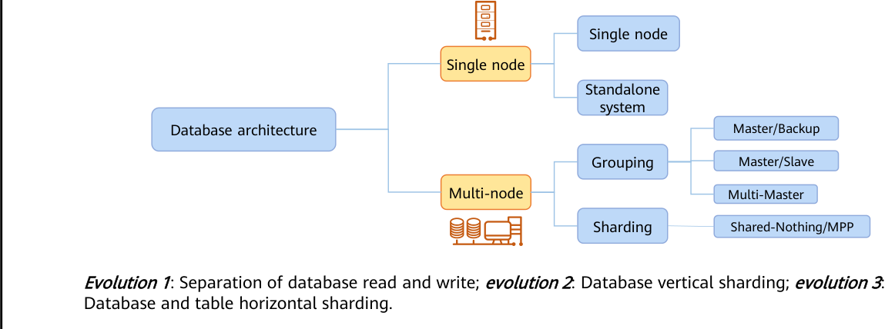
*Figure: Relational Database Deployment Architecture Taxonomy (Official Reference: p. 31)*

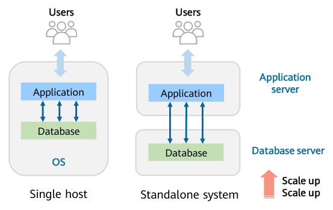
*Figure: Single Node vs Standalone Database Deployment (Official Reference: p. 32)*

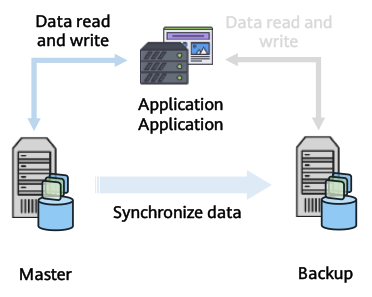
*Figure: Grouping Deployment: Master/Backup Topology (Official Reference: p. 33)*

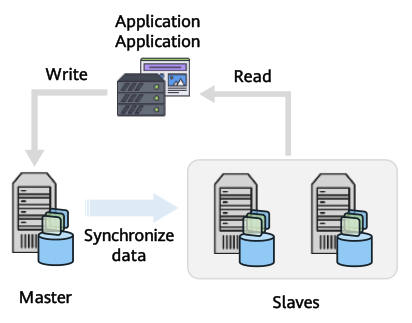
*Figure: Grouping Deployment: Master/Slave (Read/Write Split) Topology (Official Reference: p. 34)*

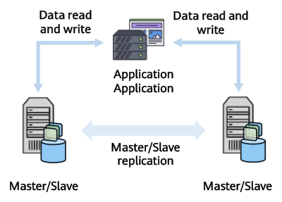
*Figure: Grouping Deployment: Multi-Master Topology (Official Reference: p. 35)*

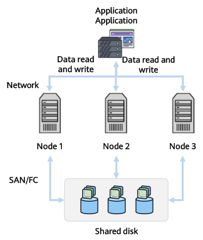
*Figure: Shared Disk Multi-Master Cluster Topology (Official Reference: p. 36)*

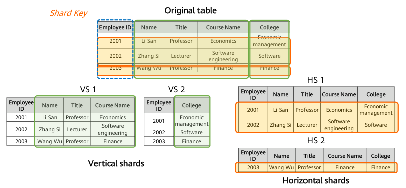
*Figure: Horizontal vs Vertical Database Sharding Diagram (Official Reference: p. 37)*

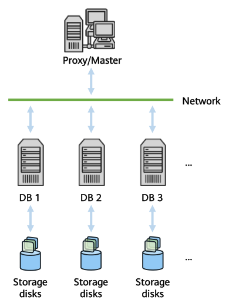
*Figure: Shared-Nothing Distributed Architecture (Official Reference: p. 38)*

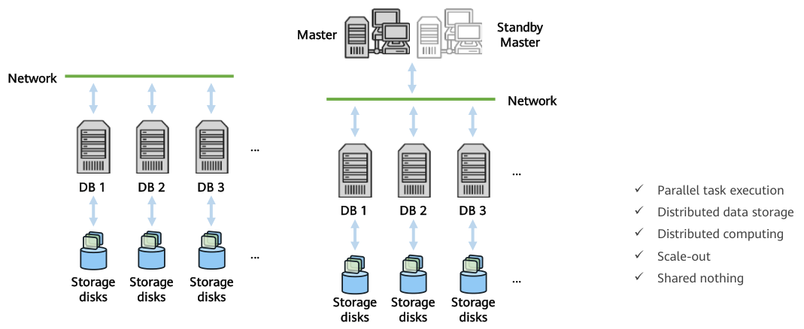
*Figure: Massively Parallel Processing (MPP) Execution Topology (Official Reference: p. 39)*
<!-- PDF_FIGS_END -->

---

## Key Takeaways
- **In ACID, 'I' stands for Isolation (concurrent transactions do not interfere), NOT Availability!**
- **CAP Theorem states a distributed system can guarantee at most two of Consistency (C), Availability (A), and Partition Tolerance (P).**
- **Shared-Nothing (MPP) gives each node independent CPU, memory, and disk, enabling near-linear horizontal scale-out.**

## Huawei ICT Competition National Stage Exam Traps
> [!WARNING]
> EXAM TRAP (Ch.01 Quiz Q2): Option C claims 'I refers to availability, whereby the database system must provide the highest availability possible'. That is INCORRECT! 'I' stands for Isolation.

> [!WARNING]
> EXAM TRAP: Do not confuse Master/Backup (standby does NOT provide read services during normal operation) with Master/Slave (slave provides read services via read/write splitting).

---

### Next Step: Immediate Hands-On Exercise
Proceed immediately to **[`04-Exercise-Transaction-ACID-and-Architecture-Lab.html`](./04-Exercise-Transaction-ACID-and-Architecture-Lab.html)** (or [`04-Exercise-Transaction-ACID-and-Architecture-Lab.md`](./04-Exercise-Transaction-ACID-and-Architecture-Lab.md)) to apply this concept in an interactive lab workbench!
