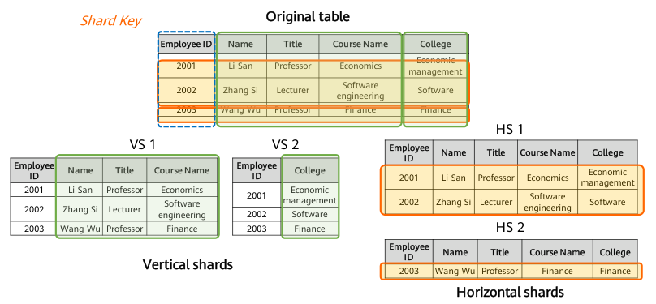

# Hands-On Lab: Simulating Bank Transfer ACID Transactions in openGauss

**Pillar:** HCIA-openGauss V2.0 (Enterprise Relational Database & GaussDB)  
**Schedule Block:** Hour 01 — openGauss Overview & Database Fundamentals (Sprint 2 of 4)  
**Format:** Immediate Hands-On Exercise (8 mins) — Paired with `03-Lecture-Transactions-ACID-NoSQL-NewSQL-and-Architectures`  
**Interactive Workbench:** Open **[`04-Exercise-Transaction-ACID-and-Architecture-Lab.html`](./04-Exercise-Transaction-ACID-and-Architecture-Lab.html)** or **[`../index.html`](../index.html)** for live execution & auto-grading!

---

## Part A: Practical Lab Scenario
Implement the Chapter 01 (p. 62) bank transfer scenario where Zhang (Account 1, balance 500) starts transferring 200 to Wang (Account 2, balance 100) but cancels (`ROLLBACK`), while Li (Account 3, balance 600) transfers 300 to Wang and commits (`COMMIT`).

<!-- PDF_FIGS_START -->
#### Reference Diagrams


*Figure: Horizontal vs Vertical Database Sharding Diagram (Official Reference: p. 37)*
<!-- PDF_FIGS_END -->

### Step-by-Step Instructions
1. Step 1: Start a transaction with `START TRANSACTION;`, deduct 200 from Zhang (`id = 1`), add 200 to Wang (`id = 2`), and then cancel the transaction with `ROLLBACK;`.
2. Step 2: Start a second transaction with `START TRANSACTION;`, deduct 300 from Li (`id = 3`), add 300 to Wang (`id = 2`), and permanently save it with `COMMIT;`.
3. Step 3: Query `SELECT id, holder, balance FROM accounts ORDER BY id;` to verify Wang's final balance is 400.

### Starter Workspace (`openGauss=#`)
```bash
-- Zhang's canceled transfer (Atomicity rollback)
START TRANSACTION;
UPDATE accounts SET balance = balance - 200 WHERE id = 1;
UPDATE accounts SET balance = balance + 200 WHERE id = 2;
____;

-- Li's completed transfer (Atomicity, Consistency, Durability)
START TRANSACTION;
UPDATE accounts SET balance = balance - 300 WHERE id = 3;
UPDATE accounts SET balance = balance + 300 WHERE id = 2;
____;

SELECT id, holder, balance FROM accounts ORDER BY id;
```

<details>
<summary><strong>Click to View Hints</strong></summary>

- Use ROLLBACK; to abort Zhang's transfer and restore Wang's balance to 100.
- Use COMMIT; to permanently persist Li's transfer of 300 so Wang's balance becomes 400.

</details>

<details>
<summary><strong>Click to Reveal Full Working Solution & Expected Output</strong></summary>

#### Solution Code / Commands:
```bash
START TRANSACTION;
UPDATE accounts SET balance = balance - 200 WHERE id = 1;
UPDATE accounts SET balance = balance + 200 WHERE id = 2;
ROLLBACK;

START TRANSACTION;
UPDATE accounts SET balance = balance - 300 WHERE id = 3;
UPDATE accounts SET balance = balance + 300 WHERE id = 2;
COMMIT;

SELECT id, holder, balance FROM accounts ORDER BY id;
```

#### Expected Console / Query Output:
```text
START TRANSACTION
UPDATE 1
UPDATE 1
ROLLBACK
START TRANSACTION
UPDATE 1
UPDATE 1
COMMIT
 id | holder | balance 
----+--------+---------
  1 | Zhang  |     500
  2 | Wang   |     400
  3 | Li     |     300
(3 rows)
```
</details>

---

## Part B: National Stage Exam Verification Drill

### Question 1 [Single-Choice]
**(Official Ch.01 Quiz Q2) Which of the following statements about the ACID feature of database transactions is INCORRECT?**

- A. A indicates atomicity, whereby operations in a transaction are either all successful or all failed.
- B. C refers to consistency, whereby the system status can only be the status before the transaction or after the transaction is successful. No inconsistent intermediate status can occur.
- C. I refers to availability, whereby the database system must provide the highest availability possible for transaction execution in order to ensure as many successfully executed transactions as possible.
- D. D refers to durability, whereby the status of a successful transaction can be maintained, even if the machine is powered off.

<details>
<summary>[PASS] <strong>Check Answer & Explanation (Question 1)</strong></summary>

- **Correct Answer:** `C`
- **Explanation:** In ACID, 'I' stands for Isolation (transactions are isolated from each other and do not interfere when executed concurrently), NOT Availability.
</details>

### Question 2 [Single-Choice]
**In which multi-node database architecture does each processing unit have its own independent CPU, memory, and hard disk without sharing hardware resources?**

- A. Shared-Everything
- B. Shared-Disk (e.g., Oracle RAC)
- C. Shared-Nothing / MPP
- D. Single-Host Standalone

<details>
<summary>[PASS] <strong>Check Answer & Explanation (Question 2)</strong></summary>

- **Correct Answer:** `C`
- **Explanation:** In Shared-Nothing (and MPP) architecture, each node has its own private CPU, memory, and disk, communicating via network protocols for horizontal scale-out.
</details>

### Question 3 [True / False]
**According to the CAP theory for distributed systems, a distributed database can simultaneously satisfy Consistency (C), Availability (A), and Partition Tolerance (P) at all times.**

- A. True
- B. False

<details>
<summary>[PASS] <strong>Check Answer & Explanation (Question 3)</strong></summary>

- **Correct Answer:** `B`
- **Explanation:** False. CAP theory states that a distributed system can satisfy at most TWO of Consistency (C), Availability (A), and Partition Tolerance (P) at the same time.
</details>
