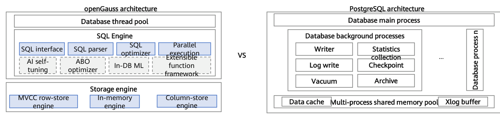

# Hands-On Lab: Inspecting the Multi-Threaded `gaussdb` Process & Kernel Version

**Pillar:** HCIA-openGauss V2.0 (Enterprise Relational Database & GaussDB)  
**Schedule Block:** Hour 01 — openGauss Overview & Database Fundamentals (Sprint 3 of 4)  
**Format:** Immediate Hands-On Exercise (8 mins) — Paired with `05-Lecture-openGauss-Positioning-Evolution-and-PG-Comparison`  
**Interactive Workbench:** Open **[`06-Exercise-openGauss-vs-PostgreSQL-Architecture-Lab.html`](./06-Exercise-openGauss-vs-PostgreSQL-Architecture-Lab.html)** or **[`../index.html`](../index.html)** for live execution & auto-grading!

---

## Part A: Practical Lab Scenario
Verify that openGauss runs as a single `gaussdb` process with multiple worker and background threads (unlike PostgreSQL's multi-process model) and check the openGauss version and incremental checkpoint setting.

<!-- PDF_FIGS_START -->
#### Reference Diagrams


*Figure: openGauss Thread Pool Architecture vs PostgreSQL Multi-Process Architecture (Official Reference: p. 48)*
<!-- PDF_FIGS_END -->

### Step-by-Step Instructions
1. Step 1: Use `ps ux | grep gaussdb` to view the running `gaussdb` master process.
2. Step 2: Use `ps -T -p 24209` to list the threads (`SPID`) inside the `gaussdb` process.
3. Step 3: Query the `enable_incremental_checkpoint` parameter using `gsql -d postgres -p 5432 -c "SHOW enable_incremental_checkpoint;"`.

### Starter Workspace (`omm@opengauss:~$`)
```bash
# Step 1: Check the gaussdb process
ps ux | grep ____

# Step 2: View all threads (-T) belonging to process 24209
ps ____ -p 24209

# Step 3: Verify incremental checkpoint is enabled
gsql -d postgres -p 5432 -c "SHOW ____;"
```

<details>
<summary><strong>Click to View Hints</strong></summary>

- The openGauss server binary name is `gaussdb`.
- The `ps -T -p <PID>` flag displays all threads running inside a single process.
- The GUC parameter for incremental checkpointing is `enable_incremental_checkpoint`.

</details>

<details>
<summary><strong>Click to Reveal Full Working Solution & Expected Output</strong></summary>

#### Solution Code / Commands:
```bash
ps ux | grep gaussdb
ps -T -p 24209
gsql -d postgres -p 5432 -c "SHOW enable_incremental_checkpoint;"
```

#### Expected Console / Query Output:
```text
omm      24209 11.9  1.0 1852000 355816 pts/0  Sl   01:54   0:33 /opt/software/openGauss/bin/gaussdb -D /opt/software/openGauss/data/single_node
  PID  SPID TTY          TIME CMD
24209 24209 pts/0    00:00:02 gaussdb
24209 24215 pts/0    00:00:01 syslogger
24209 24217 pts/0    00:00:04 pagewriter
24209 24218 pts/0    00:00:03 bgwriter
24209 24219 pts/0    00:00:05 checkpointer
24209 24220 pts/0    00:00:06 walwriter
 enable_incremental_checkpoint 
-------------------------------
 on
(1 row)
```
</details>

---

## Part B: National Stage Exam Verification Drill

### Question 1 [Single-Choice]
**Under which open-source license is the openGauss database released?**

- A. GPL v3
- B. Apache License 2.0
- C. Mulan Permissive Software License v2 (Mulan PSL v2)
- D. BSD 3-Clause License

<details>
<summary>[PASS] <strong>Check Answer & Explanation (Question 1)</strong></summary>

- **Correct Answer:** `C`
- **Explanation:** Per Chapter 01 (pp. 43, 46, 50), openGauss is released under the Mulan Permissive Software License v2 (Mulan PSL v2).
</details>

### Question 2 [Multiple-Choice (Select ALL)]
**Which of the following accurately describe architectural advantages of openGauss compared with PostgreSQL?**

- A. openGauss uses a single-process multi-threaded architecture instead of PostgreSQL's multi-process architecture
- B. openGauss uses 64-bit transaction IDs and CSNs to eliminate 32-bit transaction ID wraparound bottlenecks
- C. openGauss uses incremental checkpoints with performance fluctuation < 5% instead of full checkpoints (> 15%)
- D. openGauss supports only row-store tables whereas PostgreSQL supports row-store, column-store, and MOT

<details>
<summary>[PASS] <strong>Check Answer & Explanation (Question 2)</strong></summary>

- **Correct Answer:** `ABC`
- **Explanation:** Options A, B, and C are exact advantages of openGauss (Ch.01 pp. 48–49). Option D is reversed: openGauss supports row-store, column-store, and MOT, whereas PostgreSQL supports row-store only.
</details>

### Question 3 [True / False]
**In the openGauss community, the Technical Committee (TC) makes decisions regarding the technical development direction of the community.**

- A. True
- B. False

<details>
<summary>[PASS] <strong>Check Answer & Explanation (Question 3)</strong></summary>

- **Correct Answer:** `A`
- **Explanation:** True (Ch.01 p. 50). The TC makes decisions on the technical direction, Maintainers attend to project code, Committers monitor code quality and integrate modifications, and Contributors submit requirements/bugs/code.
</details>
