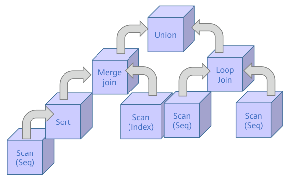
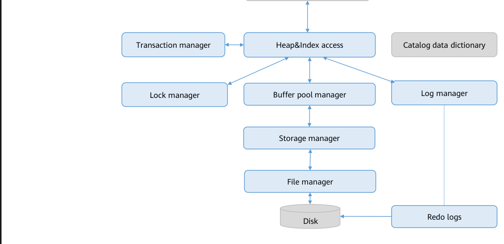
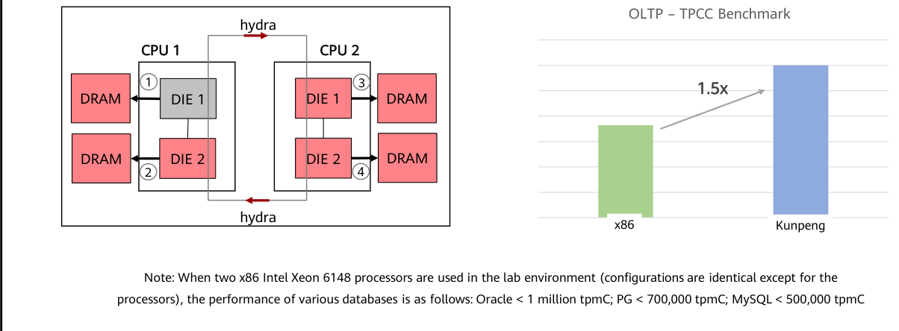
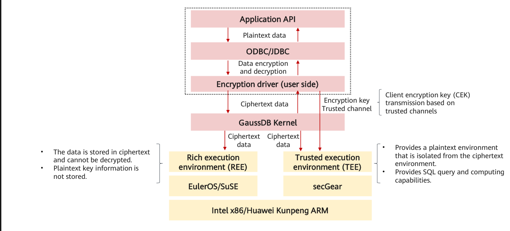
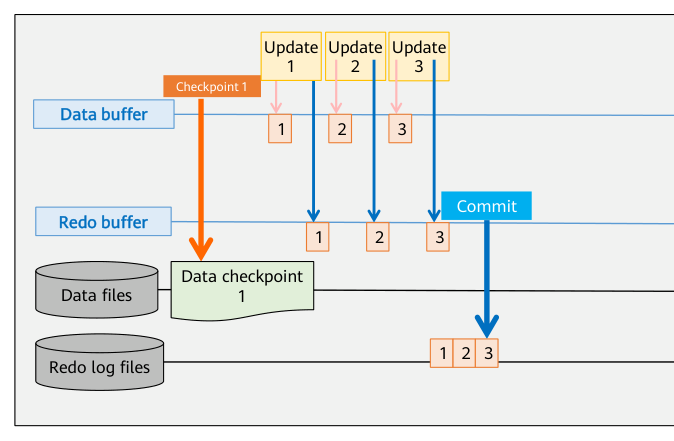

# openGauss Technical Specifications, APIs (`ODBC`/`JDBC`) & SQL Hints

**Pillar:** HCIA-openGauss V2.0 (Enterprise Relational Database & GaussDB)  
**Schedule Block:** Hour 01 — openGauss Overview & Database Fundamentals (Sprint 4 of 4)  
**Format:** Bite-Sized Lecture (7 mins) - Followed immediately by `08-Exercise-Specs-JDBC-ODBC-and-Plan-Hints-Lab` (8 mins)  
**Official Material Reference:** `HCIA-openGauss V2.0 Training Material.pdf` — Ch.01, pp. 51–71

---

## Learning Objectives
- Identify the 4 categories of execution engine plan nodes (Scan, Control, Materialize, Join)
- Memorize official openGauss technical specifications (32 TB table size, 1 GB row/field, 10,000 connections, partition limits)
- Configure standard SQL, ODBC 3.5, JDBC 4.0 (JDK 1.8), libpq/ECPG APIs, WAL/Checkpoint transaction durability, and SQL Plan Hints

---

### 1. Query Optimization, Execution Engine & Storage Engine (pp. 52–54)
- **Physical Query Optimization Pipeline**:
  `Table/Column Statistics (Unique + MCV)` -> `Row Estimation (baserel/joinrel/agg)` -> `Cost Estimation` -> `Access Path Generation (Dynamic Programming / Genetic Algorithm)` -> `PlanTree Generation`.
- **4 Categories of Execution Engine Plan Nodes (pp. 53–54)**:
  1. **Scan plan nodes** (Leaf nodes, input data + expression filtering): `SeqScan`, `IndexScan`, `SubQueryScan`.
  2. **Control plan nodes** (Flow control): `Limit`, `RecursiveUnion`, `Union`.
  3. **Materialize plan nodes** (Cache lower-layer data; return only after all data is scanned): `Agg`, `Sort`.
  4. **Join plan nodes** (Multiple inputs): `MergeJoin`, `SortJoin` / `NestLoop`, `HashJoin`.
<!-- PDF_FIGS_START -->

*Figure: openGauss Execution Engine Pipeline (Scan, Plan, Materialization, Join) (Official Reference: p. 53)*

*Figure: openGauss Storage Engine Layered Stack (Official Reference: p. 54)*

*Figure: Kunpeng Multi-Core CPU Architecture and Dual-Socket Performance (Official Reference: p. 55)*
<!-- PDF_FIGS_END -->

---

### 2. Official openGauss Technical Specifications (p. 57)

| Technical Specification Item | Official Maximum Value |
| :--- | :--- |
| **Database capacity** | Varies depending on the OS and hardware |
| **Maximum size of a single table** | **32 TB** |
| **Maximum size of data in a single row / single field** | **1 GB** (Row) / **1 GB** (Field) |
| **Maximum number of records in each table** | **2^{48}** |
| **Number of columns in a single table** | **250 to 1,600** (varies with field type) |
| **Number of indexes / constraints on a single table** | **Unlimited** |
| **Maximum columns in a composite index** | **32** (up to 16 recommended in DDL guide) |
| **Maximum concurrent connections** | **10,000** |
| **Maximum partitions in a partitioned table** | **32,768 (Range partitioning)** / **64 (Hash or List partitioning)** |
| **Size of each partition / records per partition** | **32 TB** / **2^{55} records** |

---

### 3. Standard APIs, Transaction WAL Mechanism & SQL Hints (pp. 59–66)
- **Standard SQL**: Supports SQL-92, SQL-99, **SQL:2003** standard, and core/optional features of **SQL:2011**.
- **ODBC 3.5**: Uses `unixODBC-2.3.0` or `iODBC` on Linux/UNIX, or native Windows ODBC Driver Manager. *(Note: Current open-source ODBC driver may be incompatible with `tinyint`, `smalldatetime`, and `nvarchar2`.)*
- **JDBC 4.0**: Requires **JDK 1.8** for compilation; supports third-party logging frameworks; **does NOT support JDBC-ODBC bridging**.
- **PostgreSQL Client APIs**: Compatible with **libpq** (C API foundation) and **ECPG** (Embedded SQL in C).
- **Transaction Mechanism (p. 62–63)**:
  - Default transaction isolation level is **`READ COMMITTED`** (prevents dirty reads).
  - Durability is guaranteed by **WAL (Write-Ahead Logging)** — redo logs are flushed to disk upon commit before data pages, while **Checkpoints** flush dirty buffers from the dirty buffer queue to data files.
- **SQL Plan Hints (`/*+ ... */`)**: Override the optimizer's execution plan by specifying join order, join method (`HashJoin`, `MergeJoin`, `NestLoop`), scan method (`IndexScan`, `SeqScan`), stream mode, or row estimates.
<!-- PDF_FIGS_START -->

*Figure: openGauss Fully-Encrypted Database Equality Query (Client Driver to TEE) (Official Reference: p. 56)*

*Figure: Write-Ahead Logging (WAL) Redo Buffer and Checkpoint Disk Flush Flow (Official Reference: p. 63)*
<!-- PDF_FIGS_END -->

---

## Key Takeaways
- **openGauss supports up to 32 TB per table, 1 GB per row/field, 10,000 concurrent connections, 32,768 range partitions, and 64 hash/list partitions.**
- **The default transaction isolation level in openGauss is READ COMMITTED, and durability is enforced via Write-Ahead Logging (WAL).**
- **openGauss supports ODBC 3.5, JDBC 4.0 (requires JDK 1.8, no JDBC-ODBC bridge), libpq, and ECPG.**

## Huawei ICT Competition National Stage Exam Traps
> [!WARNING]
> EXAM TRAP: Range partitioning supports up to 32,768 partitions per table, whereas Hash and List partitioning support up to 64 partitions (Ch.01 p. 57).

> [!WARNING]
> EXAM TRAP: Materialize plan nodes (such as Agg and Sort) return data ONLY after all lower-layer data has been scanned and cached.

---

### Next Step: Immediate Hands-On Exercise
Proceed immediately to **[`08-Exercise-Specs-JDBC-ODBC-and-Plan-Hints-Lab.html`](./08-Exercise-Specs-JDBC-ODBC-and-Plan-Hints-Lab.html)** (or [`08-Exercise-Specs-JDBC-ODBC-and-Plan-Hints-Lab.md`](./08-Exercise-Specs-JDBC-ODBC-and-Plan-Hints-Lab.md)) to apply this concept in an interactive lab workbench!
