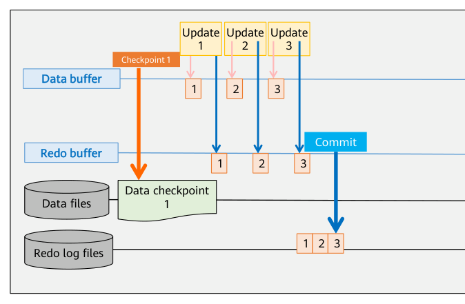

# Hands-On Lab: Applying SQL Plan Hints & Inspecting Execution Plans

**Pillar:** HCIA-openGauss V2.0 (Enterprise Relational Database & GaussDB)  
**Schedule Block:** Hour 01 — openGauss Overview & Database Fundamentals (Sprint 4 of 4)  
**Format:** Immediate Hands-On Exercise (8 mins) — Paired with `07-Lecture-Technical-Specifications-APIs-and-SQL-Hints`  
**Interactive Workbench:** Open **[`08-Exercise-Specs-JDBC-ODBC-and-Plan-Hints-Lab.html`](./08-Exercise-Specs-JDBC-ODBC-and-Plan-Hints-Lab.html)** or **[`../index.html`](../index.html)** for live execution & auto-grading!

---

## Part A: Practical Lab Scenario
You are tuning a join query between `client c` and `bank_card b`. Check the default transaction isolation level, and use an openGauss SQL Plan Hint (`/*+ ... */`) with `EXPLAIN` to force a `HashJoin(c b)` and `IndexScan(c)`.

<!-- PDF_FIGS_START -->
#### Reference Diagrams


*Figure: Write-Ahead Logging (WAL) Redo Buffer and Checkpoint Disk Flush Flow (Official Reference: p. 63)*
<!-- PDF_FIGS_END -->

### Step-by-Step Instructions
1. Step 1: Run `SHOW default_transaction_isolation;` to verify the default isolation level is `read committed`.
2. Step 2: Use `EXPLAIN SELECT /*+ HashJoin(c b) IndexScan(c) */ c.c_id, b.b_number FROM client c JOIN bank_card b ON c.c_id = b.b_c_id;` to inspect the hinted execution plan.

### Starter Workspace (`openGauss=#`)
```bash
-- Step 1: Check default transaction isolation level
SHOW ____;

-- Step 2: Use SQL Plan Hints to force HashJoin(c b) and IndexScan(c)
EXPLAIN SELECT /*+ ____(c b) ____(c) */ c.c_id, b.b_number
FROM client c JOIN bank_card b ON c.c_id = b.b_c_id;
```

<details>
<summary><strong>Click to View Hints</strong></summary>

- The GUC parameter for default isolation level is `default_transaction_isolation`.
- Inside `/*+ ... */`, specify `HashJoin(c b)` and `IndexScan(c)`.

</details>

<details>
<summary><strong>Click to Reveal Full Working Solution & Expected Output</strong></summary>

#### Solution Code / Commands:
```bash
SHOW default_transaction_isolation;

EXPLAIN SELECT /*+ HashJoin(c b) IndexScan(c) */ c.c_id, b.b_number
FROM client c JOIN bank_card b ON c.c_id = b.b_c_id;
```

#### Expected Console / Query Output:
```text
default_transaction_isolation 
-------------------------------
 read committed
(1 row)

                                    QUERY PLAN                                    
----------------------------------------------------------------------------------
 Hash Join  (cost=15.25..48.60 rows=100 width=42)
   Hash Cond: (b.b_c_id = c.c_id)
   ->  Seq Scan on bank_card b  (cost=0.00..22.00 rows=1000 width=38)
   ->  Hash  (cost=14.00..14.00 rows=100 width=4)
         ->  Index Scan using client_pkey on client c  (cost=0.00..14.00 rows=100 width=4)
(5 rows)
```
</details>

---

## Part B: National Stage Exam Verification Drill

### Question 1 [Single-Choice]
**According to the openGauss technical specifications, what is the maximum size of a single table and the maximum number of concurrent connections?**

- A. 16 TB and 5,000 connections
- B. 32 TB and 10,000 connections
- C. 64 TB and 20,000 connections
- D. 128 TB and 100,000 connections

<details>
<summary>[PASS] <strong>Check Answer & Explanation (Question 1)</strong></summary>

- **Correct Answer:** `B`
- **Explanation:** Per Chapter 01 (p. 57), the maximum size of a single table in openGauss is 32 TB, and the maximum number of concurrent connections on a single node is 10,000.
</details>

### Question 2 [Multiple-Choice (Select ALL)]
**Which of the following statements about openGauss client APIs and transaction mechanisms are TRUE?**

- A. openGauss supports ODBC 3.5 and JDBC 4.0 (requiring JDK 1.8)
- B. openGauss is compatible with PostgreSQL client APIs libpq and ECPG
- C. Transaction durability is implemented using the Write-Ahead Log (WAL) algorithm
- D. The default transaction isolation level in openGauss is SERIALIZABLE

<details>
<summary>[PASS] <strong>Check Answer & Explanation (Question 2)</strong></summary>

- **Correct Answer:** `ABC`
- **Explanation:** Options A, B, and C are true (Ch.01 pp. 60–65). Option D is false: the default transaction isolation level in openGauss is READ COMMITTED.
</details>

### Question 3 [True / False]
**In the openGauss execution engine, Materialize plan nodes (such as Agg and Sort) return data only after all lower-layer data has been scanned.**

- A. True
- B. False

<details>
<summary>[PASS] <strong>Check Answer & Explanation (Question 3)</strong></summary>

- **Correct Answer:** `A`
- **Explanation:** True (Ch.01 p. 54). Materialize plan nodes cache lower-layer data and return results only after all data is scanned.
</details>
