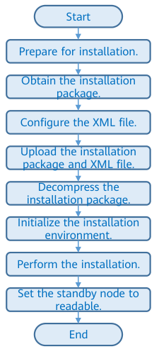

# Hands-On Lab: Single-Node Installation, Status Verification & Uninstallation

**Pillar:** HCIA-openGauss V2.0 (Enterprise Relational Database & GaussDB)  
**Schedule Block:** Hour 02 — openGauss Installation, Authentication & O&M Tools (Sprint 2 of 4)  
**Format:** Immediate Hands-On Exercise (8 mins) — Paired with `03-Lecture-Installing-Starting-Stopping-and-Uninstalling-openGauss`  
**Interactive Workbench:** Open **[`04-Exercise-Installation-Lifecycle-and-Uninstallation-Lab.html`](./04-Exercise-Installation-Lifecycle-and-Uninstallation-Lab.html)** or **[`../index.html`](../index.html)** for live execution & auto-grading!

---

## Part A: Practical Lab Scenario
Perform a simplified single-node installation of openGauss using `install.sh`, verify the instance state with `gs_ctl query`, start/stop the cluster with `gs_om`, and write the uninstallation command.

<!-- PDF_FIGS_START -->
#### Reference Diagrams


*Figure: openGauss End-to-End Installation Pipeline (Official Reference: p. 82)*
<!-- PDF_FIGS_END -->

### Step-by-Step Instructions
1. Step 1: Run `sh install.sh -w Kunpeng@2026` inside `/opt/software/openGauss/simpleInstall`.
2. Step 2: Query the instance status using `gs_ctl query -D /opt/software/openGauss/data/single_node`.
3. Step 3: Start the cluster using `gs_om -t start` and write the command to uninstall openGauss and delete data (`gs_uninstall --delete-data`).

### Starter Workspace (`omm@opengauss:~$`)
```bash
# Step 1: Run simplified single-node installation with initial password
cd /opt/software/openGauss/simpleInstall
sh install.sh ____ Kunpeng@2026

# Step 2: Check instance HA state using gs_ctl
gs_ctl ____ -D /opt/software/openGauss/data/single_node

# Step 3: Start cluster and show uninstall command
gs_om -t ____
# To uninstall as omm:
gs_uninstall ____
```

<details>
<summary><strong>Click to View Hints</strong></summary>

- Use `-w` with `install.sh` to specify the mandatory initial database password.
- Use `gs_ctl query -D <datadir>` to check the HA state of the node.
- Use `gs_om -t start` to start openGauss and `gs_uninstall --delete-data` to uninstall it.

</details>

<details>
<summary><strong>Click to Reveal Full Working Solution & Expected Output</strong></summary>

#### Solution Code / Commands:
```bash
cd /opt/software/openGauss/simpleInstall
sh install.sh -w Kunpeng@2026
gs_ctl query -D /opt/software/openGauss/data/single_node
gs_om -t start
gs_uninstall --delete-data
```

#### Expected Console / Query Output:
```text
[step 1]: check parameter
[step 2]: start install openGauss
[step 3]: initdb success, datadir is /opt/software/openGauss/data/single_node
gs_ctl query ,datadir is /opt/software/openGauss/data/single_node
 HA state:
        local_role                     : Normal
        static_connections             : 0
        db_state                       : Normal
Starting cluster.
=========================================
Successfully started.
```
</details>

---

## Part B: National Stage Exam Verification Drill

### Question 1 [Multiple-Choice (Select ALL)]
**(Official Ch.02 Quiz Q3) Which of the following are the prerequisites for installing openGauss on a single node?**

- A. User groups and common users have been created, and the operating systems and networks of all servers are running properly.
- B. Common users must have the read, write, and execute permissions on the database package decompression directory and installation directory, and the installation directory must be empty.
- C. A common user has the execution permission on the downloaded openGauss package.
- D. Before the installation, check whether the specified openGauss port is occupied. If the port is occupied, change the port number or stop the process that uses the port.

<details>
<summary>[PASS] <strong>Check Answer & Explanation (Question 1)</strong></summary>

- **Correct Answer:** `ABCD`
- **Explanation:** Per Chapter 02 (p. 92 & p. 127), all four options (A, B, C, and D) are mandatory prerequisites for installing openGauss on a single node.
</details>

### Question 2 [Single-Choice]
**When running `sh install.sh` in `simpleInstall` to deploy a single-node openGauss instance without specifying `-p`, what is the default port and default database node name created?**

- A. Port 3306, node name mysqld
- B. Port 5432, node name sgnode
- C. Port 1521, node name orcl
- D. Port 26000, node name dn_6001

<details>
<summary>[PASS] <strong>Check Answer & Explanation (Question 2)</strong></summary>

- **Correct Answer:** `B`
- **Explanation:** Per Chapter 02 (p. 92), if `-p` is not specified in `install.sh`, the default port is 5432 and the database node name after installation is `sgnode`.
</details>

### Question 3 [True / False]
**After `gs_uninstall` is executed by user `omm`, any common OS user can run `gs_postuninstall` to clean up the OS environment settings made by `gs_preinstall`.**

- A. True
- B. False

<details>
<summary>[PASS] <strong>Check Answer & Explanation (Question 3)</strong></summary>

- **Correct Answer:** `B`
- **Explanation:** False (Ch.02 p. 125). Only user `root` is authorized to run the `gs_postuninstall` command.
</details>
