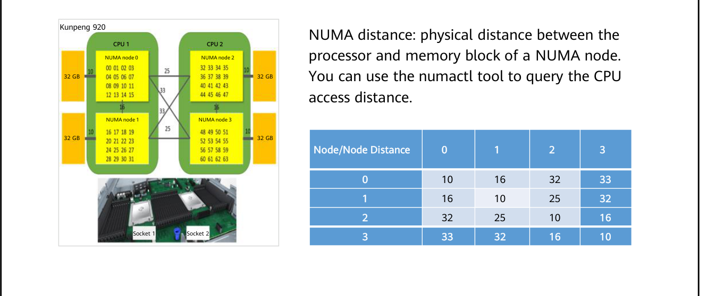
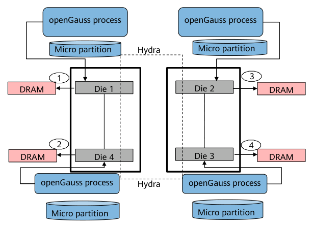
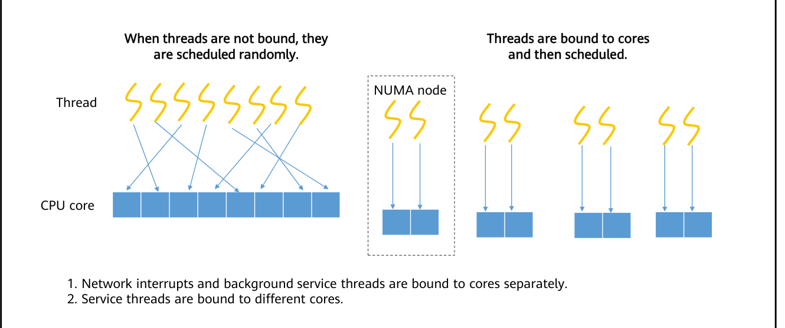
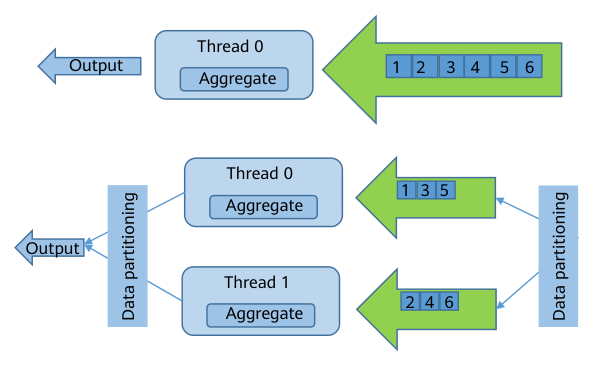
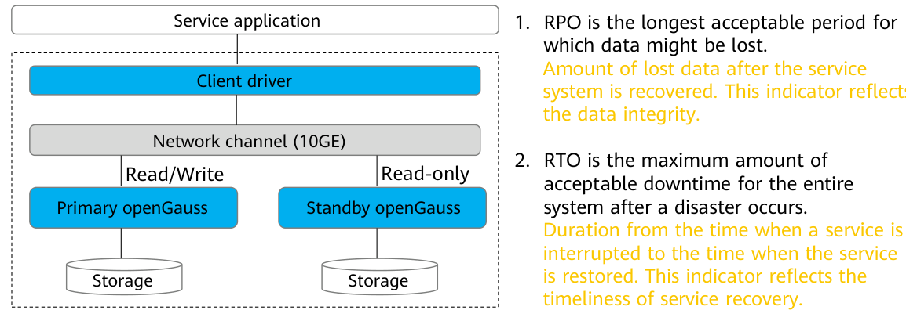

# Table Partitioning, Kunpeng NUMA Optimization, SMP & High Availability / Ultimate RTO

**Pillar:** HCIA-openGauss V2.0 (Enterprise Relational Database & GaussDB)  
**Schedule Block:** Hour 03 — openGauss Architecture, Resource Pooling & High Performance (Sprint 4 of 4)  
**Format:** Bite-Sized Lecture (7 mins) - Followed immediately by `08-Exercise-Partitioning-SMP-Switchover-and-RTO-Lab` (8 mins)  
**Official Material Reference:** `HCIA-openGauss V2.0 Training Material.pdf` — Ch.03, pp. 174–198

---

## Learning Objectives
- Create and manage Range, List, and Hash partitioned tables and `LOCAL`/`GLOBAL` partitioned indexes
- Explain Kunpeng 920 NUMA optimizations (`numactl -H`, ARMv8.1 `casal` atomic instruction, core binding) and SMP (`query_dop`)
- Execute Primary/Standby `switchover` vs `failover` (`gs_ctl`, `gs_om -t refreshconf`), configure Ultimate RTO (`recovery_parse_workers`, `recovery_parallelism`), and describe Logical Replication

---

### 1. Table Partitioning (pp. 174–181)
openGauss horizontally splits a table into non-overlapping physical partitions to deliver **high query efficiency (partition pruning)**, **high availability**, **easy maintenance**, and **balanced I/O**:
- **3 Partitioning Modes**:
  1. **Range Partitioning (`PARTITION BY RANGE(col)`)**: Maps rows by non-overlapping value ranges (`VALUES LESS THAN (...)`). Most common (often on time/date columns).
  2. **List Partitioning (`PARTITION BY LIST(col)`)**: Maps rows by discrete key value lists (`VALUES (...)`).
  3. **Hash Partitioning (`PARTITION BY HASH(col)`)**: Maps rows evenly across partitions using an internal hash function.
- **Core Partition DDL Operations (pp. 177–180)**:
  ```sql
  ALTER TABLE student1 ADD PARTITION score4 VALUES LESS THAN (101);
  ALTER TABLE student1 DROP PARTITION score1;
  ALTER TABLE student1 RENAME PARTITION score2 TO score2_new;
  ALTER TABLE student1 TRUNCATE PARTITION score2_new;
  SELECT * FROM student1 PARTITION (score2_new);
  CREATE INDEX student1_index1 ON student1 (score) LOCAL;
  ALTER INDEX student1_index2 RENAME PARTITION score1_index TO score1_index_new;
  ```

---

### 2. Kunpeng NUMA Architecture Optimization & SMP Parallelism (pp. 182–188)
- **Kunpeng 920 NUMA Structure (p. 183)**:
  - A 2-socket Kunpeng 920 (64 cores, 2 Dies per socket = **4 NUMA nodes 0–3**) has local node access distance **10**, intra-socket cross-die distance **16** (1.6x latency), and cross-socket distance **25–33**. Inspect via **`numactl -H`**.
  - **5 openGauss NUMA Optimizations (pp. 182–186)**:
    1. **Thread-to-Core Binding**: Separately binds network interrupts and service threads to CPU cores to prevent cross-core thread migration.
    2. **NUMA-Aware Data Structures**: Partitions hotspot structures (e.g., Clog partitions, WAL buffers) per NUMA node to reduce cross-node access.
    3. **Redo Log Batch Insertion** & larger Kunpeng L3 cache-line padding.
    4. **ARMv8.1 LSE Atomic Instruction (`casal`)**: Replaces 4 instructions (`ldxr` + `stlxr` loop) with **1 single atomic instruction (`casal`)**, boosting 2-socket Kunpeng TPC-C performance by **> 10%** (from **1.34M to 1.51M tpmC**)!
- **SMP (Symmetric Multi-Processing, pp. 187–188)**:
  - Intra-query operator-level multi-threaded parallel execution within a single process (exchanging data in memory via the **`Stream`** operator without network overhead).
  - Controlled by GUC **`query_dop`**: `1` (disabled, default); `0` (adaptive selection between `[1, 8]` when system load < 50%). *Note*: Data skew or high concurrent OLTP load degrades SMP efficiency.
<!-- PDF_FIGS_START -->

*Figure: Kunpeng NUMA CPU Die Structure and Node Distance Matrix (Official Reference: p. 183)*


*Figure: NUMA-Aware Kernel Data Partitioning Structure (Official Reference: p. 185)*


*Figure: Unscheduled Thread Migration vs NUMA-Pinned Core Binding (Official Reference: p. 186)*


*Figure: SMP Multi-Thread Parallel Execution Flow (Official Reference: p. 187)*
<!-- PDF_FIGS_END -->


---

### 3. High Availability, Switchover/Failover, Ultimate RTO & Logical Replication (pp. 190–198)
- **Switchover vs. Failover (pp. 190–193)**:
  - **Switchover (Planned maintenance, zero data loss)**:
    ```bash
    gs_om -t status --detail
    gs_ctl switchover -D /home/omm/cluster/dn1/   # Run on target standby node as omm
    gs_om -t refreshconf                          # Save dynamic primary/standby role state
    ```
  - **Failover (Unplanned primary fault, may cause data loss if async)**:
    ```bash
    gs_ctl failover -D /home/omm/cluster/dn1/     # Promote standby to primary
    gs_om -t refreshconf
    ```
  - *Cascaded standby rule*: Cannot be directly promoted to primary; must first switchover/failover to become a normal standby, then primary.
- **RPO vs. RTO & Ultimate RTO (pp. 195–197)**:
  - **RPO (Recovery Point Objective)**: Data-oriented — maximum tolerable period of **data loss** (measures data integrity).
  - **RTO (Recovery Time Objective)**: Application-oriented — maximum tolerable **service downtime** (measures recovery timeliness).
  - **Ultimate RTO (Parallel Redo + Incremental Checkpoint)**: Uses multi-level pipelines to replay Xlogs in parallel on the standby node. Enabled only when **both `recovery_parse_workers > 1` AND `recovery_parallelism > 1`**. *(Constraint: Cascaded standby nodes are NOT supported when Ultimate RTO is enabled!)*
- **Logical Replication (p. 198)**: DNs reversely parse physical WAL logs into logical logs (**logical decoding**, supported on standby nodes since v1.1.0); tools like **DRS** convert them into SQL for heterogeneous bidirectional sync with **MySQL** or **Oracle**. *(Constraint: Column-store replication is NOT supported!)*
<!-- PDF_FIGS_START -->

*Figure: RPO vs RTO Disaster Recovery Metrics on Time Axis (Official Reference: p. 196)*
<!-- PDF_FIGS_END -->


---

## Key Takeaways
- **On Kunpeng 920 (ARMv8.1 LSE), replacing `ldxr`/`stlxr` (4 instructions) with the single atomic `casal` instruction boosts TPC-C throughput from 1.34M to 1.51M tpmC (+10%).**
- **RPO (Recovery Point Objective) is data-oriented (tolerable data loss), whereas RTO (Recovery Time Objective) is application-oriented (tolerable service downtime).**
- **After running `gs_ctl switchover -D <datadir>` or `gs_ctl failover -D <datadir>` on the standby node, you MUST run `gs_om -t refreshconf` to update the dynamic configuration file.**

## Huawei ICT Competition National Stage Exam Traps
> [!WARNING]
> EXAM TRAP: Parallel recovery (Ultimate RTO) is active ONLY when BOTH `recovery_parse_workers > 1` and `recovery_parallelism > 1`, and cascaded standby nodes are NOT supported when Ultimate RTO is enabled (Ch.03 p. 192 & p. 196).

> [!WARNING]
> EXAM TRAP: Logical replication supports row-store tables and standby decoding, but Column-store replication is NOT supported (Ch.03 p. 198).

---

### Next Step: Immediate Hands-On Exercise
Proceed immediately to **[`08-Exercise-Partitioning-SMP-Switchover-and-RTO-Lab.html`](./08-Exercise-Partitioning-SMP-Switchover-and-RTO-Lab.html)** (or [`08-Exercise-Partitioning-SMP-Switchover-and-RTO-Lab.md`](./08-Exercise-Partitioning-SMP-Switchover-and-RTO-Lab.md)) to apply this concept in an interactive lab workbench!
