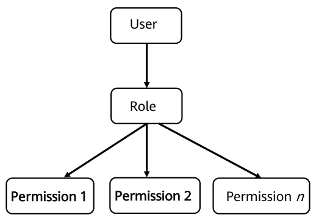

# High Security Part 2 — RBAC, Row-Level Security (RLS), Unified Auditing & TDE

**Pillar:** HCIA-openGauss V2.0 (Enterprise Relational Database & GaussDB)  
**Schedule Block:** Hour 04 — openGauss High Security, Easy O&M & AI Capabilities (DBMind) (Sprint 2 of 4)  
**Format:** Bite-Sized Lecture (7 mins) - Followed immediately by `04-Exercise-RLS-and-Unified-Audit-Policy-Lab` (8 mins)  
**Official Material Reference:** `HCIA-openGauss V2.0 Training Material.pdf` — Ch.03, pp. 209–226

---

## Learning Objectives
- Explain RBAC (Who, What, How) and Separation of Duties (System, Security, and Audit Administrators)
- Configure Row-Level Security (`ALTER TABLE ... ENABLE ROW LEVEL SECURITY`, `CREATE ROW LEVEL SECURITY POLICY`) and understand its constraints
- Create Unified Audit Policies (`CREATE AUDIT POLICY`) and Transparent Data Encryption (TDE) tables (`AES_128_CTR` / `SM4_CTR`)

---

### 1. Access Control: RBAC & Separation of Duties (pp. 209–212)
- **Separation of Duties (3 Admin Roles, p. 209)**:
  1. **Security Administrator (`CREATEROLE`)**: Creates and manages users.
  2. **System Administrator (`SYSADMIN`)**: Grants and revokes user permissions.
  3. **Audit Administrator (`AUDITADMIN`)**: Audits all user behaviors.
- **RBAC (Role-Based Access Control)**:
  - Defines relationships among **Who** (subject/user/role), **What** (target database object), and **How** (specific positive/negative permission).
  - Supports many-to-many mappings (users <-> roles <-> permissions) and enforces the **principle of least privilege**.
<!-- PDF_FIGS_START -->

*Figure: Role-Based Access Control (RBAC) User-Role-Permission Mapping (Official Reference: p. 210)*
<!-- PDF_FIGS_END -->


---

### 2. Row-Level Security (RLS, pp. 213–215)
Controls data visibility **row by row** so different users executing the exact same SQL statement see only the rows permitted by policy expressions (`PERMISSIVE` combined via `OR`, or `RESTRICTIVE` combined via `AND`):
```sql
ALTER TABLE tablename ENABLE ROW LEVEL SECURITY;
CREATE ROW LEVEL SECURITY POLICY tablename_rls ON tablename USING(role = CURRENT_USER);
```
- **RLS Constraints (p. 215)**:
  - Applies **ONLY to `SELECT`, `UPDATE`, and `DELETE`** operations (**cannot** be applied to `INSERT` or `MERGE`!).
  - Cannot be defined on **views**, **foreign tables (MOT)**, or **temporary tables**.
  - Maximum of **100 RLS policies** per table.
  - **Initial users and `SYSADMIN` users bypass (are not affected by) RLS policies.**

---

### 3. Unified Auditing & Transparent Data Encryption (TDE, pp. 216–226)
- **Unified Auditing (pp. 217–224)**:
  - Requires `enable_security_policy = on` and user with **`POLADMIN`**, **`SYSADMIN`**, or **initial user** privileges; logs via OS **`rsyslog`**.
  - **Syntax**:
    ```sql
    CREATE RESOURCE LABEL adt_lb0 ADD TABLE(tb_for_audit);
    -- DDL audit policy (PRIVILEGES)
    CREATE AUDIT POLICY adt3 PRIVILEGES CREATE ON LABEL(adt_lb0) FILTER ON ROLES(dev_audit, bob_audit);
    -- DML audit policy (ACCESS)
    CREATE AUDIT POLICY adt4 ACCESS SELECT ON LABEL(adt_lb0), INSERT ON LABEL(adt_lb0), DELETE
        FILTER ON ROLES(dev_audit, bob_audit), APP(psql, gsql), IP('10.20.30.40', '127.0.0.0/24');
    ```
  - **4 System Catalogs (p. 223)**: `GS_AUDITING_POLICY` (main info), `GS_AUDITING_POLICY_ACCESS` (DML), `GS_AUDITING_POLICY_PRIVILEGES` (DDL), `GS_AUDITING_POLICY_FILTERS` (filters).
  - **Constraint (p. 224)**: A single unified audit policy **cannot contain both DDL (`PRIVILEGES`) and DML (`ACCESS`) operations**! Max **98** unified audit policies.
- **Transparent Data Encryption (TDE, pp. 225–226)**:
  - Encrypts data automatically when writing to storage media and decrypts when reading, preventing static data file leakage.
  - **3-Layer Key Hierarchy (interconnected with Huawei Cloud KMS)**: **Root Key (`RK`)** -> **Cluster Master Key (`CMK`)** -> **Data Encryption Key (`DEK`, one per table, stored in `pg_class.reloptions`)**.
  - Supports **Heap Row-Store tables only** (does **not** support column-store, Ustore, materialized views, indexes, sequences, Xlogs, or MOTs).
  - Algorithms: **`AES_128_CTR` (default)** or **`SM4_CTR`**. Once specified at `CREATE TABLE`, the algorithm **cannot** be changed (and an unencrypted table created without TDE cannot later be converted to an encrypted table), though **DEK key rotation** is supported.

---

## Key Takeaways
- **Row-Level Security (RLS) affects ONLY `SELECT`, `UPDATE`, and `DELETE` (not `INSERT` or `MERGE`), supports up to 100 policies per table, and does not affect initial users or `SYSADMIN`.**
- **A single Unified Audit Policy (`CREATE AUDIT POLICY`) can audit either DDL (`PRIVILEGES`) or DML (`ACCESS`), but CANNOT contain both DDL and DML operations in the same policy.**
- **TDE uses a 3-layer key hierarchy (RK -> CMK -> DEK via KMS) with `AES_128_CTR` (default) or `SM4_CTR` on heap row-store tables only.**

## Huawei ICT Competition National Stage Exam Traps
> [!WARNING]
> EXAM TRAP: Can a single Unified Audit Policy contain both `PRIVILEGES CREATE` (DDL) and `ACCESS SELECT` (DML)? NO! A unified audit policy applies to either DDL or DML, never both (Ch.03 p. 224).

> [!WARNING]
> EXAM TRAP: If a table is created without TDE enabled, it CANNOT later be switched to an encrypted table (only tables created with encryption can toggle encryption state or rotate DEKs, Ch.03 p. 225).

---

### Next Step: Immediate Hands-On Exercise
Proceed immediately to **[`04-Exercise-RLS-and-Unified-Audit-Policy-Lab.html`](./04-Exercise-RLS-and-Unified-Audit-Policy-Lab.html)** (or [`04-Exercise-RLS-and-Unified-Audit-Policy-Lab.md`](./04-Exercise-RLS-and-Unified-Audit-Policy-Lab.md)) to apply this concept in an interactive lab workbench!
