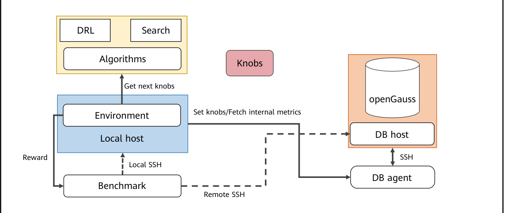

# Hands-On Lab: Recommending & Testing Indexes with `gs_index_advise` and Virtual Indexes

**Pillar:** HCIA-openGauss V2.0 (Enterprise Relational Database & GaussDB)  
**Schedule Block:** Hour 04 — openGauss High Security, Easy O&M & AI Capabilities (DBMind) (Sprint 4 of 4)  
**Format:** Immediate Hands-On Exercise (8 mins) — Paired with `07-Lecture-AI-Capabilities-AI4DB-and-DB4AI`  
**Interactive Workbench:** Open **[`08-Exercise-Index-Advisor-Virtual-Index-and-DB4AI-Lab.html`](./08-Exercise-Index-Advisor-Virtual-Index-and-DB4AI-Lab.html)** or **[`../index.html`](../index.html)** for live execution & auto-grading!

---

## Part A: Practical Lab Scenario
A query `SELECT c_discount FROM bmsql_customer WHERE c_w_id = 10` is running a slow `Seq Scan`. Use `gs_index_advise` to get an index recommendation, create a virtual index using `hypopg_create_index`, enable `enable_hypo_index`, and verify the optimizer switches to an `Index Scan`.

<!-- PDF_FIGS_START -->
#### Reference Diagrams


*Figure: X-Tuner Deep Reinforcement Learning Parameter Optimization Loop (Official Reference: p. 246)*
<!-- PDF_FIGS_END -->

### Step-by-Step Instructions
1. Step 1: Call `SELECT * FROM gs_index_advise('SELECT c_discount FROM bmsql_customer WHERE c_w_id = 10');`.
2. Step 2: Create a virtual index using `SELECT * FROM hypopg_create_index('CREATE INDEX ON bmsql_customer(c_w_id)');`.
3. Step 3: Enable virtual indexes with `SET enable_hypo_index = on;` and run `EXPLAIN SELECT c_discount FROM bmsql_customer WHERE c_w_id = 10;`.

### Starter Workspace (`openGauss=#`)
```bash
-- Step 1: Get single-query index recommendation
SELECT * FROM ____('SELECT c_discount FROM bmsql_customer WHERE c_w_id = 10');

-- Step 2: Create a virtual (hypothetical) index on bmsql_customer(c_w_id)
SELECT * FROM ____('CREATE INDEX ON bmsql_customer(c_w_id)');

-- Step 3: Enable virtual index evaluation in the optimizer and run EXPLAIN
SET ____ = on;
EXPLAIN SELECT c_discount FROM bmsql_customer WHERE c_w_id = 10;
```

<details>
<summary><strong>Click to View Hints</strong></summary>

- Use `gs_index_advise('<SQL>')` for single-query index recommendation.
- Use `hypopg_create_index('<CREATE INDEX SQL>')` to create a virtual index.
- Set `enable_hypo_index = on` before running `EXPLAIN`.

</details>

<details>
<summary><strong>Click to Reveal Full Working Solution & Expected Output</strong></summary>

#### Solution Code / Commands:
```bash
SELECT * FROM gs_index_advise('SELECT c_discount FROM bmsql_customer WHERE c_w_id = 10');

SELECT * FROM hypopg_create_index('CREATE INDEX ON bmsql_customer(c_w_id)');

SET enable_hypo_index = on;
EXPLAIN SELECT c_discount FROM bmsql_customer WHERE c_w_id = 10;
```

#### Expected Console / Query Output:
```text
table      |  column  
----------------+----------
 bmsql_customer | (c_w_id)
(1 row)

 indexrelid |              indexname              
------------+-------------------------------------
     329726 | <329726>btree_bmsql_customer_c_w_id
(1 row)

SET
                                                 QUERY PLAN                                                 
------------------------------------------------------------------------------------------------------------
 [Bypass]
 Index Scan using <329726>btree_bmsql_customer_c_w_id on bmsql_customer  (cost=0.00..39678.69 rows=31224 width=4)
   Index Cond: (c_w_id = 10)
(3 rows)
```
</details>

---

## Part B: National Stage Exam Verification Drill

### Question 1 [Single-Choice]
**Which running mode of the openGauss `X-Tuner` parameter tuning tool generates a parameter recommendation report in seconds based on the running workload WITHOUT restarting the database?**

- A. train
- B. tune
- C. recommend
- D. predict

<details>
<summary>[PASS] <strong>Check Answer & Explanation (Question 1)</strong></summary>

- **Correct Answer:** `C`
- **Explanation:** Per Chapter 03 (p. 247), X-Tuner runs in three modes: `recommend`, `train`, and `tune`. In `recommend` mode, operations complete in seconds and the database does not need to be restarted.
</details>

### Question 2 [Multiple-Choice (Select ALL)]
**Which of the following statements about the openGauss `Index-advisor` and virtual indexes are TRUE?**

- A. `Index-advisor` provides single-query index recommendation (`gs_index_advise`), virtual index recommendation, and workload-level index recommendation (`index_advisor_workload.py`)
- B. To allow the optimizer to consider virtual indexes during `EXPLAIN`, the GUC parameter `enable_hypo_index` must be set to `on`
- C. Virtual indexes created by `hypopg_create_index` persist permanently on disk even after the database is restarted
- D. `hypopg_estimate_size` can estimate the disk space required to create a specified virtual index

<details>
<summary>[PASS] <strong>Check Answer & Explanation (Question 2)</strong></summary>

- **Correct Answer:** `ABD`
- **Explanation:** Per Chapter 03 (pp. 254–261), A, B, and D are true. Option C is false: virtual indexes exist in memory at the instance level and are cleared when the database is restarted.
</details>

### Question 3 [True / False]
**`SQLdiag` requires collecting the execution plans of SQL statements in advance to predict their execution time.**

- A. True
- B. False

<details>
<summary>[PASS] <strong>Check Answer & Explanation (Question 3)</strong></summary>

- **Correct Answer:** `B`
- **Explanation:** False (Ch.03 pp. 250–251). `SQLdiag` predicts SQL execution time based on statement logic similarity and historical execution logs WITHOUT obtaining the SQL execution plan, so it has no impact on database performance.
</details>
