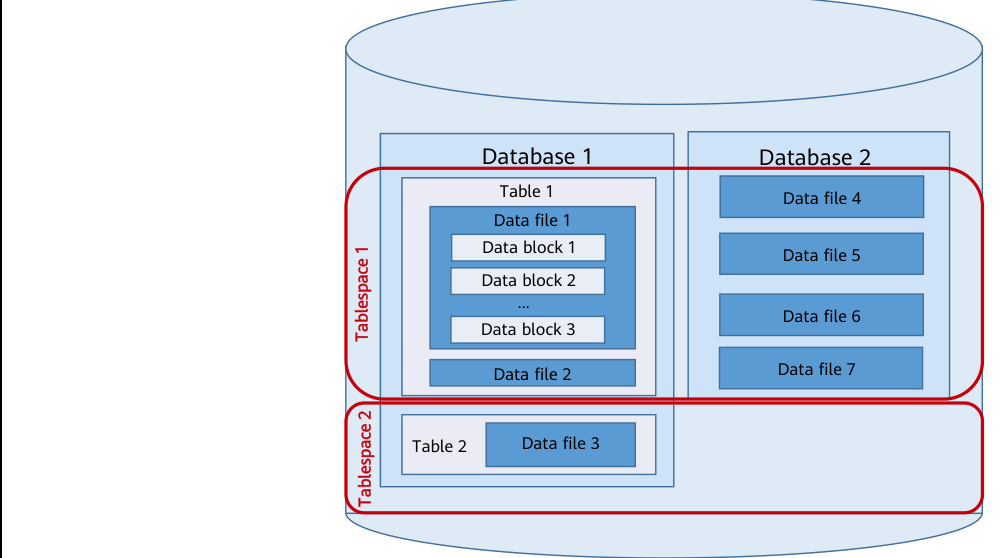

# Logical Structure & Core Objects (Databases, Schemas, Tables, Views, Indexes, Transactions)

**Pillar:** HCIA-openGauss V2.0 (Enterprise Relational Database & GaussDB)  
**Schedule Block:** Hour 05 — Database & Object Management (MOT, Tablespaces, Users/Roles, Backup/Export) (Sprint 1 of 4)  
**Format:** Bite-Sized Lecture (7 mins) - Followed immediately by `02-Exercise-Schemas-Views-Indexes-and-Isolation-Lab` (8 mins)  
**Official Material Reference:** `HCIA-openGauss V2.0 Training Material.pdf` — Ch.04, pp. 277–293

---

## Learning Objectives
- Navigate the logical hierarchy (Tablespace -> Database -> Schema -> Table -> Datafile Segment -> 8 KB Block)
- Use `gsql` meta-commands (`\h`, `\c`, `\l`, `\dt`, `\d`, `\db`) and manage Schemas (`public`, `pg_temp`), Views, and Indexes
- Contrast `READ COMMITTED` (statement-level snapshot, default) and `REPEATABLE READ` (transaction-level snapshot) isolation levels

---

### 1. Logical Structure & `gsql` Meta-Commands (pp. 277–285)
- **Logical Hierarchy**:
  - **Tablespace**: Physical directory mapping; can hold files for multiple databases.
  - **Database**: Isolated collection of schemas and objects (default database: **`postgres`**; default templates: **`template0`**, **`template1`**).
  - **Schema**: Logical namespace container inside a database (cannot be nested). Every new database has a **`public`** schema by default. Creating a user via `CREATE USER` automatically creates a **schema with the same name** as the user!
  - **Table -> Datafile Segment (> 1 GB split) -> Block (8 KB default)**.
- **Essential `gsql` Meta-Commands (p. 285)**:
  - `\h [NAME]`: View SQL syntax help (e.g., `\h create user`).
  - `\l`: List all databases.
  - `\c dbname`: Switch/connect to `dbname`.
  - `\dt`: List all tables in the current schema/database.
  - `\d tablename`: Describe columns, types, and indexes of `tablename` (or system catalog).
  - `\db`: List all tablespaces.
  - `\q`: Quit `gsql`.
<!-- PDF_FIGS_START -->

*Figure: openGauss Tablespace, Database, Table, and Data Block Hierarchy (Official Reference: p. 277)*
<!-- PDF_FIGS_END -->

---

### 2. Core Objects: Indexes, Views & Schemas (pp. 288–292)
- **Indexes (pp. 288–289)**:
  - Recommended on: frequently queried columns, `JOIN` condition columns (composite index), `WHERE` filter/range columns, and `ORDER BY` / `GROUP BY` / `DISTINCT` columns.
  - Types: Single-column, Composite (`(col1, col2)`), Unique (`CREATE UNIQUE INDEX`), Expression/Function-based (`ON table (expression)`), and Partial (`WHERE predicate`).
- **Views (`CREATE [TEMP] VIEW view_name AS query;`, p. 290)**:
  - A **virtual table**: only the view definition is stored in the database; actual data remains in the base tables.
- **Schemas (`CREATE SCHEMA`, pp. 291–292)**:
  - **Public Schema Security Rule**: All users have `USAGE` on `public` by default, but **only `SYSADMIN` and initial users** can create functions, aggregates, stored procedures, and synonyms in `public`, and **only the initial user** can create operators in `public`!
  - **Internal Schemas**: Schemas starting with **`pg_temp`** or **`pg_toast_temp`** are for internal temporary tables/TOAST — **never drop them**!

---

### 3. Transaction Isolation Levels in openGauss (p. 293)

| Isolation Level | Snapshot Timing | Visibility Behavior & Application Notes |
| :--- | :--- | :--- |
| **`READ COMMITTED` (Default)** | **Statement-level snapshot** (new snapshot taken at the start of *each* `SELECT` statement) | Sees only data committed before the statement began (plus own uncommitted updates). Two consecutive `SELECT`s in the same transaction may see different data if another transaction commits in between. |
| **`REPEATABLE READ`** | **Transaction-level snapshot** (single snapshot taken at the start of the *first* statement in the transaction) | Repeated `SELECT` statements within the same transaction always see the exact same data snapshot. Applications must be prepared to retry transactions on serialization conflicts. |

---

## Key Takeaways
- **When `CREATE USER` is executed, openGauss automatically creates a schema with the same name as the user in the current database.**
- **Schemas cannot be nested, and internal schemas starting with `pg_temp` or `pg_toast_temp` must never be dropped.**
- **At `READ COMMITTED` (default), each statement takes a fresh snapshot; at `REPEATABLE READ`, the transaction uses the snapshot taken at the start of the transaction.**

## Huawei ICT Competition National Stage Exam Traps
> [!WARNING]
> EXAM TRAP: A view is a virtual table — the database stores ONLY the view definition, NOT the view data (except materialized views).

> [!WARNING]
> EXAM TRAP: Even if an ordinary user is granted `CREATE` permission on the `public` schema, only `SYSADMIN`/initial users can create functions, aggregate functions, stored procedures, and synonyms in `public` (Ch.04 p. 291)!

---

### Next Step: Immediate Hands-On Exercise
Proceed immediately to **[`02-Exercise-Schemas-Views-Indexes-and-Isolation-Lab.html`](./02-Exercise-Schemas-Views-Indexes-and-Isolation-Lab.html)** (or [`02-Exercise-Schemas-Views-Indexes-and-Isolation-Lab.md`](./02-Exercise-Schemas-Views-Indexes-and-Isolation-Lab.md)) to apply this concept in an interactive lab workbench!
