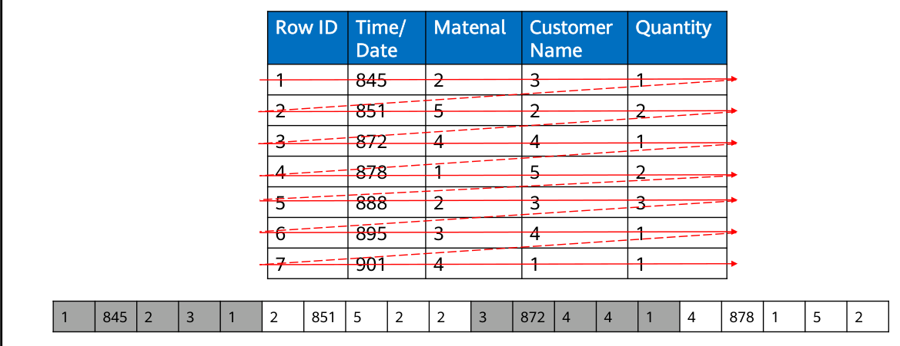
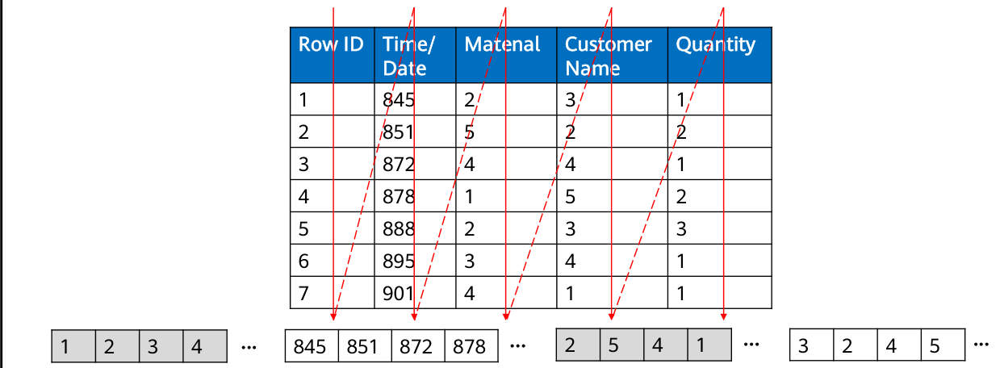
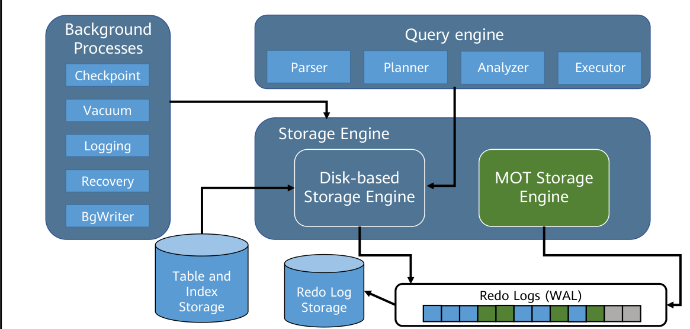

# Storage Engine Selection & Memory-Optimized Table (MOT)

**Pillar:** HCIA-openGauss V2.0 (Enterprise Relational Database & GaussDB)  
**Schedule Block:** Hour 05 — Database & Object Management (MOT, Tablespaces, Users/Roles, Backup/Export) (Sprint 2 of 4)  
**Format:** Bite-Sized Lecture (7 mins) - Followed immediately by `04-Exercise-Memory-Optimized-Table-MOT-Lab` (8 mins)  
**Official Material Reference:** `HCIA-openGauss V2.0 Training Material.pdf` — Ch.04, pp. 294–305

---

## Learning Objectives
- Select the optimal storage engine (Row-store, Column-store, or MOT) based on workload characteristics
- Explain MOT architecture, performance benchmarks (2.5x–4x throughput, 4.8M tpmC on 4-socket 256-core ARM, 3x–5.5x lower latency, 99% CPU utilization), and memory formula
- Authorize `mot_server` (`GRANT USAGE ON FOREIGN SERVER`), create/drop MOTs (`CREATE/DROP FOREIGN TABLE`), and index MOTs (`CREATE INDEX` without `FOREIGN`)

---

### 1. Storage Engine Selection Rules (pp. 295–301)

| Selection Factor | Choose Row-Store (`ORIENTATION = ROW`) | Choose Column-Store (`ORIENTATION = COLUMN`) | Choose MOT (Memory-Optimized Table) |
| :--- | :--- | :--- | :--- |
| **Update / Insert Pattern** | Frequent updates; frequent small inserts | Rarely updated; **large batch inserts** | Mission-critical, ultra-low-latency OLTP |
| **Column Width & Projection** | Narrow tables or queries reading most columns | Wide tables where queries touch **< 50% of columns** | All data **AND** indexes fit in RAM |
| **Query Pattern** | Index point queries returning a few rows | Statistical aggregation (`SUM`, `AVG`, `GROUP BY`) & ad-hoc scans | High-concurrency, high-contention OLTP |
| **Compression** | Moderate compression | **High compression ratio** (trades higher CPU usage for smaller I/O) | In-memory NUMA-aware row store |
<!-- PDF_FIGS_START -->

*Figure: Row-Store Table Sequential Tuple Disk Layout (Official Reference: p. 296)*


*Figure: Column-Store Table Columnar Compression Layout (Official Reference: p. 298)*
<!-- PDF_FIGS_END -->


---

### 2. Memory-Optimized Table (MOT) Architecture & Benchmarks (pp. 302–304)
- **What is MOT?**: Production-grade transactional **in-memory row-store engine** integrated with openGauss via the **Foreign Data Wrapper (`FDW`)** mechanism (`mot_server`), storing **both data and indexes entirely in memory**.
- **Core Technical Pillars**:
  - **NUMA-aware memory management** + **Lock-free concurrency control & indexing** + **Native query compilation (JIT/LLVM)** + full **ACID** support (WAL logging, Checkpoints, Recovery; supports `READ COMMITTED` and `REPEATABLE READ`).
  - *Prerequisite*: Set `enable_incremental_checkpoint = off` in `postgresql.conf` before creating MOT tables.
- **Official Huawei TaiShan (ARM/Kunpeng) TPC-C Benchmarks (p. 304)**:
  - **Throughput**: **2.5x to 4x** higher than disk tables (**2.5x** gain on 2-socket servers; **4.8 million tpmC** on 4-socket 256-core Arm servers).
  - **Latency**: Reduces transaction latency by **3x to 5.5x**.
  - **Resource Utilization**: Reaches **99% CPU utilization** on 4-socket servers under high load and high contention.
<!-- PDF_FIGS_START -->

*Figure: openGauss Dual Storage Architecture: Disk Engine vs Memory-Optimized Table (MOT) (Official Reference: p. 303)*
<!-- PDF_FIGS_END -->


---

### 3. MOT Memory Formula & SQL Syntax (p. 305)
- **Mandatory Memory Formula**:
  $$(max\_mot\_global\_memory + max\_mot\_local\_memory) + 2 GB < max\_process\_memory$$
  - **Global memory**: Long-term memory shared across all CPU cores storing all MOT table data and indexes.
  - **Local memory**: Short-term session memory used to handle private transaction data changes until commit.
- **MOT SQL Syntax (FDW Mechanism)**:
  ```sql
  -- 1. Grant user permission to use mot_server (run once per user)
  GRANT USAGE ON FOREIGN SERVER mot_server TO jack;
  -- 2. Create an MOT (uses FOREIGN keyword!)
  CREATE FOREIGN TABLE test(x INT) SERVER mot_server;
  -- 3. Create an index on MOT (DO NOT use FOREIGN keyword here!)
  CREATE INDEX text_index1 ON test(x);
  -- 4. Drop an MOT (uses FOREIGN keyword!)
  DROP FOREIGN TABLE test;
  ```
  - *Converting a disk table to MOT*: Use `gs_dump` to dump the disk table data, replace `CREATE TABLE` with `CREATE FOREIGN TABLE`, and use `gs_restore` / `gsql` to load data into the MOT.

---

## Key Takeaways
- **MOT stores all data and indexes in memory using lock-free algorithms and NUMA-aware design, achieving 2.5x–4x higher throughput (4.8M tpmC on 4-socket 256-core ARM) and 3x–5.5x lower latency.**
- **MOT memory configuration must satisfy `(max_mot_global_memory + max_mot_local_memory) + 2 GB < max_process_memory`.**
- **MOT is integrated via FDW (`GRANT USAGE ON FOREIGN SERVER mot_server TO <user>;`): use `CREATE FOREIGN TABLE` and `DROP FOREIGN TABLE`, but do NOT use the `FOREIGN` keyword in `CREATE INDEX` or `DROP INDEX`!**

## Huawei ICT Competition National Stage Exam Traps
> [!WARNING]
> EXAM TRAP: When creating or dropping an index on an MOT, do NOT include the `FOREIGN` keyword (`CREATE INDEX idx ON test(x);`, NOT `CREATE FOREIGN INDEX`)! `FOREIGN` is used only in `CREATE FOREIGN TABLE` and `DROP FOREIGN TABLE` (Ch.04 p. 305).

> [!WARNING]
> EXAM TRAP: If a query touches less than 50% of the total columns in a wide table for analytical aggregation, choose a Column-Store table (Ch.04 p. 301).

---

### Next Step: Immediate Hands-On Exercise
Proceed immediately to **[`04-Exercise-Memory-Optimized-Table-MOT-Lab.html`](./04-Exercise-Memory-Optimized-Table-MOT-Lab.html)** (or [`04-Exercise-Memory-Optimized-Table-MOT-Lab.md`](./04-Exercise-Memory-Optimized-Table-MOT-Lab.md)) to apply this concept in an interactive lab workbench!
