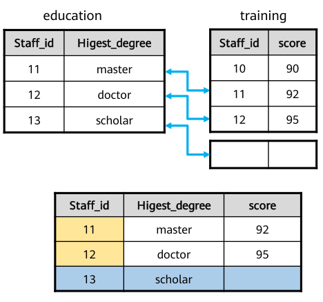

# Hands-On Lab: Writing `INNER JOIN`, `LEFT JOIN`, and `FULL JOIN` Queries

**Pillar:** HCIA-openGauss V2.0 (Enterprise Relational Database & GaussDB)  
**Schedule Block:** Hour 06 — SQL Basics — Classification, Data Types, DQL, Joins & DML (Sprint 3 of 4)  
**Format:** Immediate Hands-On Exercise (8 mins) — Paired with `05-Lecture-Join-Queries-Inner-Outer-and-Cartesian-Product`  
**Interactive Workbench:** Open **[`06-Exercise-Inner-Left-Right-Full-Outer-Join-Lab.html`](./06-Exercise-Inner-Left-Right-Full-Outer-Join-Lab.html)** or **[`../index.html`](../index.html)** for live execution & auto-grading!

---

## Part A: Practical Lab Scenario
Using the official `education e` (`staff_id` 11, 12, 13) and `training t` (`staff_id` 10, 11, 12) tables from Chapter 05 (pp. 387–389), write `LEFT JOIN`, `RIGHT JOIN`, and `FULL JOIN` queries to compare how unmatched rows are padded with `NULL`.

<!-- PDF_FIGS_START -->
#### Reference Diagrams


*Figure: Left Outer Join Row Matching Visual Example (Official Reference: p. 387)*
<!-- PDF_FIGS_END -->

### Step-by-Step Instructions
1. Step 1: Write a `LEFT JOIN` query between `education e` and `training t` on `e.staff_id = t.staff_id`.
2. Step 2: Write a `RIGHT JOIN` query between `education e` and `training t` on `e.staff_id = t.staff_id`.
3. Step 3: Write a `FULL JOIN` query between `education e` and `training t` on `e.staff_id = t.staff_id`.

### Starter Workspace (`openGauss=#`)
```bash
-- Step 1: Preserve all rows from the first table (education e)
SELECT e.staff_id, e.higest_degree, t.score
FROM education e ____ JOIN training t ON (e.staff_id = t.staff_id);

-- Step 2: Preserve all rows from the second table (training t)
SELECT e.staff_id, e.higest_degree, t.score
FROM education e ____ JOIN training t ON (e.staff_id = t.staff_id);

-- Step 3: Preserve unmatched rows from both tables
SELECT e.staff_id, e.higest_degree, t.score
FROM education e ____ JOIN training t ON (e.staff_id = t.staff_id);
```

<details>
<summary><strong>Click to View Hints</strong></summary>

- Use `LEFT JOIN`, `RIGHT JOIN`, and `FULL JOIN` respectively.

</details>

<details>
<summary><strong>Click to Reveal Full Working Solution & Expected Output</strong></summary>

#### Solution Code / Commands:
```bash
SELECT e.staff_id, e.higest_degree, t.score
FROM education e LEFT JOIN training t ON (e.staff_id = t.staff_id);

SELECT e.staff_id, e.higest_degree, t.score
FROM education e RIGHT JOIN training t ON (e.staff_id = t.staff_id);

SELECT e.staff_id, e.higest_degree, t.score
FROM education e FULL JOIN training t ON (e.staff_id = t.staff_id);
```

#### Expected Console / Query Output:
```text
staff_id | higest_degree | score 
----------+---------------+-------
       11 | master        |    92
       12 | doctor        |    95
       13 | scholar       |      
(3 rows)

 staff_id | higest_degree | score 
----------+---------------+-------
          |               |    90
       11 | master        |    92
       12 | doctor        |    95
(3 rows)

 staff_id | higest_degree | score 
----------+---------------+-------
       11 | master        |    92
       12 | doctor        |    95
       13 | scholar       |      
          |               |    90
(4 rows)
```
</details>

---

## Part B: National Stage Exam Verification Drill

### Question 1 [Single-Choice]
**If table A has 4 records and 3 columns, and table B has 5 records and 2 columns, how many records and columns are returned by `SELECT * FROM A, B;` without a `WHERE` condition?**

- A. 9 records and 5 columns
- B. 20 records and 5 columns
- C. 20 records and 6 columns
- D. 4 records and 3 columns

<details>
<summary>[PASS] <strong>Check Answer & Explanation (Question 1)</strong></summary>

- **Correct Answer:** `B`
- **Explanation:** Per Chapter 05 (p. 383), the Cartesian product of X (I tuples, N attributes) and Y (J tuples, M attributes) has I * J tuples (4 * 5 = 20 records) and N + M attributes (3 + 2 = 5 columns).
</details>

### Question 2 [Single-Choice]
**Which type of join returns all matched rows plus one row for each unmatched left-hand row (extended with `NULL` on the right) AND one row for each unmatched right-hand row (extended with `NULL` on the left)?**

- A. INNER JOIN
- B. LEFT OUTER JOIN
- C. RIGHT OUTER JOIN
- D. FULL OUTER JOIN

<details>
<summary>[PASS] <strong>Check Answer & Explanation (Question 2)</strong></summary>

- **Correct Answer:** `D`
- **Explanation:** Per Chapter 05 (p. 386 & p. 389), `FULL [OUTER] JOIN` returns all joined rows plus unmatched rows from both the left and right tables, filling missing columns with `NULL`.
</details>

### Question 3 [True / False]
**In `SELECT ... FROM table1 INNER JOIN table2 ON ...`, the keyword `INNER` is optional and can be omitted (`JOIN` defaults to `INNER JOIN`).**

- A. True
- B. False

<details>
<summary>[PASS] <strong>Check Answer & Explanation (Question 3)</strong></summary>

- **Correct Answer:** `A`
- **Explanation:** True (Ch.05 p. 385). In `INNER JOIN`, the `INNER` keyword can be omitted.
</details>
