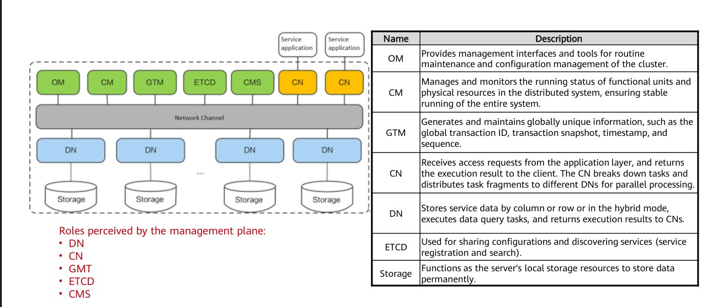
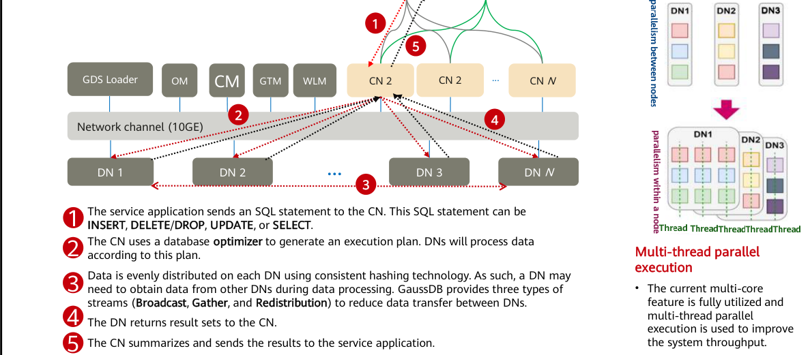

# Hands-On Lab: Mapping GaussDB Distributed Components (`CN`, `DN`, `GTM`, `CM`, `OM`, `ETCD`)

**Pillar:** HCIA-openGauss V2.0 (Enterprise Relational Database & GaussDB)  
**Schedule Block:** Hour 08 — GaussDB Enterprise Distributed Database & Cloud Ecosystem (Sprint 2 of 4)  
**Format:** Immediate Hands-On Exercise (8 mins) — Paired with `03-Lecture-GaussDB-Distributed-Components-CN-DN-GTM-CMS-ETCD`  
**Interactive Workbench:** Open **[`04-Exercise-Distributed-Query-Flow-and-Components-Lab.html`](./04-Exercise-Distributed-Query-Flow-and-Components-Lab.html)** or **[`../index.html`](../index.html)** for live execution & auto-grading!

---

## Part A: Practical Lab Scenario
Complete the GaussDB distributed component responsibility lookup query so that every component from Chapter 06 Slide 20 (p. 495) is accurately matched to its official role.

<!-- PDF_FIGS_START -->
#### Reference Diagrams


*Figure: GaussDB Distributed Components Architecture and Control/Data Planes (CM, GTM, CN, DN, ETCD, CMS) (Official Reference: p. 495)*


*Figure: GaussDB Distributed SQL Execution 5-Step Flow Across CN and DNs (Official Reference: p. 487)*
<!-- PDF_FIGS_END -->

### Step-by-Step Instructions
1. Step 1: Match `'CN'` to receiving application SQL requests and distributing task fragments, and `'DN'` to storing service data and executing query tasks.
2. Step 2: Match `'GTM'` to generating global transaction IDs, snapshots, timestamps, and sequences.
3. Step 3: Match `'ETCD'` to sharing configurations and service discovery (service registration and search — Ch.06 Quiz Q1).

### Starter Workspace (`GaussDB=#`)
```bash
-- Map each GaussDB distributed component to its official function:
SELECT
    '____' AS sql_coordinator,       -- Breaks down tasks & distributes to DNs
    '____' AS data_executor,         -- Stores service data & executes query tasks
    '____' AS global_txn_mgr,        -- Generates global XID, snapshot, timestamp, sequence
    '____' AS config_and_discovery;  -- Shares configuration & service discovery (Ch.06 Quiz Q1)
```

<details>
<summary><strong>Click to View Hints</strong></summary>

- Coordinator Node is `CN`, Data Node is `DN`, Global Transaction Manager is `GTM`, and Editable Text Configuration Daemon is `ETCD`.

</details>

<details>
<summary><strong>Click to Reveal Full Working Solution & Expected Output</strong></summary>

#### Solution Code / Commands:
```bash
SELECT
    'CN'   AS sql_coordinator,
    'DN'   AS data_executor,
    'GTM'  AS global_txn_mgr,
    'ETCD' AS config_and_discovery;
```

#### Expected Console / Query Output:
```text
sql_coordinator | data_executor | global_txn_mgr | config_and_discovery 
-----------------+---------------+----------------+----------------------
 CN              | DN            | GTM            | ETCD
(1 row)
```
</details>

---

## Part B: National Stage Exam Verification Drill

### Question 1 [Single-Choice]
**(Official Ch.06 Quiz Q1) In the GaussDB distributed architecture, which of the following components is used for sharing configuration and service discovery (service registration and search)?**

- A. CN
- B. DN
- C. GTM
- D. ETCD

<details>
<summary>[PASS] <strong>Check Answer & Explanation (Question 1)</strong></summary>

- **Correct Answer:** `D`
- **Explanation:** Per Chapter 06 (p. 482, p. 495 & p. 527), ETCD is used for sharing configurations and discovering services (service registration and search).
</details>

### Question 2 [Single-Choice]
**In the GaussDB distributed architecture, which component generates and maintains globally unique information such as the global transaction ID, transaction snapshot, timestamp, and sequence?**

- A. CN (Coordinator Node)
- B. DN (Data Node)
- C. GTM (Global Transaction Manager)
- D. CM (Cluster Manager)

<details>
<summary>[PASS] <strong>Check Answer & Explanation (Question 2)</strong></summary>

- **Correct Answer:** `C`
- **Explanation:** Per Chapter 06 (p. 487 & p. 495), the GTM (Global Transaction Manager) generates and maintains globally unique information, including the global transaction ID, transaction snapshot, timestamp, and sequence.
</details>

### Question 3 [Multiple-Choice (Select ALL)]
**Which three types of Stream operators does GaussDB provide to exchange data between DNs during distributed query execution?**

- A. Broadcast
- B. Gather
- C. Redistribution
- D. ShuffleSplit

<details>
<summary>[PASS] <strong>Check Answer & Explanation (Question 3)</strong></summary>

- **Correct Answer:** `ABC`
- **Explanation:** Per Chapter 06 (p. 487), GaussDB provides three types of streams — `Broadcast`, `Gather`, and `Redistribution` — to handle data transfer between DNs.
</details>
