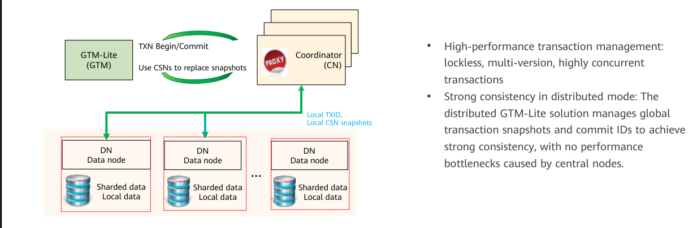

# Hands-On Lab: Designing Hash vs. Replication Distributed Tables in GaussDB

**Pillar:** HCIA-openGauss V2.0 (Enterprise Relational Database & GaussDB)  
**Schedule Block:** Hour 08 — GaussDB Enterprise Distributed Database & Cloud Ecosystem (Sprint 3 of 4)  
**Format:** Immediate Hands-On Exercise (8 mins) — Paired with `05-Lecture-GaussDB-Enterprise-Features-Storage-GTM-Lite-and-Backup`  
**Interactive Workbench:** Open **[`06-Exercise-Distributed-Tables-GTM-Lite-and-Backup-Lab.html`](./06-Exercise-Distributed-Tables-GTM-Lite-and-Backup-Lab.html)** or **[`../index.html`](../index.html)** for live execution & auto-grading!

---

## Part A: Practical Lab Scenario
In a GaussDB distributed cluster, create a large fact table `orders_fact` distributed across shards by `HASH(order_id)` and a small lookup table `currency_dim` replicated on every shard using `DISTRIBUTE BY REPLICATION` so joins do not require network redistribution.

<!-- PDF_FIGS_START -->
#### Reference Diagrams


*Figure: GTM-Lite Lockless Transaction Timestamp Coordination (Official Reference: p. 500)*
<!-- PDF_FIGS_END -->

### Step-by-Step Instructions
1. Step 1: Create `orders_fact(order_id INT, cust_id INT, amount NUMERIC(10,2))` distributed by hash on `order_id` (`DISTRIBUTE BY HASH(order_id)`).
2. Step 2: Create `currency_dim(curr_code CHAR(3), curr_name VARCHAR(20))` replicated across all shards (`DISTRIBUTE BY REPLICATION`).

### Starter Workspace (`GaussDB=#`)
```bash
-- Step 1: Create large table orders_fact distributed by HASH on order_id
CREATE TABLE orders_fact (
    order_id INT,
    cust_id INT,
    amount NUMERIC(10,2)
) DISTRIBUTE BY ____(order_id);

-- Step 2: Create small lookup table currency_dim using REPLICATION distribution
CREATE TABLE currency_dim (
    curr_code CHAR(3),
    curr_name VARCHAR(20)
) DISTRIBUTE BY ____;
```

<details>
<summary><strong>Click to View Hints</strong></summary>

- Large tables use `DISTRIBUTE BY HASH(order_id)`.
- Small tables frequently joined with large tables use `DISTRIBUTE BY REPLICATION`.

</details>

<details>
<summary><strong>Click to Reveal Full Working Solution & Expected Output</strong></summary>

#### Solution Code / Commands:
```bash
CREATE TABLE orders_fact (
    order_id INT,
    cust_id INT,
    amount NUMERIC(10,2)
) DISTRIBUTE BY HASH(order_id);

CREATE TABLE currency_dim (
    curr_code CHAR(3),
    curr_name VARCHAR(20)
) DISTRIBUTE BY REPLICATION;
```

#### Expected Console / Query Output:
```text
CREATE TABLE
CREATE TABLE
```
</details>

---

## Part B: National Stage Exam Verification Drill

### Question 1 [Single-Choice]
**In GaussDB distributed storage between shards, which distribution mode stores a complete copy of a small table on every shard to improve distributed multi-table join performance?**

- A. Hash distribution
- B. Range partitioning
- C. Replication distribution
- D. List partitioning

<details>
<summary>[PASS] <strong>Check Answer & Explanation (Question 1)</strong></summary>

- **Correct Answer:** `C`
- **Explanation:** Per Chapter 06 (p. 497), Replication distribution is used for user tables with a small amount of data and stores all of the table's data in each shard, improving distributed multi-table join performance.
</details>

### Question 2 [Multiple-Choice (Select ALL)]
**Which of the following statements about GaussDB `GTM-Lite` and `GTM-Free` transaction modes are TRUE?**

- A. `GTM-Lite` uses Commit Sequence Numbers (CSNs) instead of traversing a global transaction list to quickly determine transaction visibility
- B. `GTM-Lite` uses lock-free atomic operations to assign CSNs and provides strong global consistency
- C. `GTM-Free` mode does not connect to the GTM and provides eventual consistency for perfectly sharded OLTP workloads
- D. `GTM-Free` mode requires every read query to lock all DNs in the cluster via the GTM

<details>
<summary>[PASS] <strong>Check Answer & Explanation (Question 2)</strong></summary>

- **Correct Answer:** `ABC`
- **Explanation:** Per Chapter 06 (p. 500), A, B, and C are true. Option D is false: `GTM-Free` does not connect to the GTM at all.
</details>

### Question 3 [True / False]
**In GaussDB physical backup, an incremental backup takes a shorter time than a full backup, and a complete database can be restored using only the incremental backup without a full backup.**

- A. True
- B. False

<details>
<summary>[PASS] <strong>Check Answer & Explanation (Question 3)</strong></summary>

- **Correct Answer:** `B`
- **Explanation:** False (Ch.06 p. 502). Although an incremental backup takes a shorter timeframe, a complete database can be restored ONLY after both the full backup and incremental backup are performed.
</details>
