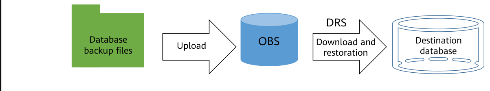
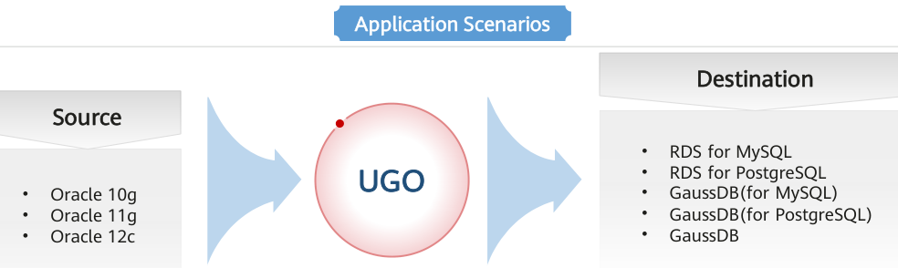
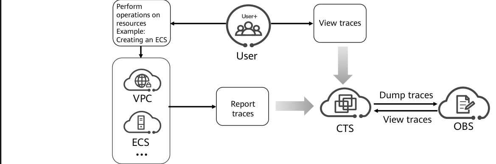

# GaussDB Ecosystem Tools — UGO, DRS, DAS, CTS, CES, DBSS & Industry Cases

**Pillar:** HCIA-openGauss V2.0 (Enterprise Relational Database & GaussDB)  
**Schedule Block:** Hour 08 — GaussDB Enterprise Distributed Database & Cloud Ecosystem (Sprint 4 of 4)  
**Format:** Bite-Sized Lecture (7 mins) - Followed immediately by `08-Exercise-UGO-DRS-DAS-Cloud-Migration-Pipeline-Lab` (8 mins)  
**Official Material Reference:** `HCIA-openGauss V2.0 Training Material.pdf` — Ch.06, pp. 504–531

---

## Learning Objectives
- Memorize all 6 core functions of UGO (Database and Application Migration UGO — exact Ch.06 Quiz Q2!)
- Contrast DAS (Standard, Cloud DBA, Enterprise DevOps), DRS (Real-time migration, Backup migration, Real-time synchronization, Data subscription, Real-time DR), and UGO (heterogeneous schema/SQL migration)
- Identify Huawei Cloud security/monitoring services: CTS (7-day console trace query + OBS/KMS dump), CES (resource/log monitoring), and DBSS (bypass security audit + DB firewall)

---

### 1. Database Management, Replication & Migration Suite: `DAS`, `DRS`, `UGO` (pp. 505–512)

#### A. `DAS` (Data Admin Service, p. 505)
One-stop web-based cloud database management console with **3 editions**:
1. **Standard Edition (for Developers)**: Web client, online SQL editing, intelligent SQL prompts without local client installation.
2. **Cloud DBA (for DBAs & O&M)**: Instance performance metrics, slow SQL analysis, SQL explorer, real-time and historical diagnosis.
3. **Enterprise Edition (for Enterprise DevOps)**: Automatic identification of modification risks + permission approval workflows to ensure secure data changes.

#### B. `DRS` (Data Replication Service, pp. 506–509)
Cloud service for **real-time database data migration and synchronization** offering **5 functions**: *Real-time migration*, *Backup migration*, *Real-time synchronization*, *Data subscription*, and *Real-time DR*:
- **Real-Time Migration**: Online incremental data migration across public networks, VPCs, VPNs, or Direct Connect with minimal downtime.
- **Backup Migration**: Exports source DB backup files -> uploads to **OBS** -> DRS downloads and restores to destination DB **without exposing the source DB's IP address or connecting directly** (currently supports migrating **SQL Server** to the cloud, p. 508).
- **Real-Time Synchronization**: Continuous real-time data flow (many-to-one, one-to-many, different table names) for real-time analytics, reporting, and data warehouses.

#### C. `UGO` (Database and Application Migration UGO, pp. 510–512, Ch.06 Quiz Q2!)
Professional tool focused on **heterogeneous database object/schema migration and application SQL migration** (e.g., from Oracle 10g/11g/12c, DB2, Teradata, SQL Server to GaussDB / RDS).
- **The 6 Official Core Functions of UGO (Slide 37, p. 512 & Ch.06 Quiz Q2 Answer!)**:
  1. **Source database profiling**
  2. **Destination database selection and specification recommendation**
  3. **Destination database compatibility analysis**
  4. **Migration workload evaluation**
  5. **Database structure migration**
  6. **Application SQL migration**
<!-- PDF_FIGS_START -->

*Figure: DRS Service Module: Backup Migration Workflow via OBS (Official Reference: p. 508)*

*Figure: UGO Heterogeneous Database Schema and Application Migration Workflow (Official Reference: p. 510)*
<!-- PDF_FIGS_END -->

---

### 2. Cloud Security & Monitoring Services: `CTS`, `CES`, `DBSS` (pp. 513–520)

| Service | Full Name | Core Capabilities & Exam Specifications |
| :--- | :--- | :--- |
| **`CTS`** | **Cloud Trace Service** | Log audit service recording console/API operations on cloud resources. **Console queries cover the last 7 days**; dumps compressed trace files to **OBS** for long-term storage encrypted via **KMS**. |
| **`CES`** | **Cloud Eye Service** | Resource & database monitoring platform (automatic/server monitoring, real-time alarm notifications, OBS dumping, resource grouping, error/slow log & trace monitoring). |
| **`DBSS`** | **Database Security Service** | Includes **Database Protection (DB firewall, data breach prevention)** and **Database Security Audit**. Deployed in **bypass mode**; provides user behavior detection (associating app & DB layers), multi-dimensional lead analysis (Risk, Session, Statement leads), real-time SQL injection/blacklist/whitelist alarms, and **Sarbanes-Oxley (SOX)** compliance reports. |
<!-- PDF_FIGS_START -->

*Figure: CTS (Cloud Trace Service) Audit Log Flow (Official Reference: p. 513)*
<!-- PDF_FIGS_END -->

---

## Key Takeaways
- **The 6 core functions of UGO (Ch.06 Quiz Q2) are: (1) Source database profiling, (2) Destination database selection and specification recommendation, (3) Destination database compatibility analysis, (4) Migration workload evaluation, (5) Database structure migration, and (6) Application SQL migration.**
- **UGO migrates heterogeneous database structures (schemas/objects) and application SQL, whereas DRS migrates and synchronizes the actual data (via Real-Time Migration, Backup Migration via OBS, or Real-Time Synchronization).**
- **DAS provides web-based database management; CTS audits cloud resource operations (7-day console query + KMS-encrypted OBS dump); CES monitors system metrics/alarms; DBSS provides bypass-mode database security auditing and firewall protection.**

## Huawei ICT Competition National Stage Exam Traps
> [!WARNING]
> EXAM TRAP (Ch.06 Quiz Q2): Memorize all 6 core functions of UGO verbatim: Source database profiling, Destination database selection and specification recommendation, Destination database compatibility analysis, Migration workload evaluation, Database structure migration, and Application SQL migration!

> [!WARNING]
> EXAM TRAP: Which DRS module migrates data without connecting directly to the source database (hiding the source IP by staging backup files in OBS, commonly for SQL Server)? **Backup Migration** (Ch.06 p. 508)!

---

### Next Step: Immediate Hands-On Exercise
Proceed immediately to **[`08-Exercise-UGO-DRS-DAS-Cloud-Migration-Pipeline-Lab.html`](./08-Exercise-UGO-DRS-DAS-Cloud-Migration-Pipeline-Lab.html)** (or [`08-Exercise-UGO-DRS-DAS-Cloud-Migration-Pipeline-Lab.md`](./08-Exercise-UGO-DRS-DAS-Cloud-Migration-Pipeline-Lab.md)) to apply this concept in an interactive lab workbench!
